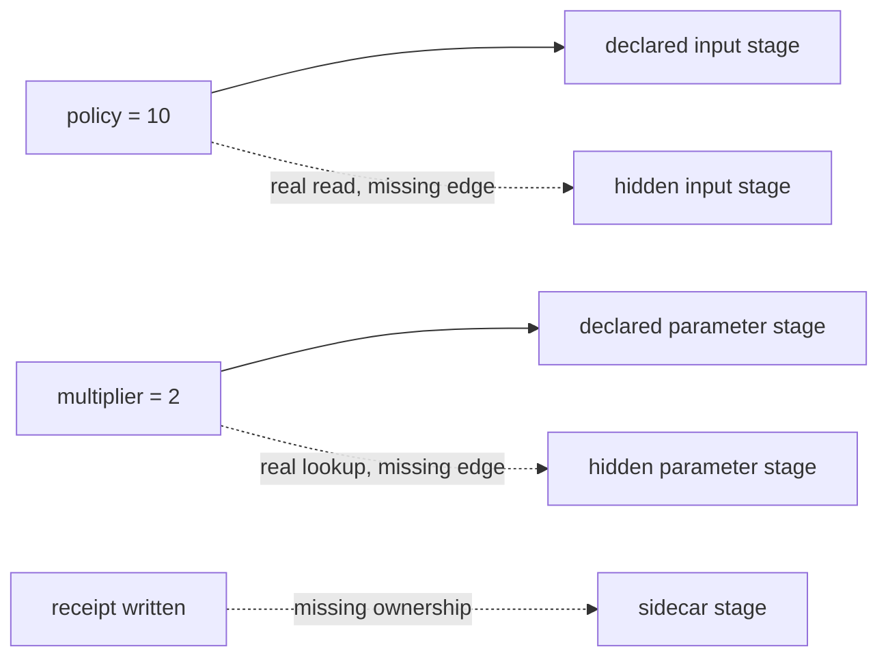

# Stage Contract Audit Guide

This audit answers a narrow question:

> Can DVC detect every file, parameter, and artifact boundary that the command actually
> uses?

The answer depends on the declaration. DVC can record and compare what `dvc.yaml` tells
it. It cannot infer arbitrary file reads, parameter lookups, or side effects from Python
code.

Run the audit from the capstone:

```bash
make stage-contract-audit
```

The audit writes its review bundle under the repository-level `artifacts/` directory.
Start with `summary.tsv`, then use `route.txt` to inspect the raw evidence.

## The specimen

The specimen has five stages:

| Stage | Real behavior | Declaration quality |
| --- | --- | --- |
| `declared_input` | reads source data and a policy file | both files are in `deps` |
| `hidden_input` | reads source data and the same policy file | the policy file is omitted |
| `declared_param` | reads `settings.multiplier` | the key is in `params` |
| `hidden_param` | reads the same parameter key | the key is omitted |
| `undeclared_sidecar` | writes a main result and a receipt | only the main result is in `outs` |

All five stages succeed on the baseline run. All five skip on the second run. That
convergence is useful, but it does not prove the contracts are complete.



The dashed edges are real behavior that DVC cannot see.

## What the audit changes

The checker creates isolated workspaces so one case cannot contaminate another.

### File influence

It changes `policy/threshold.txt` from `10` to `20`.

The expected `dvc status --json` result names only `declared_input`. Before rebuilding,
both outputs still contain `threshold=10`. After rebuilding the declared stage:

```text
declared-input.txt  threshold=20
hidden-input.txt    threshold=10
```

The hidden output is not merely old by timestamp. Its semantic value disagrees with the
current policy.

### Parameter influence

It changes `settings.multiplier` from `2` to `3`.

The expected status names only `declared_param`. After rebuilding that stage:

```text
declared-param.txt  multiplier=3  score=24
hidden-param.txt    multiplier=2  score=16
```

Putting a value in `params.yaml` is not enough. The stage must list the relevant key
under `params`.

### Output ownership

The sidecar stage writes:

```text
results/declared-main.txt
results/undeclared-receipt.txt
```

Only the main file appears in `outs`. The audit deletes the receipt, asks DVC for status,
and reproduces the stage. DVC reports no stale stage and skips execution, so the receipt
remains absent.

If the receipt carries review or downstream meaning, this is an ownership defect. If it
is disposable scratch, the command and documentation should say so and no consumer
should depend on it.

## Read result and decision separately

Every row has a result and a decision:

- `PASS / ACCEPT` means the audit observed behavior a truthful stage should preserve.
- `PASS / REJECT` means the audit successfully reproduced a deceptive contract that a
  real pipeline should reject.
- `FAIL` means the specimen no longer demonstrates the intended contrast.

The expected findings are:

| Finding | Decision | Evidence claim |
| --- | --- | --- |
| `BASELINE_CONVERGES` | `ACCEPT` | ordinary success and a settled second run establish the starting state |
| `DECLARED_INPUT_CHANGE_IS_STALE` | `ACCEPT` | the declared policy edge reaches DVC status |
| `DECLARED_INPUT_REBUILDS_CURRENT_VALUE` | `ACCEPT` | the rebuilt artifact adopts the new policy |
| `HIDDEN_INPUT_CHANGE_IS_INVISIBLE` | `REJECT` | the omitted file edge leaves an old semantic value |
| `DECLARED_PARAM_CHANGE_IS_STALE` | `ACCEPT` | the declared parameter key reaches DVC status |
| `DECLARED_PARAM_REBUILDS_CURRENT_VALUE` | `ACCEPT` | the rebuilt artifact adopts the new control value |
| `HIDDEN_PARAM_CHANGE_IS_INVISIBLE` | `REJECT` | a key in `params.yaml` is invisible when the stage omits it |
| `UNDECLARED_OUTPUT_LOSS_IS_INVISIBLE` | `REJECT` | DVC cannot restore an artifact the stage does not own |

## What each evidence layer proves

| Surface | What it proves | What it does not prove alone |
| --- | --- | --- |
| `dvc.yaml` | the declared contract | that command behavior matches it |
| `dvc.lock` | recorded declared state after execution | completeness of undeclared influences |
| `dvc status --json` | which declared changes DVC detects | semantic freshness of hidden outputs |
| result files | the values produced by each case | why DVC chose to run or skip |
| adversarial tests | the checker fails when contrasts are weakened | correctness of every production pipeline |

Read at least two layers together. A status receipt without output values can show a
planner decision but not whether the result adopted current meaning. An output without
status can show a value but not whether the graph reacted honestly.

## Why forcing a rerun is not a repair

`dvc repro --force` can refresh a hidden stage once. Deleting its output can also force
one run. Neither action adds the missing edge.

After the next policy or parameter change, the stage can become stale again without DVC
noticing. The durable repair is to declare the influence or remove it from command
behavior.

## Review questions

After running the audit, answer these from evidence:

1. Which status receipt proves that the declared file changed?
2. Why does an empty status object reject rather than accept the hidden-input case?
3. Which output values prove semantic staleness?
4. Why is a value in `params.yaml` not automatically a stage parameter?
5. When should a sidecar be in `outs`, and when should it remain scratch?
6. Why is successful baseline convergence compatible with all three defects?

If you cannot answer those questions from the bundle, inspect the raw receipts before
returning to the lesson prose.
