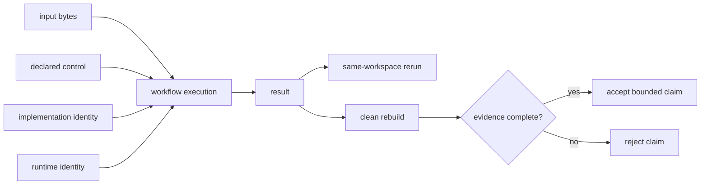
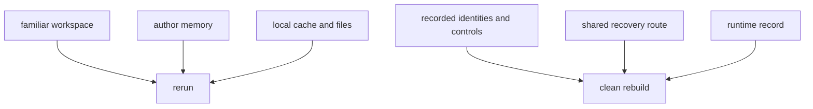

# Workflow evidence audit guide

A workflow can produce the same result twice and still be impossible for a
teammate to reconstruct. Local repeatability asks whether the familiar
workspace behaves consistently. Team reproducibility asks whether recorded
evidence is sufficient to rebuild and explain the result outside that
workspace.

This guide teaches the distinction with eight executable cases. Every case
produces identical results in two local runs. Only one has enough evidence to
support the reproducibility claim.

## The bounded claim

The specimen claims:

> A clean maintainer can rebuild and explain the incident risk summary from
> recorded evidence.

The audit does not judge whether the scoring rule is scientifically valid or
ready for production. It tests whether the mechanical result story is
recoverable.



## Build the audit bundle

From the repository root:

```console
make PROGRAM=reproducible-research/deep-dive-dvc \
  capstone-workflow-evidence-audit
```

The bundle is written under:

```text
artifacts/audit/reproducible-research/deep-dive-dvc/workflow-evidence/
```

Read `route.txt`, `specimen/workflow-contract.json`, and `report.json` before
the implementation. The report is a decision argument, not merely command
output.

Run the adversarial tests separately with:

```console
make PROGRAM=reproducible-research/deep-dive-dvc \
  capstone-workflow-evidence-selftest
```

## Read the result that every case shares

Each workspace contains:

```text
evidence/local-run-a.json
evidence/local-run-b.json
```

The audit compares them and reports:

```json
{
  "local_repeatability": true
}
```

for all eight cases.

That fact is intentionally weak. It supports:

> With the current files, controls, environment, and machine context, the
> workflow returned the same JSON twice.

It does not support:

> Another maintainer can recover those files, identify the effective control,
> reconstruct the runtime, and produce the same result cleanly.

## Inspect the complete evidence case

`COMPLETE_EVIDENCE` records:

- the digest of the effective input;
- the digest of the scoring implementation;
- a threshold declared in `params.json`;
- every influential file;
- Python implementation, executable class, and version;
- two local command receipts;
- a clean rebuild from recorded sources;
- a statement that the input is recoverable through the shared boundary.

The audit requires every check:

```text
input_identity_matches
implementation_identity_matches
controls_are_declared
all_influential_inputs_are_declared
runtime_is_recorded
clean_rebuild_matches
input_is_recoverable
```

No single item replaces another. A known input digest cannot prove the runtime,
and a clean rebuild cannot prove future input recovery unless the input is
available outside the original workspace.

## Compare one rejected case at a time

| Finding | Local reruns | Missing or contradicted evidence | Why the claim stops |
|---|---:|---|---|
| `COMPLETE_EVIDENCE` | equal | none | clean reconstruction is supported |
| `SAME_WORKSPACE_RERUN` | equal | clean rebuild | private workspace may supply hidden state |
| `HIDDEN_THRESHOLD` | equal | declared control | result depends on an environment value absent from the contract |
| `CHANGED_INPUT_SAME_PATH` | equal | current input identity | filename stayed stable while bytes changed |
| `MANUAL_PREPROCESSING` | equal | declared influential input | an unrecorded preparation operation shaped the result |
| `MISSING_RUNTIME` | equal | runtime identity | execution context cannot be reconstructed |
| `UNRECOVERABLE_INPUT` | equal | shared recovery | recorded identity points to bytes another maintainer cannot obtain |
| `STALE_IMPLEMENTATION` | equal | current implementation identity | result belongs to code different from the current file |

Use:

```console
jq '.findings[] | {
  finding,
  local_repeatability,
  decision,
  failed_checks
}' artifacts/audit/reproducible-research/deep-dive-dvc/workflow-evidence/report.json
```

The contrast is strongest because each rejected case isolates one evidence
gap.

## Why a clean rebuild is different

A local rerun inherits:

- files already present;
- caches and notebook state;
- environment variables;
- manually prepared data;
- installed packages;
- remembered command choices.

A clean rebuild deliberately removes those conveniences. It begins from the
recorded boundary and asks whether the evidence is sufficient.



A clean directory alone is not enough. If it mounts the author's cache or uses
undeclared environment values, it has not crossed the social boundary the
claim promises.

## Hidden control: stable is still hidden

The scoring program accepts either:

```console
python score_incidents.py --threshold 0.20 ...
```

or:

```console
RISK_THRESHOLD=0.20 python score_incidents.py ...
```

Both can be deterministic. The second route is rejected because the effective
control is absent from the declared parameter surface.

The problem is not that environment variables are inherently bad. The problem
is that a result-changing value is not represented in the evidence used to
explain and compare the result.

A legitimate external control needs:

- a stable name;
- recorded effective value or immutable identity;
- declared influence on the stage;
- an owner;
- a reconstruction route.

Moving the value from an environment variable to a private config file without
recording that file does not repair the contract.

## Path and content identity

`CHANGED_INPUT_SAME_PATH` creates a result, records the input digest, then adds a
row to `observations.csv`. The path has not changed. The input has.

The output can still be locally repeatable because both reruns happened before
the mutation. A later reviewer who sees only the path may incorrectly connect
the result to the new bytes.

Content identity answers:

> Which bytes influenced this result?

Path answers:

> Where are some bytes currently located?

DVC is useful at this boundary because it connects a path in repository
metadata to content identity and a recoverable object.

## Manual preprocessing

The manual case removes one observation into
`prepared-observations.csv` and scores that file. The local result is stable,
but the declared workflow lists `observations.csv`.

The missing evidence is not just the prepared file. The team needs to know:

- which raw input produced it;
- which transformation was applied;
- which code or rule performed the transformation;
- whether the transformation is deterministic;
- where the prepared identity is recorded.

Copying the prepared file into the repository without recording its origin
preserves an unexplained artifact.

## Runtime identity

The specimen records Python implementation, executable class, and version. A
real workflow may also need:

- dependency lock or environment image;
- operating system and architecture;
- external tool versions;
- locale and timezone;
- hardware or accelerator details;
- thread and randomness controls.

Record only influences that can change the claimed result, but do not treat
“worked on my laptop” as a runtime description.

## Recoverability and the Git boundary

Git can preserve:

- scoring source;
- workflow contract;
- parameter file;
- small sample input in this specimen;
- decision and verification code.

Large or sensitive inputs may not belong in Git. Their **identity and recovery
route** still belong in the reproducibility story.

`UNRECOVERABLE_INPUT` represents a familiar failure: the result records which
input mattered, but those bytes remain only on the author's machine. The
identity is useful for diagnosis, but insufficient for team reconstruction.

DVC can provide content tracking and shared remote recovery. It cannot create
an organizational right to access sensitive data or choose retention policy.

## Stale implementation

`STALE_IMPLEMENTATION` records a result, then changes
`score_incidents.py`. Two local result files still agree because both belong to
the earlier implementation.

A reviewer needs the implementation identity that actually produced the
result. “The script is in Git” is incomplete unless the result is linked to the
relevant Git revision or content digest.

This is why result folders copied between branches are dangerous. Proximity to
source code is not provenance.

## Build an evidence ladder

Use claims that grow only when evidence grows:

| Evidence | Supported claim |
|---|---|
| one successful run | the command produced this result once |
| two equal local runs | the current workspace is locally repeatable |
| input, code, and control identities | the result's main influences are named |
| runtime record | execution context is bounded |
| clean rebuild | recorded evidence can reconstruct the result now |
| shared recovery | another maintainer can obtain the protected inputs |
| independent receipt | the team boundary has exercised the route |

Do not jump from the first row to the last in a project README.

## Decide whether DVC is the next repair

DVC is a fitting next tool when the main gaps are:

- large-file content identity;
- data and artifact recovery through a shared remote;
- declared stage relationships;
- parameter and metric evidence;
- reproducible pipeline materialization.

DVC is not the first repair for:

- unknown scientific validity;
- missing access authorization;
- undocumented human approval;
- production rollout policy;
- a script whose behavior is not understood;
- an organization that has not decided which results matter.

Complete the workflow inventory first. Adopt the tool around a named state
contract.

## Review checklist

- [ ] The claim is stated narrowly.
- [ ] Local rerun evidence is not described as clean reconstruction.
- [ ] Effective input bytes have recorded identity.
- [ ] The implementation that produced the result is identifiable.
- [ ] Result-changing controls are declared.
- [ ] Manual transformations are represented as workflow inputs or stages.
- [ ] Runtime influences are bounded.
- [ ] A clean rebuild starts outside the original private workspace.
- [ ] Required data can be recovered through the promised team boundary.
- [ ] The result description states what remains out of scope.

The honest outcome may be “repeatable here, not yet reproducible for the team.”
That diagnosis is more useful than a broad claim built from local confidence.
