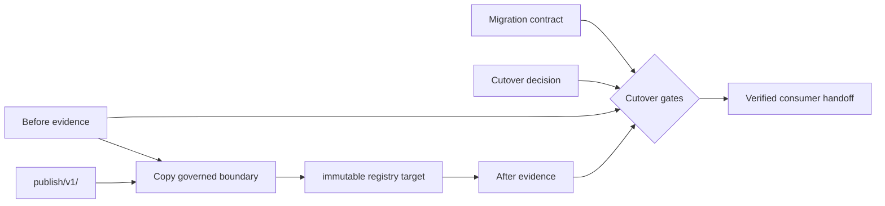
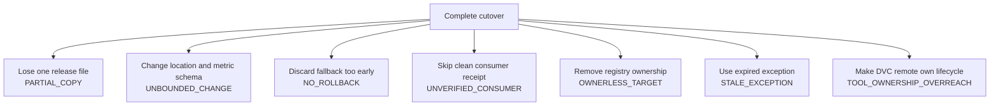

# Boundary Migration Governance Specimen

This specimen models a migration of the promoted capstone bundle from its repository path
to an immutable registry reference. The audit uses the real `publish/v1/` bundle as the
source, copies it into isolated case workspaces, and asks whether cutover has earned
approval.

The migration is intentionally narrow:

> Change the consumer location while preserving exact inventory, artifact bytes, promoted
> meaning, and source provenance.

## Evidence model

`migration-contract.json` defines the one boundary allowed to change, the invariants that
must survive, required before/after evidence, rollback conditions, system ownership, and
exception policy.

`migration-decision.json` records the proposed cutover, evidence receipts, rollback
readiness, consumer verification, and responsible owners.

## Case contrasts

Compare one blocked case with the complete cutover. Each mutation should break one
governance proposition, so the decision identifies a repairable boundary rather than
reporting only that migration is risky.

## Decision under review

Approve cutover only when:

- source and target bundles have identical governed payloads;
- exactly one declared boundary changes;
- before and after proof receipts are complete;
- rollback remains executable until target and consumer verification finish;
- a clean consumer has verified the immutable target;
- every responsibility has a named owner;
- any exception is current, owned, bounded, and removable;
- DVC, registry, CI, and release-owner responsibilities match the ownership policy;
- the decision describes the same migration as the contract.

The audit verifies governance evidence, not a production registry transaction. Its proof
limits are part of the lesson.
