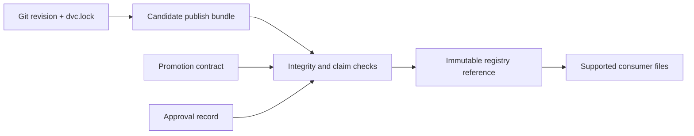

# Promotion Integrity Specimen

This specimen turns a release review into a decision that can fail for specific reasons.
It uses the capstone's `publish/v1/` bundle as the candidate and adds the two records that
the bundle cannot provide by itself:

- `promotion-contract.json` states the immutable registry reference, exact release
  inventory, source revision, promoted claim, approval policy, and supported consumer
  files.
- `promotion-decision.json` records who approved that exact source and registry
  reference.

The audit copies the healthy candidate into an isolated workspace and creates contrasting
cases. Some cases remain tidy directories even though their provenance, inventory,
claims, or approval no longer support promotion.

## Evidence boundary

The source bundle proves artifact-level integrity with its own manifest. The promotion
contract adds release meaning. The decision record adds authority. None of the three can
substitute for the others.

## Decision under review

Accept promotion only when:

1. the registry reference is immutable;
2. the release inventory exactly matches the contract;
3. every artifact matches its recorded digest and byte size;
4. the promoted threshold agrees between the contract, params, and bundle manifest;
5. the decision approves the same release, registry reference, Git revision, and DVC
   lock identity;
6. every required reviewer role approved the release.

The audit deliberately separates these checks so a learner can explain why a case blocks
instead of treating verification as one opaque pass or fail.
