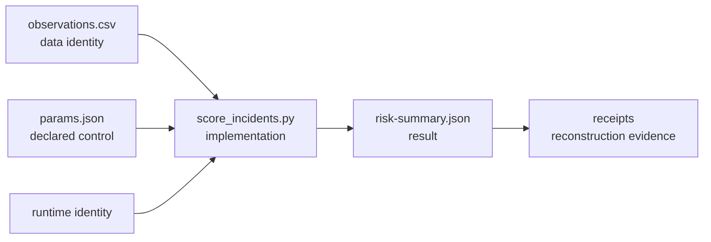
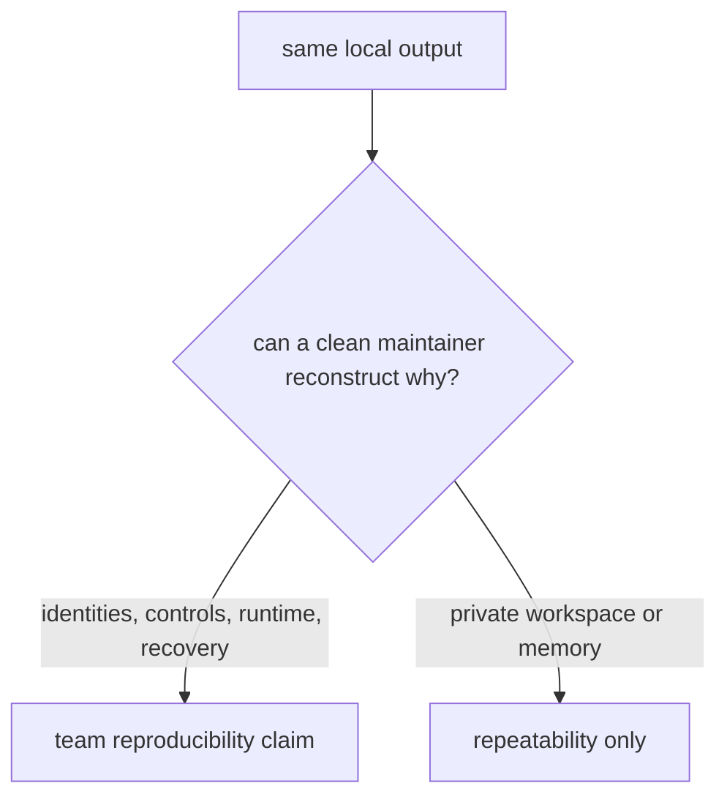

# Workflow evidence specimen

This specimen is intentionally smaller than the capstone pipeline. It exists to
answer the first question a team should ask before adopting DVC:

> Can another maintainer explain and rebuild this result from recorded
> evidence, or can the original author merely rerun it in a familiar
> workspace?

The workflow scores five incident observations. `params.json` declares the
error-rate threshold, and `score_incidents.py` writes a deterministic JSON
result.



## Honest route

```console
python score_incidents.py \
  --input observations.csv \
  --threshold 0.20 \
  --output risk-summary.json
```

The command is repeatable when the same workspace produces the same JSON
again. It supports a team reproducibility claim only when the workflow record
also preserves:

- input content identity;
- implementation identity;
- the effective threshold and its declared source;
- runtime identity;
- the command result;
- a clean rebuild outside the original workspace;
- a shared recovery route for the input.

## Deliberate hidden-control route

The program also accepts `RISK_THRESHOLD` when `--threshold` is absent:

```console
RISK_THRESHOLD=0.40 python score_incidents.py \
  --input observations.csv \
  --output risk-summary.json
```

This route exists to reproduce a common failure. It can return identical output
on one machine while hiding the control that determines the result. The
environment variable is capability, not declared evidence.

## What the contract protects

`workflow-contract.json` declares the minimum evidence expected before calling
the result reproducible. The audit creates one complete case and several
counterexamples:

- a same-workspace rerun with no clean rebuild;
- a hidden threshold;
- new bytes behind the old input path;
- manual preprocessing outside the declared workflow;
- missing runtime identity;
- a Git-only snapshot whose input cannot be recovered;
- a stale result after the implementation changes.

Each case isolates a different reason local confidence can exceed the recorded
evidence.



The specimen does not claim that these checks prove scientific validity,
production readiness, or every possible runtime influence. It teaches how to
bound the mechanical claim before those larger decisions.
