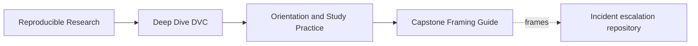
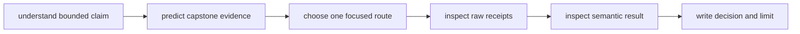
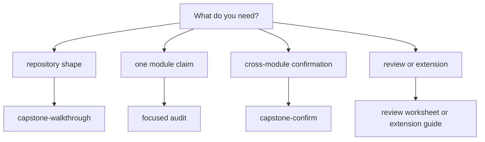

# Capstone Framing Guide

<!-- page-maps:start -->
## Page Maps




<!-- page-maps:end -->

The capstone is a repository-scale specimen for an incident-escalation workflow. It joins
data identity, preparation, modeling, metrics, experiments, collaboration, recovery,
promotion, and governance.

Its purpose is corroboration and integration. It should not become an unexplained block
of source code that learners copy, nor a large command whose successful exit is treated
as universal proof.

## Know what the capstone represents

The capstone provides:

- a real DVC pipeline and lock evidence;
- reviewed parameters and metrics;
- remote-backed state and recovery routes;
- promotion and release surfaces;
- deliberately isolated audit specimens;
- tests that enforce evidence decisions.

It does not provide:

- a universal architecture for every research project;
- proof that its modeling choices fit a real deployment;
- organization-specific access, retention, or approval policy;
- automatic capture of every runtime and domain influence.

Treat domain names and values as a concrete setting for reproducibility reasoning, not as
production recommendations.

## Choose the smallest useful surface



| Need | Use |
| --- | --- |
| see the learner-facing repository flow | `capstone-walkthrough` |
| inspect one evidence boundary | corresponding focused audit |
| verify capstone contracts | `capstone-verify` |
| run the strongest integrated route | `capstone-confirm` |
| review structure before commands | [Capstone Map](../capstone/capstone-map.md) |
| conduct a repository review | [Capstone Review Worksheet](../capstone/capstone-review-worksheet.md) |
| adapt the specimen | [Capstone Extension Guide](../capstone/capstone-extension-guide.md) |

Do not begin with `capstone-confirm`. It combines boundaries that are easier to learn
separately.

## Map focused audits to learning claims

Run from the repository root with:

```bash
make PROGRAM=reproducible-research/deep-dive-dvc <target>
```

| Module | Focused target | Question tested |
| ---: | --- | --- |
| 01 | `capstone-workflow-evidence-audit` | does local rerun evidence support team reproducibility? |
| 02 | `capstone-data-identity-audit` | which identities connect pointer, cache, workspace, and remote? |
| 03 | `capstone-runtime-contract-audit` | which runtime influences are declared or hidden? |
| 04 | `capstone-stage-contract-audit` | do declarations match real reads, controls, and outputs? |
| 05 | `capstone-metric-contract-audit` | are numeric changes semantically comparable? |
| 06 | `capstone-experiment-comparability-audit` | do candidates preserve baseline and allowed-change boundaries? |
| 07 | `capstone-reviewer-handoff-audit` | can a reviewer reconstruct submitted state independently? |
| 08 | `capstone-recovery-readiness-audit` | do protected revisions survive the modeled loss and cutover? |
| 09 | `capstone-promotion-integrity-audit` | does the consumer bundle match authorized evidence and policy? |
| 10 | `capstone-boundary-migration-audit` | does cutover preserve governed invariants and rollback? |

Each audit has a matching self-test target. Use self-tests when changing the audit or
when the course explicitly asks you to verify its enforcement logic.

## Read an audit bundle

Generated audit evidence is placed under:

```text
artifacts/audit/reproducible-research/deep-dive-dvc/
```

Exact contents differ, but use this order:

1. audit guide;
2. baseline declaration or specimen;
3. route or case description;
4. raw tool receipts;
5. semantic artifacts;
6. summary table;
7. structured report;
8. tests only after understanding the evidence contract.

Starting with the compact report encourages answer-reading rather than investigation.

## Distinguish specimen source from generated workspace

The capstone contains authored specimens under `capstone/repro/`. Audit commands copy or
construct isolated workspaces under `artifacts/`.

| Surface | Role | Editing expectation |
| --- | --- | --- |
| `capstone/repro/` | governed specimen source | read during lessons; edit only for implementation work |
| `capstone/tests/` | enforcement contract | inspect to understand adversarial coverage |
| `capstone/docs/` | focused audit explanation | use with generated evidence |
| `artifacts/audit/` | generated run evidence | safe learning and verification output |
| main capstone data and outputs | integrated workflow state | use through documented targets |

For exercise repairs, copy an audit specimen to `artifacts/learning/`. Do not mutate
governed source merely to demonstrate a failure.

## Predict accepted and rejected cases

Before running a focused audit, create:

```text
finding:
expected result:
expected decision:
declaration or authority:
semantic assertion:
evidence limit:
```

Audits commonly include deliberate `PASS / REJECT` findings. Predicting both fields
prevents “all tests passed” from erasing an intentionally reproduced defect.

## Use capstone commands in increasing strength

| Strength | Route | Suitable claim |
| --- | --- | --- |
| orientation | `capstone-tour`, `capstone-walkthrough` | repository and evidence surfaces are legible |
| focused | one audit target | one bounded contrast behaves as claimed |
| enforcement | matching self-test | audit rejects relevant weakened cases |
| integrated | `capstone-verify` | capstone contract checks pass together |
| strongest | `capstone-confirm` | full documented confirmation route passes in current environment |

Stronger execution is not automatically better evidence. A focused audit often explains
causality more clearly than a full run.

## Handle generated tracked drift

Some repository-wide documentation commands synchronize generated configuration or
shared documentation. Before and after a capstone or docs command:

```bash
git status --short
```

If tracked files change unexpectedly:

- inspect the diff;
- determine whether it is governed output or incidental synchronization;
- preserve intentional changes;
- do not commit unrelated generated drift with lesson work.

Never use a broad destructive reset to make the status quiet.

## Interpret a failed capstone route

Classify failure by boundary:

| Failure | Evidence response |
| --- | --- |
| environment installation | preserve platform and dependency receipt |
| missing remote credentials | mark remote claim untested; continue local inspection |
| missing object | preserve revision, pointer, remote, and fetch evidence |
| semantic assertion | stop; inspect data, controls, and command behavior |
| policy rejection | keep rejection as expected decision evidence |
| audit self-test failure | treat enforcement contract as broken |

A failure can expose exactly the boundary a module teaches. Do not force past it before
capturing the original state.

## Build a cross-module capstone packet

After Module 10, assemble:

```text
capstone-review/
├── state-authority.md
├── identity-receipts/
├── runtime-and-stage-contracts/
├── comparison-decisions/
├── handoff-and-recovery/
├── promotion-integrity/
└── governance-decision.md
```

Link existing focused evidence rather than copying every generated file. The packet
should let a reviewer trace a trust claim to its shortest supporting route.

## Capstone checkpoint

You are using the capstone appropriately when you can:

- choose a route from a defined claim;
- predict accepted and rejected evidence before running;
- distinguish authored specimen from generated workspace;
- read raw receipts before compact verdicts;
- prefer focused causality over theatrical full execution;
- classify failures without erasing them;
- integrate module evidence into a bounded repository decision.
