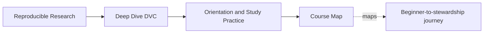
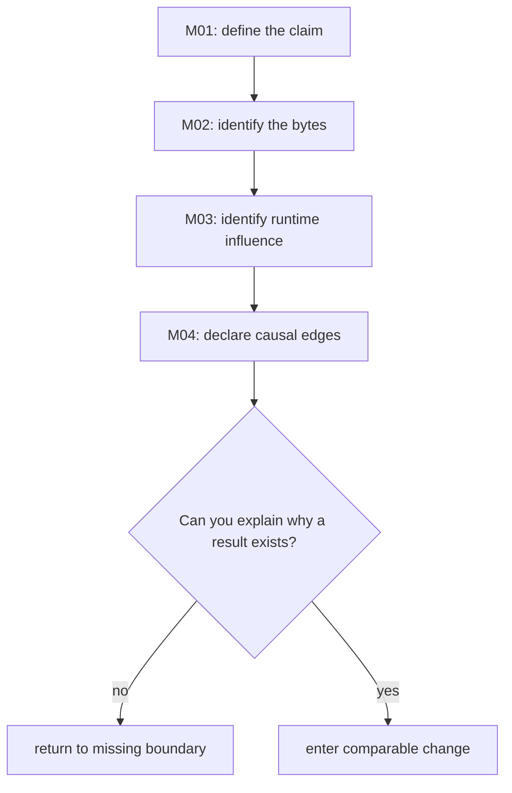

# Course Map

<!-- page-maps:start -->
## Page Maps

```mermaid
flowchart LR
  failures["failure diagnosis"] --> identity["data identity"]
  identity --> runtime["runtime influence"]
  runtime --> pipeline["stage contracts"]
  pipeline --> metrics["comparable meaning"]
  metrics --> experiments["controlled change"]
  experiments --> collaboration["shared execution"]
  collaboration --> recovery["survival"]
  recovery --> promotion["downstream trust"]
  promotion --> governance["long-lived ownership"]
```

<!-- page-maps:end -->

The course progresses from one local question—“can this result be repeated?”—to a
stewardship question—“which claims should this system continue to own?” Each module adds
an evidence boundary needed by the next.

Use this map to plan complete study, locate a missing prerequisite, or explain why a later
module cannot be learned as an isolated feature tutorial.

## The four learning arcs

| Arc | Modules | Governing question | Evidence you learn to review |
| --- | --- | --- | --- |
| state truth | 01–04 | what state and influence produced this result? | pointers, cache identity, runtime receipts, stage contracts |
| comparable change | 05–06 | do changed values describe the same claim and controlled experiment? | metric contracts, parameters, baselines, experiment receipts |
| shared survival | 07–08 | can another executor reconstruct and recover the submitted state? | CI evidence, remote state, recovery drills, retention decisions |
| downstream trust | 09–10 | what may consumers trust, and who should own each boundary? | promotion manifests, integrity checks, migration and governance decisions |

The arcs are not independent tracks. A metric comparison depends on truthful inputs; a
promotion decision depends on comparable experiments; recovery depends on declared
authority.

## Modules 01–04: establish state truth

### Module 01 — diagnose reproducibility claims

You learn to separate rerunning, repeating, reproducing, and reconstructing. The module
starts from failure evidence because a tool choice cannot repair a claim that has not
been defined.

Leave with:

- an inventory of source, data, runtime, output, and operational evidence;
- a repeatable-workflow claim tested against hidden influence;
- language for rejecting claims broader than the evidence.

### Module 02 — identify data by content

You trace the relationship among workspace paths, pointer files, cache objects, remotes,
and published artifacts.

Leave able to:

- explain why a path locates data but does not identify its bytes;
- trace a pointer into cache and remote state;
- predict which state move `add`, `push`, `pull`, or `checkout` performs;
- test recovery from each surviving layer.

### Module 03 — include execution environment influence

You treat runtime as a potential input surface rather than background scenery.

Leave able to:

- separate graph evidence from runtime evidence;
- choose lockfiles, containers, or CI by the boundary they control;
- measure tolerance instead of claiming absolute determinism;
- diagnose hidden runtime drift through causal contrast.

### Module 04 — make pipelines truthful

You compare command reads, controls, and writes with DVC declarations.

Leave able to:

- classify `deps`, selected `params`, and owned outputs;
- predict status and reproduction from declared edges;
- distinguish false reruns from stale results;
- repair a hidden influence and replay the original mutation.

Do not enter metric and experiment work merely because the pipeline executes. Enter when
you can explain its state and influence boundaries.

## Modules 05–06: establish comparable change

### Module 05 — interpret metrics as semantic claims

A numeric difference is not automatically an improvement. You join population identity,
metric definition, unit, aggregation, schema, and parameter controls.

Leave able to:

- reconstruct the complete meaning behind a metric value;
- distinguish mechanical DVC diffs from semantic comparison decisions;
- accept additive schema evolution and reject incompatible drift;
- abstain when comparability evidence is missing.

### Module 06 — control experiments against an authority

Experiments become reviewable deviations from a named baseline rather than a collection
of attractive results.

Leave able to:

- identify baseline authority;
- distinguish declared change from allowed change;
- gate ranking on comparability;
- separate candidate selection from promotion and cleanup.

Transition test:

> Can you say which population, controls, metric contract, baseline, and allowed change
> make this candidate comparable?

If not, return to Modules 05–06 before treating a result as release evidence.

## Modules 07–08: establish shared survival

### Module 07 — make a reviewer handoff executable

You move from local success to submitted-state reconstruction by another executor.

Leave able to:

- define shared remote stewardship;
- preserve submitted-state CI evidence;
- review merges as coherent data-and-code claims;
- block handoffs that require oral knowledge or warm local caches.

### Module 08 — prove recovery and retention

You distinguish current convenience from historical recoverability.

Leave able to:

- define recovery objectives by protected revision;
- reason about garbage-collection reachability;
- migrate remotes without transferring authority prematurely;
- preserve incident evidence and demonstrate cache-cold restoration.

Transition test:

> Can a new executor recover the protected state using only governed declarations,
> metadata, remote objects, and documented credentials?

If not, downstream promotion rests on evidence the team may not be able to reconstruct.

## Modules 09–10: establish downstream trust

### Module 09 — create a smaller promotion boundary

You distinguish repository evidence from the artifact contract offered to consumers.

Leave able to:

- bind promotion to an authorized baseline and policy;
- build consumer-verifiable manifests and checksums;
- detect threshold or evidence drift;
- reject promotion when required integrity evidence is missing.

### Module 10 — govern ownership and migration

You review whether DVC remains the right owner for data, execution, experiment, registry,
release, and recovery concerns.

Leave able to:

- name invariants before migration;
- assign one authority to each state boundary;
- design cutover, rollback, and acceptance evidence;
- intervene on recurring contract failures rather than layering more tooling.

## Suggested schedules

| Schedule | Rhythm | Appropriate when |
| --- | --- | --- |
| ten-week | one technical module each week | exercises and reflection need class discussion |
| five-week | two adjacent modules each week | learner already knows basic DVC commands |
| intensive | one arc per study block | learner can reserve long lab sessions |
| audit-led | diagnostic route through modules by observed failure | learner brings an existing repository |

For accelerated study, do not drop exercises or evidence interpretation. Reduce repeated
reading, not proof work.

## Progress ledger

Track readiness by capability:

| Boundary | I can explain | I can predict | I can demonstrate | I can review |
| --- | --- | --- | --- | --- |
| data identity | | | | |
| runtime influence | | | | |
| stage contract | | | | |
| metric comparability | | | | |
| experiment control | | | | |
| reviewer handoff | | | | |
| recovery | | | | |
| promotion | | | | |
| governance | | | | |

An empty cell is a navigation signal, not a score. Return to the earliest missing
capability because later boundaries usually depend on it.

## Route onward

- Begin with [First-Contact Map](first-contact-map.md).
- Return after Module 04 through [Mid-Course Map](mid-course-map.md).
- Re-enter for repository stewardship through [Mastery Map](mastery-map.md).
