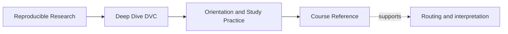
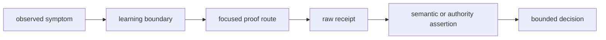
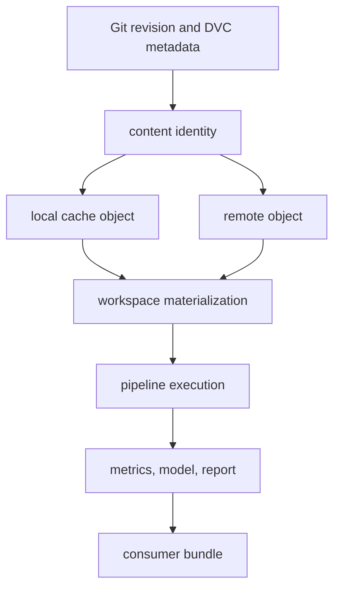

# Course Reference

<!-- page-maps:start -->
## Page Maps




<!-- page-maps:end -->

Use this page to route a question and interpret a proof surface after you have learned the
underlying concept. It is not a substitute for the technical lessons.

## Course boundaries at a glance

| Module | Boundary | Failure to recognize | Focused proof target |
| ---: | --- | --- | --- |
| 01 | reproducibility claim | local rerun presented as team reconstruction | `capstone-workflow-evidence-audit` |
| 02 | data identity | path or presence presented as content identity | `capstone-data-identity-audit` |
| 03 | runtime influence | environment assumed captured by the graph | `capstone-runtime-contract-audit` |
| 04 | stage contract | real read, control, or output hidden from DVC | `capstone-stage-contract-audit` |
| 05 | metric meaning | numeric movement presented as comparable improvement | `capstone-metric-contract-audit` |
| 06 | experiment authority | candidate ranked without baseline or allowed-change scope | `capstone-experiment-comparability-audit` |
| 07 | reviewer handoff | success depends on author's warm local state | `capstone-reviewer-handoff-audit` |
| 08 | recovery | present availability presented as protected recoverability | `capstone-recovery-readiness-audit` |
| 09 | promotion | repository result presented as consumer-verifiable release | `capstone-promotion-integrity-audit` |
| 10 | governance | overlapping authority or unsafe cutover accepted | `capstone-boundary-migration-audit` |

Invoke a target from the repository root:

```bash
make PROGRAM=reproducible-research/deep-dive-dvc <target>
```

## General capstone targets

| Target | Use |
| --- | --- |
| `capstone-platform-report` | record supported tool context |
| `capstone-tour` | build learner-facing proof bundle |
| `capstone-walkthrough` | follow bounded capstone story |
| `capstone-state-summary` | inspect declaration, execution, and release summary |
| `capstone-verify` | run capstone contract verification |
| `capstone-confirm` | run strongest documented integrated confirmation |
| `capstone-source-bundle` | build tracked-source release bundle |

Choose the focused audit when investigating causality. Choose integrated confirmation
only when the component boundaries are already understood.

## Core DVC commands and bounded claims

| Command | Supports | Does not by itself support |
| --- | --- | --- |
| `dvc add` | pointer and cache state created for content | remote durability or semantic correctness |
| `dvc push` | required available objects transferred to configured remote | retention for every protected revision |
| `dvc pull` | objects fetched and workspace materialized for selected metadata | runtime equivalence or result validity |
| `dvc checkout` | workspace aligned to available pointer or lock state | missing remote objects can be recovered |
| `dvc status` | declared current state compared with recorded state | completeness of declarations |
| `dvc repro` | declared stale work executed or current work skipped | semantic correctness of outputs |
| `dvc dag` | declared dependency shape rendered | actual hidden reads and writes |
| `dvc metrics diff` | numeric metric movement extracted | semantic comparability or improvement |
| `dvc params diff` | selected control movement extracted | experiment intent or allowed change |

## State layers



| Layer | Authority question |
| --- | --- |
| Git | which declaration and revision are under review? |
| pointer or lock | which identity was recorded? |
| cache | which local object copies are available? |
| remote | which shared or recovery objects are reachable? |
| workspace | which bytes are currently materialized? |
| execution | which declared and runtime influences produced the result? |
| result | what does the artifact mean? |
| promotion | what may a consumer verify and trust? |

Do not use presence in a lower layer as proof of authority in a higher one.

## Decision vocabulary

| Decision | Use when |
| --- | --- |
| `ACCEPT` | required evidence supports the exact claim |
| `REJECT` | observed evidence violates a required contract |
| `ABSTAIN` | required identity, authority, or semantic evidence is missing |
| `REPAIR` | present owner is appropriate but declaration or enforcement is defective |
| `MIGRATE` | a different system should become authority under preserved invariants |
| `RETIRE` | result or contract has no justified consumer or retention obligation |

Audit `PASS` or `FAIL` describes whether the checker observed its expected condition. It
is not a substitute for these decisions.

## Recurring distinctions

| Do not confuse | With | Test |
| --- | --- | --- |
| path | content identity | compare recorded hash and bytes |
| local cache | remote durability | recover after removing local object |
| declared state current | semantic result current | mutate every real influence |
| command ran | command used new meaning | assert domain value |
| metric key same | metric contract same | compare definition, unit, aggregation, population, controls |
| comparable candidate | selected candidate | apply selection policy |
| selected candidate | promoted artifact | verify promotion authority and manifest |
| available now | recoverable later | restore protected revision under modeled loss |
| artifact exists | consumer may trust it | verify identity, policy, provenance, and instructions |
| copied state | migrated authority | test cutover, rollback, and consumer use |

## Evidence packet template

```text
scope:
consumer:
claim:
authority:
baseline:
declaration:
controlled mutation or comparison:
prediction:
raw receipt:
semantic, ownership, or policy assertion:
decision:
repair or follow-up:
replay or integrity check:
limit:
```

Not every investigation uses every field. Authority, prediction, decision, and limit
should rarely be absent.

## Generated evidence locations

| Evidence | Repository location |
| --- | --- |
| course audits | `artifacts/audit/reproducible-research/deep-dive-dvc/` |
| personal learning packets | `artifacts/learning/deep-dive-dvc/` |
| built documentation | `artifacts/site/reproducible-research/deep-dive-dvc/` |
| capstone specimen source | `programs/reproducible-research/deep-dive-dvc/capstone/repro/` |
| audit enforcement tests | `programs/reproducible-research/deep-dive-dvc/capstone/tests/` |
| audit explanations | `programs/reproducible-research/deep-dive-dvc/capstone/docs/` |

Generated logs and workspaces belong under `artifacts/`, not beside lesson or capstone
source.

## Review order by problem

### Result did not change when expected

1. inspect real command reads and controls;
2. compare them with stage declaration;
3. preserve status before reproduction;
4. inspect semantic result after ordinary repro;
5. repair and replay the original mutation.

### Metric changed dramatically

1. identify baseline authority;
2. inspect metric and parameter diffs;
3. compare population, definition, unit, aggregation, schema, and controls;
4. decide comparability;
5. only then discuss improvement or selection.

### Another maintainer cannot reproduce

1. preserve submitted revision and dirty state;
2. identify required data objects and remote;
3. construct runtime through documented route;
4. reproduce in a cold workspace;
5. compare semantic results;
6. locate oral or local-only dependency.

### Data may not survive cleanup or migration

1. name protected revisions and retention obligation;
2. establish reachable objects before change;
3. exercise recovery under modeled loss;
4. verify semantic identity;
5. test rollback before switching authority.

### Release may not match approved result

1. identify authorized baseline and candidate;
2. preserve selection and policy evidence;
3. verify artifact identity and manifest;
4. detect post-selection drift;
5. review as a downstream consumer.

## Verification routes

For changes to one focused audit:

```bash
make PROGRAM=reproducible-research/deep-dive-dvc capstone-<boundary>-selftest
make PROGRAM=reproducible-research/deep-dive-dvc capstone-<boundary>-audit
```

Use the exact target from the module table; `<boundary>` is explanatory notation, not a
literal command.

For the full course implementation:

```bash
make PROGRAM=reproducible-research/deep-dive-dvc test
make PROGRAM=reproducible-research/deep-dive-dvc docs-build
```

Inspect worktree status after generated documentation routes.

## Reference checkpoint

This page is serving its purpose when you can:

- route a symptom to the earliest relevant module;
- choose a focused proof target;
- bound what a DVC command establishes;
- identify the governing state layer;
- use precise decision vocabulary;
- assemble a compact review packet;
- locate generated evidence without contaminating source.
