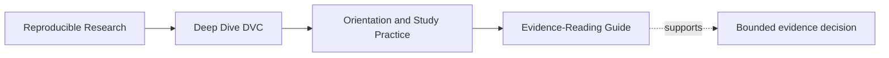
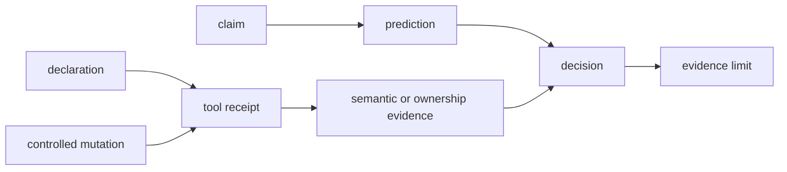
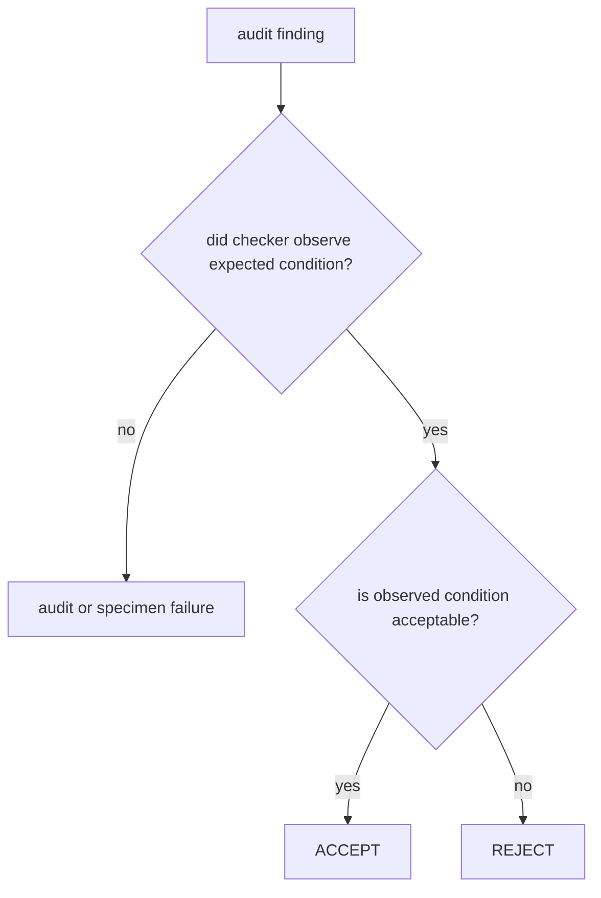

# Evidence-Reading Guide

<!-- page-maps:start -->
## Page Maps




<!-- page-maps:end -->

DVC can report content identity, changed declarations, metric movement, parameter
movement, experiment records, and remote transfers. Those receipts are observations.
They do not automatically decide whether data is authoritative, a metric is comparable,
an experiment is promotable, or a recovery promise is adequate.

This guide teaches how to read course evidence without asking one receipt to answer a
larger question than it can support.

## Separate five evidence roles

| Role | Typical surface | Question |
| --- | --- | --- |
| claim | lesson statement, stage or promotion contract | what is asserted? |
| declaration | `.dvc`, `dvc.yaml`, params, manifest, policy | what state or behavior is named? |
| observation | status, diff, repro, push, pull, audit receipt | what did the tool observe or do? |
| semantic evidence | result values, schema, population, policy decision | what does the artifact mean? |
| authority evidence | revision, remote, baseline, signer, consumer contract | who or what decides truth? |

A strong conclusion normally joins several roles. “`dvc repro` succeeded” is an
observation, not a complete reproducibility claim.

## Read evidence in time order

For mutation-based investigations:

1. record baseline declaration and semantic result;
2. write the expected consequence;
3. change one influence;
4. capture status or diff before repair;
5. execute through the ordinary route;
6. inspect the result's meaning;
7. apply a repair if needed;
8. repeat the original change;
9. demonstrate convergence or integrity;
10. state the remaining limit.

For comparison-based investigations:

1. identify baseline authority;
2. reconstruct baseline semantic contract;
3. inspect candidate declarations and allowed changes;
4. capture numeric and parameter diffs;
5. check population, schema, unit, aggregation, and controls;
6. decide comparability before ranking;
7. separate selection from promotion.

Order prevents later successful execution from erasing the original stale or incompatible
state.

## Read common DVC receipts

### `dvc status`

Supports:

- current declared state differs from recorded declared state;
- named dependencies, parameters, commands, or outputs changed.

Does not support:

- every real influence was declared;
- skipped results are semantically current;
- runtime environments are equivalent.

Save structured output before reproduction when the route offers it:

```bash
dvc status --json > artifacts/learning/deep-dive-dvc/status-before.json
```

### `dvc repro`

Supports:

- DVC executed or skipped stages according to the declared graph and current recorded
  state.

Does not support:

- the command used every input correctly;
- hidden inputs do not exist;
- the scientific result is valid.

Join it to a semantic assertion and an unchanged second reproduction.

### `dvc.lock`

Supports:

- recorded identities and values for declared stage state after execution.

Does not support:

- complete runtime capture;
- absence of undeclared reads or writes;
- current meaning after facts outside the graph change.

Read the declaration first. The lock can record only the contract exposed to it.

### `dvc metrics diff`

Supports:

- mechanically extracted numeric movement between revisions or workspace state.

Does not support:

- same population, definition, unit, aggregation, schema, or control;
- improvement;
- release eligibility.

The Module 05 audit deliberately produces numeric movement for rejected comparisons.

### `dvc params diff`

Supports:

- selected parameter values differ.

Does not support:

- the difference was allowed by experiment intent;
- other hidden controls stayed constant;
- the resulting metric remains comparable.

Join parameter and metric receipts before deciding.

### `dvc push`, `pull`, and `checkout`

Support:

- specific object-transfer or workspace-materialization actions succeeded for available
  metadata and configured storage.

Do not support:

- every protected revision is retained;
- credentials and remote authority are durable;
- consumers can verify a published artifact.

Recovery claims need a protected revision, cold-state assumptions, and semantic
verification after restoration.

## Interpret audit result and decision separately

Course audits often encode deliberate failure cases:

```text
finding                           result   decision
HIDDEN_INPUT_CHANGE_IS_INVISIBLE PASS     REJECT
```

Here:

- `PASS` means the checker successfully observed the expected contrast;
- `REJECT` means the underlying repository claim must not be accepted.



Never summarize such an audit as “all checks passed.” Report accepted and rejected
decisions.

## Preserve raw and interpreted evidence

Keep both:

```text
raw/
├── status.json
├── repro.stdout.txt
├── metrics-diff.json
└── params-diff.json
interpretation/
├── prediction.md
├── semantic-assertions.tsv
└── decision.md
```

Raw receipts let another reviewer challenge your reading. Interpretation states why the
receipt matters. One without the other is weak:

- raw output alone can be detailed but directionless;
- prose alone can be clear but unverifiable.

## Write observation, inference, and decision separately

Example:

```text
Observation:
Status names the declared policy dependency and omits the hidden stage.
After ordinary repro, declared output contains 20; hidden output contains 10.

Inference:
The missing dependency edge explains why the hidden stage retained old meaning.

Decision:
Reject the hidden stage contract for policy-driven freshness.

Limit:
This test covers the policy influence in the specimen, not every read in another command.
```

Do not hide inference inside phrases such as “obviously stale” or “DVC knows.” State the
causal link.

## Detect evidence inflation

| Observation | Inflated claim | Bounded claim |
| --- | --- | --- |
| local repro succeeded | repository is reproducible everywhere | declared route ran in this recorded environment |
| status is empty | output is current | declared current state matches recorded state |
| metric increased | candidate improved | numeric value moved; comparability still requires review |
| push succeeded | data is safely backed up | required current objects transferred to configured remote |
| tests passed | release is trustworthy | tested contracts held under covered cases |
| file exists | artifact is governed | artifact is present; ownership and integrity remain to be shown |

Whenever “therefore” appears in your note, check whether an evidence boundary was crossed
without support.

## Decide among accept, reject, and abstain

- **Accept** when required evidence is present and consistent for the bounded claim.
- **Reject** when evidence demonstrates contract violation.
- **Abstain** when a required identity, control, authority, or receipt is missing.

Missing evidence is not a neutral comparison and not proof that nothing changed.

## Evidence-reading checkpoint

You can use course receipts independently when you can:

- identify which role each surface plays;
- preserve pre-execution evidence;
- interpret status, repro, lock, metric, parameter, and transfer receipts within bounds;
- read audit result separately from decision;
- retain raw and interpreted evidence;
- distinguish observation, inference, decision, and limit;
- reject inflated claims and abstain when authority is missing.
