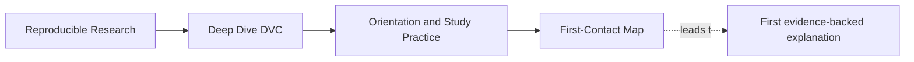
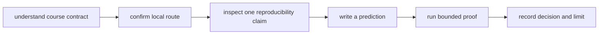
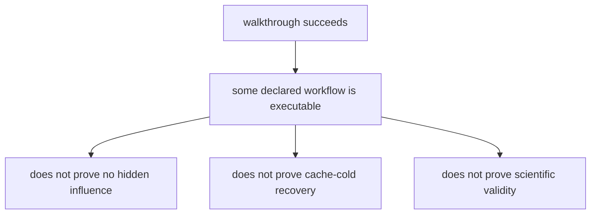

# First-Contact Map

<!-- page-maps:start -->
## Page Maps




<!-- page-maps:end -->

Your first session should answer one useful question:

> What would I need to preserve before another person could trust this result?

Do not begin by learning every DVC command. Begin by recognizing the gap between “the
script ran here” and “the result can be reconstructed and reviewed elsewhere.”

## First-session outcome

By the end of this route, you should have:

- confirmed how course commands are invoked;
- read one concrete workflow claim;
- predicted one observable result;
- run or inspect one bounded proof;
- written one acceptance limit;
- chosen the next module based on a diagnosed gap.

Allow 60–90 minutes. Stop earlier only if setup blocks execution; preserve the failure
receipt and continue the reading route.

## Confirm the local course route

From the repository root:

```bash
git branch --show-current
git status --short
make PROGRAM=reproducible-research/deep-dive-dvc help
```

These commands establish location, local changes, and available course targets. They do
not modify the capstone's governed results.

Use the platform setup guide if the help target or required tools fail:

- [Platform Setup](../guides/platform-setup.md)
- [Start Here](../guides/start-here.md)

Do not hide an environment failure by switching tools or installing unrecorded
dependencies into the source tree. Save generated logs under `artifacts/`.

## Write the opening claim

Create a learning note under:

```text
artifacts/learning/deep-dive-dvc/first-contact.md
```

Write your current answer, even if incomplete:

```text
Claim: this repository can reproduce a result because…
Evidence I expect:
State I suspect is hidden:
What would make me reject the claim:
```

The point is to expose your starting model. You will revise it after Modules 01–04.

## Read one failure before one tool

Open these Module 01 pages:

1. [Repeatability Versus Reproducibility](../module-01-reproducibility-failures-real-teams/repeatability-versus-reproducibility.md)
2. [Hidden State and Undeclared Inputs](../module-01-reproducibility-failures-real-teams/hidden-state-and-undeclared-inputs.md)
3. [The First Honest Workflow Inventory](../module-01-reproducibility-failures-real-teams/the-first-honest-workflow-inventory.md)

While reading, classify the opening claim:

| Question | Your current evidence |
| --- | --- |
| Is the code identified? | |
| Are data bytes identified? | |
| Is runtime influence bounded? | |
| Are commands and dependencies declared? | |
| Are result meanings recorded? | |
| Can a new executor recover required objects? | |

Unknown is an acceptable answer. Unexamined certainty is not.

## Predict the walkthrough

Before running anything, predict what a course walkthrough can establish.

Choose from:

- declarations exist;
- a known workspace can execute;
- generated artifacts have expected structure;
- all hidden influences are absent;
- another machine can recover every required object;
- the scientific claim is valid.

Only the first three are plausible from one local walkthrough. The others require
specific audits, independent reconstruction, or domain evidence.



Write your prediction before the command so the successful output cannot inflate the
claim afterward.

## Run the bounded walkthrough

```bash
make PROGRAM=reproducible-research/deep-dive-dvc capstone-walkthrough
```

Record:

```text
command:
exit status:
artifacts or receipts produced:
declared behavior observed:
claim now supported:
claim still unsupported:
```

If the command fails, record the exact first failure and continue with the generated
receipt if one exists. A setup failure changes the practical route; it does not erase the
conceptual distinction between repeatability and reproducibility.

## Inspect without touring everything

Choose only one capstone surface that matches the question:

| Question | Inspect |
| --- | --- |
| what stages claim to read and write | `capstone/dvc.yaml` |
| what declared state was recorded | `capstone/dvc.lock` |
| which reviewed controls exist | `capstone/params.yaml` |
| what a focused audit produces | `capstone/docs/` audit guide for that boundary |
| how the capstone fits the course | [Capstone Map](../capstone/capstone-map.md) |

Do not browse every directory. The capstone becomes educational when a question selects
the surface.

## Revise the opening claim

Your first conclusion might be:

> The walkthrough demonstrates that this checked-out course environment can execute a
> declared capstone route and produce its expected local evidence. It does not yet prove
> complete input declaration, equivalent execution elsewhere, cache-cold recovery, or
> scientific validity. Those claims require the focused boundaries developed later in
> the course.

Compare that with your original note. Name what changed in your reasoning.

## Choose the next route

| If you are now asking… | Continue with |
| --- | --- |
| what “reproduce” should mean | Module 01 |
| how DVC identifies and moves data state | Module 02 |
| why the same graph can produce different results | Module 03 |
| why a stage ran or skipped | Module 04 |
| how the whole journey fits together | [Course Map](course-map.md) |

New learners should continue with Module 01 even if a later question feels more urgent.
The early modules define terms used by every later review.

## First-contact checkpoint

You are ready to leave this page when you can:

- distinguish successful local execution from reconstruction elsewhere;
- name at least one hidden state category;
- identify declaration, execution, and artifact evidence as separate layers;
- state one claim the walkthrough supports and one it does not;
- locate your next lesson without instructor direction.
