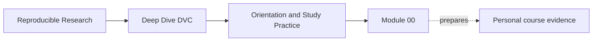
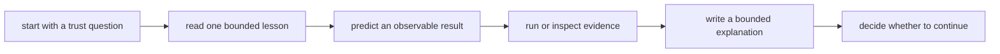
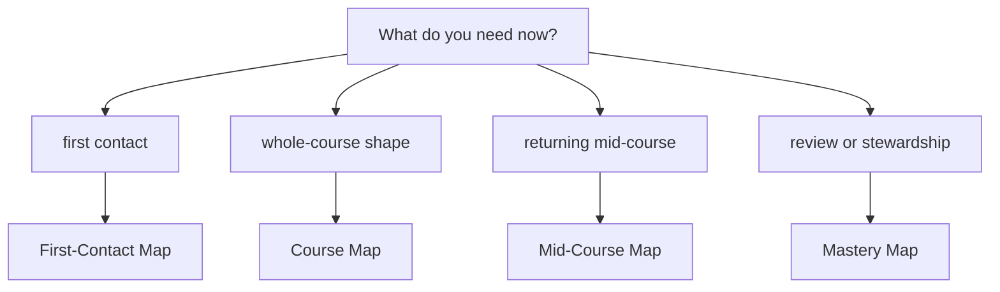

# Module 00: Orientation and Study Practice

<!-- page-maps:start -->
## Page Maps




<!-- page-maps:end -->

Deep Dive DVC is a course about deciding which reproducibility claims a repository can
support. Commands are part of that work, but command recall is not the learning target.

You will learn to answer questions such as:

- Which bytes does this pointer identify?
- Which hidden runtime fact could change this result?
- Why did this stage run or skip?
- Are two metric values measurements of the same claim?
- Could another maintainer reconstruct the submitted state?
- Which evidence survives local loss?
- What exactly may a downstream consumer trust?

Module 00 shows how to study those questions without depending on an instructor to choose
the next page, interpret a command, or decide when your evidence is sufficient.

## The course contract

For each technical module, you should leave with four things:

| Outcome | What it looks like |
| --- | --- |
| mental model | you can explain the relevant state boundary in plain language |
| prediction | you can say what should happen before running a command |
| observation | you can identify the receipt or artifact that records what happened |
| bounded decision | you can state what the evidence establishes and what remains unknown |

Reading alone does not complete a module. Running commands without predictions does not
complete it either. The course joins conceptual reasoning to reviewable evidence.

## Choose your entry route



| Situation | Open |
| --- | --- |
| first serious session with DVC | [First-Contact Map](first-contact-map.md) |
| planning the complete beginner-to-advanced route | [Course Map](course-map.md) |
| planning independent sessions or recovering a missed class | [Self-Study Guide](self-study-guide.md) |
| unsure what a DVC receipt can prove | [Evidence-Reading Guide](evidence-reading-guide.md) |
| deciding when and how to use the capstone | [Capstone Framing Guide](capstone-framing-guide.md) |
| opening a DVC repository you did not author | [Repository Reading Guide](repository-reading-guide.md) |
| locating commands, proof targets, and recurring distinctions | [Course Reference](course-reference.md) |
| returning after Modules 01–04 | [Mid-Course Map](mid-course-map.md) |
| auditing a mature repository or migration | [Mastery Map](mastery-map.md) |
| uncertain about a recurring term | [Course Reference](../reference/index.md) |

If more than one row applies, choose the first one. The maps cross-link where their
responsibilities meet.

## Use lessons as investigations

Every module follows the same underlying method:

1. Name the claim under review.
2. Identify the state that could make the claim false.
3. Predict the tool or artifact behavior before inspecting the result.
4. Run the smallest proof route that can test the prediction.
5. Compare declared evidence with semantic meaning.
6. Record an acceptance, rejection, or abstention.
7. State the limit of the test.

This method prevents two common failures:

- treating successful execution as proof of reproducibility;
- treating a tool receipt as if it judged scientific meaning.

## Keep a learning evidence directory

Course commands write generated evidence under the repository-level `artifacts/`
directory. Keep your own notes there too:

```text
artifacts/learning/deep-dive-dvc/
├── questions.md
├── predictions.md
├── module-decisions.md
└── review-packets/
```

For each module, add:

```text
claim:
prediction:
observed evidence:
decision:
remaining limit:
```

These notes are for learning and review, not source control. They make it possible to
resume after a missed class or a long interruption without reconstructing your reasoning
from shell history.

## Know which evidence layer you are reading

| Layer | Typical surface | Question answered |
| --- | --- | --- |
| declaration | `dvc.yaml`, `.dvc` files, parameters | what does the repository claim? |
| recorded execution | `dvc.lock`, status and repro receipts | what declared state was observed? |
| artifact | data, model, metric, report | what result exists? |
| semantic contract | schema, population, controls, policy | what does the result mean? |
| operational boundary | remote, CI, retention, promotion | who can recover or trust it? |

No one layer answers every question. Later modules repeatedly test the gaps between them.

## Use the capstone proportionately

The capstone is a repository-scale specimen. It is useful when you already understand
the claim you want to inspect.

Use it to:

- corroborate a lesson with real declarations and receipts;
- run a controlled mutation audit;
- practice reviewer handoff or recovery;
- assemble a cross-module proof packet.

Do not use it as the first explanation of an unfamiliar idea. Start with the lesson's
smaller model, then move to the capstone when you can predict what the command should
show.

The smallest general route is:

```bash
make PROGRAM=reproducible-research/deep-dive-dvc capstone-walkthrough
```

Individual modules provide narrower audit targets when a focused contrast is more useful.

## Decide when a module is complete

A module is complete for first-pass study when you can:

- explain its central boundary without quoting the page;
- solve its cumulative exercises before reading the answers;
- reproduce the worked investigation's reasoning;
- interpret the focused audit's accepted and rejected findings;
- write one limit on what the evidence proves.

You do not need to memorize every command. You do need to know which command or artifact
would answer the next question.

## If a command does not match the page

Do not improvise until the evidence is unrecognizable. Preserve:

- the exact command;
- exit status;
- relevant standard output and error;
- current branch and changed files;
- tool versions involved.

Then classify the mismatch:

| Mismatch | Likely response |
| --- | --- |
| setup or dependency failure | return to platform setup |
| receipt shape differs but claim is testable | inspect the current structured output |
| expected semantic value differs | stop and investigate the claim |
| command writes unexpected tracked files | preserve status and review ownership |
| audit reports a deliberate rejection | read result and decision together |

A failed expectation can be useful evidence. Hiding it with force, deletion, or unrelated
changes is not.

## Orientation checkpoint

Before Module 01, be able to say:

- this course teaches evidence-backed trust decisions, not merely DVC syntax;
- every module joins a claim, prediction, observation, decision, and limit;
- the capstone corroborates a understood idea rather than replacing explanation;
- generated learning and audit evidence belongs under `artifacts/`;
- you know which orientation map fits your present need.

Then use the [First-Contact Map](first-contact-map.md) to begin the technical route.
