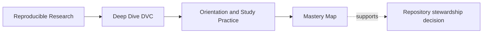
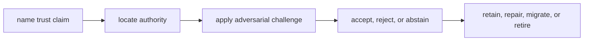

# Mastery Map

<!-- page-maps:start -->
## Page Maps




<!-- page-maps:end -->

Mastery in this course is not command fluency. It is the ability to make a defensible
repository decision when evidence is incomplete, responsibilities overlap, or a passing
workflow conceals an unsafe boundary.

Use this map when reviewing an existing DVC repository, planning a migration, preparing
a promotion, designing recovery policy, or deciding whether DVC should continue to own a
concern.

## The mastery standard

A strong reviewer can do all of the following:

| Capability | Demonstration |
| --- | --- |
| bound a claim | names exact artifact, revision, population, environment, or consumer |
| locate authority | identifies which surface decides current truth |
| trace evidence | follows declarations into receipts and semantic results |
| challenge causality | changes one relevant boundary and predicts the consequence |
| recognize absence | abstains when necessary evidence is missing |
| assign ownership | gives each durable state boundary one accountable owner |
| plan change | preserves invariants through repair, migration, or retirement |

Passing commands can support these capabilities. They cannot substitute for them.

## Enter through a real pressure

| Pressure | Begin with | Required earlier boundaries |
| --- | --- | --- |
| consumers cannot verify a release | Module 09 | identity, comparability, promotion policy |
| historical data may be garbage-collected | Module 08 | revision authority, remote reachability |
| CI passes but reviewers cannot reproduce | Module 07 | runtime and stage contracts |
| registry and DVC responsibilities overlap | Modules 09–10 | promotion and consumer contracts |
| remote migration is planned | Modules 08–10 | protected revisions, rollback, cutover authority |
| pipeline has recurring stale-result incidents | Modules 04 and 10 | command behavior and governance |
| experiment history is large but indecisive | Modules 05–06 | semantic comparison and baseline authority |

Start with the pressure, but descend to the earliest missing prerequisite. A migration
plan cannot compensate for unknown ownership.

## Review a repository by trust claim

Do not begin with “is DVC configured correctly?” Begin with a claim someone relies on:

- “this pointer can reconstruct the approved training data”;
- “this metric improvement is comparable to baseline”;
- “this promoted model matches the authorized evidence”;
- “this historical revision survives workstation loss”;
- “this reviewer can reproduce the submitted result.”

For each claim, build:

```text
consumer:
authority:
declarations:
required objects:
execution evidence:
semantic or policy evidence:
adversarial challenge:
decision:
evidence limit:
```

The consumer field prevents repository-internal convenience from being mistaken for a
public contract.

## Trace authority before artifacts

An artifact can exist in several places while only one surface has authority for the
decision under review.

```mermaid
flowchart TD
  question["Which claim is under review?"] --> data["data reconstruction"]
  question --> run["execution reproduction"]
  question --> compare["candidate comparison"]
  question --> release["consumer release"]
  data --> pointer["Git revision + DVC pointer + remote object"]
  run --> graph["stage declaration + runtime contract"]
  compare --> baseline["authorized baseline + semantic contract"]
  release --> manifest["promotion policy + manifest + integrity receipt"]
```

Ask:

- Which state is authoritative now?
- Which copies are caches, mirrors, or conveniences?
- What happens if the authoritative surface disappears?
- Who may change the authority?
- Which receipt demonstrates that change?

If two systems both appear authoritative, the boundary is already a governance problem.

## Apply an adversarial review

Happy-path execution shows that one available state worked. Stewardship requires a
challenge that attacks the claim:

| Claim | Useful challenge |
| --- | --- |
| data is recoverable | remove local data and cache, then pull protected revision |
| runtime is bounded | vary one relevant runtime capability while declarations stay fixed |
| stage contract is complete | mutate a real file or selected control |
| metric is comparable | keep value movement but change population, unit, or control |
| handoff is independent | reconstruct from submitted state in a cold workspace |
| promotion is authorized | alter threshold, evidence, or artifact after selection |
| migration preserves truth | fail new authority before cutover and exercise rollback |

The challenge should preserve enough validity to isolate the boundary. A corrupted file
that merely crashes a parser may prove nothing about semantic comparability or ownership.

## Separate decision types

Use explicit decisions:

| Decision | Meaning |
| --- | --- |
| `ACCEPT` | required evidence supports the bounded claim |
| `REJECT` | evidence demonstrates a violated contract |
| `ABSTAIN` | evidence needed to compare or authorize is missing |
| `REPAIR` | ownership remains appropriate, but contract must change |
| `MIGRATE` | another system should become authority under preserved invariants |
| `RETIRE` | the claim or artifact no longer has justified consumers |

Do not convert abstention into acceptance because a deadline exists. Do not choose
migration merely because repair is less fashionable.

## Decide whether DVC remains the owner

DVC is a strong owner for content-addressed data state, declared pipelines, parameters,
metrics, experiments, and remote-backed reconstruction within a repository workflow.
It may not be the final owner for:

- deployment orchestration;
- model serving;
- organization-wide registry policy;
- secret management;
- environment image distribution;
- long-term archival guarantees;
- domain validation.

Evaluate ownership by contract:

1. What state does the concern govern?
2. Which consumers depend on it?
3. Which system can enforce its invariants?
4. Which evidence can reviewers retrieve later?
5. Which rollback exists if authority changes?

Tool overlap is not automatically wrong. Ambiguous authority is.

## Plan a governed change

Before repair or migration, state invariants:

```text
protected revisions remain reconstructable
artifact identities remain verifiable
consumer contract does not silently change
one system is authoritative at each cutover point
rollback is possible before old authority is retired
acceptance evidence is preserved
```

Then define:

| Change boundary | Required content |
| --- | --- |
| before state | authority, inventories, known defects, baseline receipts |
| transition | copy or transform mechanism, verification, dual-read limits |
| cutover | named decision, acceptance threshold, authority switch |
| rollback | trigger, procedure, restored authority |
| after state | consumer checks, monitoring, retirement evidence |

A calendar date is not a cutover criterion. A successful copy is not proof that consumers
can use the new authority.

## Build a mastery review packet

Keep:

```text
trust-claims.tsv
authority-map.md
state-inventory.tsv
adversarial-challenges.md
accepted-evidence/
rejected-evidence/
migration-or-repair-decision.md
residual-risks.md
```

For each accepted claim, preserve the shortest route another reviewer can use to verify
it. For each rejected claim, preserve the original failure before repair.

## Recognize weak mastery signals

Reject these explanations:

- “all tests passed, so the repository is reproducible”;
- “DVC tracks it, so it is backed up”;
- “the metric increased, so the candidate is better”;
- “the remote was copied, so migration is complete”;
- “the artifact exists, so consumers can trust it”;
- “we can force a rerun if anything looks wrong.”

Each collapses several evidence boundaries into one reassuring observation.

## Mastery checkpoint

You are ready to lead a review when you can:

- begin from a consumer or maintainer trust claim;
- identify authority rather than merely listing copies;
- choose an adversarial challenge that isolates the boundary;
- distinguish acceptance, rejection, and abstention;
- preserve original failure and post-repair evidence;
- decide among repair, migration, and retirement;
- state residual risk without weakening it into boilerplate.

Use Module 10 for the detailed governance and migration investigation, then return here to
assemble the repository-level decision.
