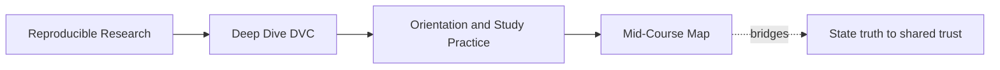
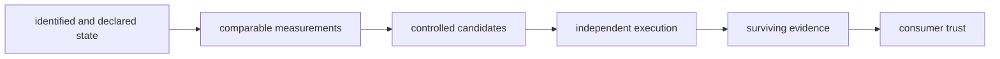
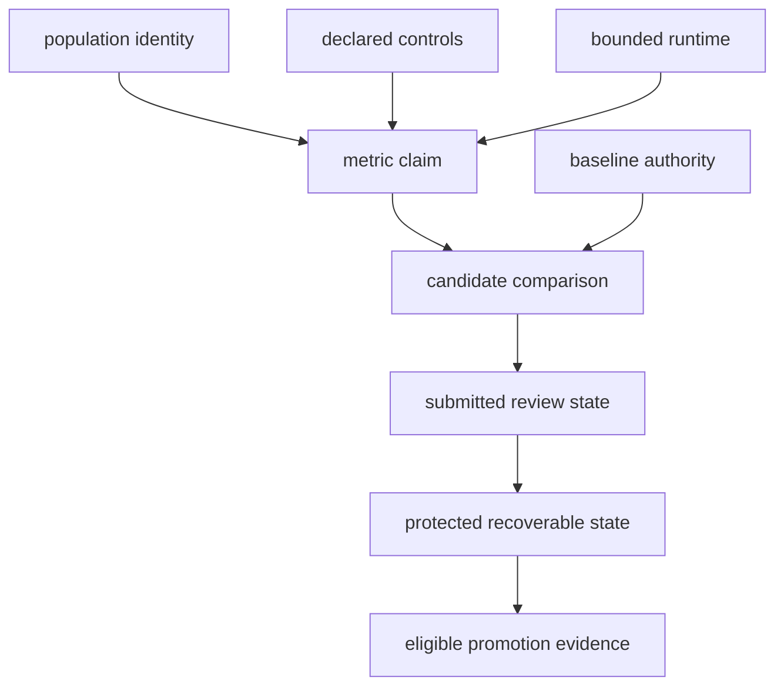

# Mid-Course Map

<!-- page-maps:start -->
## Page Maps




<!-- page-maps:end -->

Use this page after Module 04, after a long interruption, or when a later lesson feels
like an isolated DVC feature. The middle of the course changes the unit of trust:

- early modules ask whether one result has an explainable origin;
- middle modules ask whether results can be compared, shared, and recovered;
- late modules ask which result may cross a downstream boundary.

The bridge is conceptual, not chronological. Do not continue until the earlier state
claims needed by your next comparison are stable.

## Diagnose readiness

Without opening the earlier lessons, answer:

1. Why can two files at the same path represent different data identity?
2. Which runtime facts can influence a result without appearing in `dvc.lock`?
3. Why can `dvc status` be empty while an output is semantically stale?
4. What evidence distinguishes an unnecessary rerun from a hidden influence?
5. How would you prove that a repaired dependency works on the next change?

Use the result:

| Pattern | Return before continuing |
| --- | --- |
| data identity answer relies on path names | Module 02 |
| runtime is treated as automatically captured | Module 03 |
| status is treated as universal freshness proof | Module 04 |
| repair relies on `--force` or output deletion | Module 04 worked investigation |
| all five answers are evidence-based | begin Module 05 |

This is not a memory quiz. These distinctions are prerequisites for interpreting metrics
and experiments honestly.

## Understand the middle-course dependency

A metric value is derived from a population, controls, code, and runtime. An experiment
compares such values against an authority. A reviewer handoff must reconstruct those
inputs and decisions. Recovery must preserve the state needed to do so.



Skipping a boundary does not merely leave a gap in course coverage. It weakens the claims
available downstream.

## Module 05: decide whether numbers are comparable

Start Module 05 with this deliberately incomplete statement:

> F1 increased from `0.7368` to `0.7826`.

Ask what must remain stable before “increased” can mean improvement in the same
measurement:

- population identity and size;
- metric name and definition;
- unit and aggregation;
- selected threshold;
- schema contract;
- evidence presence.

Run the focused audit only after predicting accepted and rejected cases:

```bash
make PROGRAM=reproducible-research/deep-dive-dvc capstone-metric-contract-audit
```

Exit Module 05 able to explain why DVC can report a numerically correct diff for a
semantically invalid comparison.

## Module 06: decide whether candidates share an experiment

Module 06 adds baseline authority and allowed-change boundaries.

Before ranking candidates, establish:

| Boundary | Review question |
| --- | --- |
| baseline | which revision and evidence define the reference? |
| intent | what question does the experiment answer? |
| allowed change | which controls may differ? |
| preserved state | which data, metric, runtime, and pipeline boundaries must match? |
| decision | is the candidate comparable, selectable, and promotable? |

These are different decisions. A comparable result need not be selected; a selected
candidate need not be ready for promotion.

Focused route:

```bash
make PROGRAM=reproducible-research/deep-dive-dvc capstone-experiment-comparability-audit
```

If the available target name differs, use `make ... help` and the module's current
command block. Preserve the actual receipt rather than inventing an expected one.

## Module 07: move from author to reviewer

Local evidence becomes a handoff claim. The decisive test is whether a cold reviewer or
CI executor can reconstruct the submitted state without undocumented local context.

Review:

- Git revision and dirty-worktree state;
- DVC metadata and required objects;
- environment construction;
- exact command route;
- preserved status before automatic repair;
- result and policy decisions.

Focused route:

```bash
make PROGRAM=reproducible-research/deep-dive-dvc capstone-reviewer-handoff-audit
```

Exit Module 07 able to reject a handoff that succeeds only with the author's warm cache.

## Module 08: separate availability from recoverability

An artifact available in one workspace is not necessarily recoverable after loss.
Recovery review asks which protected revisions and objects remain authoritative.

Use Module 08 when:

- local cache was lost;
- retention or garbage collection is being changed;
- a remote is being migrated;
- historical revisions matter;
- incident evidence must survive repair.

Focused route:

```bash
make PROGRAM=reproducible-research/deep-dive-dvc capstone-recovery-readiness-audit
```

Exit able to state which exact losses the recovery evidence covers.

## Module 09: cross the promotion boundary

Promotion creates a smaller consumer-facing contract than the whole working repository.
It should not smuggle internal state, undeclared thresholds, or unverified artifacts into
a release.

Review:

- authorized candidate and baseline;
- promotion policy and threshold;
- artifact identities and manifest;
- integrity verification;
- downstream instructions;
- rollback or rejection evidence.

Focused route:

```bash
make PROGRAM=reproducible-research/deep-dive-dvc capstone-promotion-integrity-audit
```

Exit able to distinguish “repository evidence exists” from “consumer may trust this
promoted bundle.”

## Resume after a missed class

Do not reread the whole course by default. Reconstruct the last completed boundary:

1. Open your `artifacts/learning/deep-dive-dvc/module-decisions.md`.
2. Find the last claim with prediction, observation, decision, and limit.
3. Re-run only its focused audit if the receipt is unavailable.
4. Use the readiness questions above.
5. Continue at the earliest unsupported boundary.

If you have no learning packet, use the module's worked investigation and final exercise
as the fastest honest re-entry test.

## Mid-course evidence ledger

Keep one row per boundary:

| Boundary | Authority | Preserved receipt | Decision | Limit |
| --- | --- | --- | --- | --- |
| metric comparison | | | | |
| experiment candidate | | | | |
| reviewer handoff | | | | |
| recovery target | | | | |
| promotion bundle | | | | |

The authority column matters. A receipt without a named baseline, revision, remote, or
policy can be operationally detailed and still ambiguous.

## Leave this map when

Move to the [Mastery Map](mastery-map.md) when you can:

- reject semantically invalid metric movement;
- name experiment baseline and allowed changes;
- reconstruct a submitted state independently;
- explain protected recovery scope;
- verify a promotion boundary as a consumer would.

If one capability is missing, use the corresponding module rather than treating Module
10 as a general summary.
