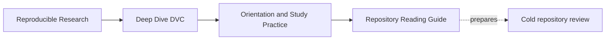
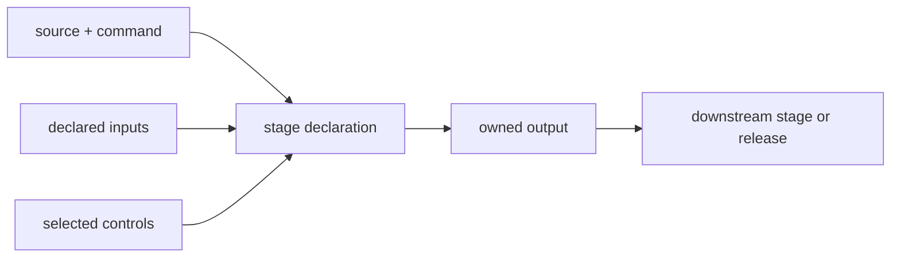

# Repository Reading Guide

<!-- page-maps:start -->
## Page Maps



```mermaid
flowchart LR
  claim["identify relied-on claim"] --> inventory["inventory state surfaces"]
  inventory --> graph["read declarations"]
  graph --> authority["locate authority"]
  authority --> predict["predict one challenge"]
  predict --> execute["run bounded route"]
  execute --> decide["write decision and limit"]
```
<!-- page-maps:end -->

Use this guide when opening a DVC repository you did not author. The goal is not to tour
every file or run the largest target. The goal is to construct a reliable account of what
the repository claims, which state makes those claims true, and which evidence a new
reviewer can reproduce.

## Begin read-only

Before any command that can modify workspace state:

```bash
git rev-parse --show-toplevel
git branch --show-current
git status --short
git log -5 --oneline
```

Record:

- repository and revision;
- branch purpose;
- tracked and untracked changes;
- whether review begins from a clean state;
- relevant recent intent.

Existing changes belong to the current user or workflow. Do not discard them to create a
clean-looking review.

## Name the relied-on claim

Ask who needs what:

| Consumer | Example claim |
| --- | --- |
| analyst | approved data and code reconstruct the reported metric |
| maintainer | submitted state can run in a clean executor |
| incident responder | protected revision survives local cache loss |
| release reviewer | promoted artifact matches authorized candidate and policy |
| downstream service | manifest identifies the exact artifact it consumes |

Without a consumer and claim, repository inspection becomes a file inventory without a
decision.

## Inventory state surfaces

Look for:

```bash
rg --files -g 'dvc.yaml' -g 'dvc.lock' -g '*.dvc' -g 'params.yaml'
rg --files -g 'pyproject.toml' -g 'requirements*.txt' -g 'environment*.yml'
rg --files -g 'Makefile' -g 'README.md' -g '.dvc/config*'
```

Do not print credentials or secret-bearing configuration. Record presence and ownership,
not secret values.

Build:

| Surface | Found at | Role | Authority or copy? | Consumer |
| --- | --- | --- | --- | --- |
| Git revision | | source and metadata identity | | |
| DVC pointer or lock | | data or execution declaration | | |
| cache | | local object copy | | |
| remote | | shared or recovery object store | | |
| runtime declaration | | environment construction | | |
| metrics and parameters | | comparison contract | | |
| promoted manifest | | consumer identity | | |

An absent row is a finding when the claim depends on it.

## Read declarations before materializing data

Inspect:

- `.dvc` pointer fields;
- stage commands, dependencies, parameters, outputs, metrics, and plots;
- lock records;
- parameter selection;
- remote names and repository documentation;
- target descriptions in Makefiles or task runners.

Draw the declared path:



Then compare actual command behavior. Declarations are reviewable claims, not discovery
of all reads and writes.

## Build an authority map

For each state category, choose the surface that decides current truth:

| Category | Candidate authorities | Deciding question |
| --- | --- | --- |
| source and metadata | Git revision | which committed declaration is under review? |
| data bytes | pointer plus reachable remote object | which content identity must materialize? |
| runtime | lockfile, image digest, CI executor policy | which environment boundary is promised? |
| pipeline | `dvc.yaml` plus application behavior | which influences trigger which products? |
| comparison | baseline, params, metric schema | which measurements share meaning? |
| promotion | policy, approval, manifest | which artifact may consumers trust? |
| recovery | protected revision and retained objects | which loss scenario is covered? |

If several systems can independently change “current” state, record ambiguous authority
rather than choosing the most convenient copy.

## Predict before installing or reproducing

Write:

```text
expected environment route:
expected data fetch:
expected stale stages:
expected outputs:
expected semantic values:
expected dirty-worktree effect:
```

Prediction exposes hidden assumptions. If no expected output or semantic assertion can be
stated, learn the repository's claim before executing it.

## Choose a bounded first command

Prefer documented, read-only or narrowly generating commands:

- help or target listing;
- platform report;
- state summary;
- status;
- focused verification;
- isolated audit.

Do not start with:

- force reproduction;
- cache deletion;
- garbage collection;
- remote migration;
- promotion;
- broad cleanup.

Those actions can destroy the state needed to diagnose the repository.

## Compare three truths

After the bounded route, compare:

| Truth | Evidence |
| --- | --- |
| declared truth | metadata says what should influence and result |
| observed truth | tool says what changed, ran, moved, or compared |
| semantic truth | artifact and policy say what the result means |

Examples:

- status can agree with declared truth while hidden semantic influence is stale;
- metric diff can report observed movement while semantic contracts differ;
- a pull can transfer objects while the protected recovery claim remains incomplete.

## Challenge one boundary

Select a safe isolated challenge:

| Suspected weakness | Controlled challenge |
| --- | --- |
| path mistaken for identity | compare pointer identity and materialized bytes |
| hidden runtime influence | vary one runtime capability in isolated execution |
| missing stage dependency | mutate one real input and preserve status |
| invalid metric comparison | hold value movement while changing unit or population |
| warm-cache handoff | reconstruct in a clean workspace |
| weak recovery | remove only modeled local layers and restore protected revision |
| promotion drift | modify post-selection artifact or policy in an audit copy |

Use a disposable workspace under `artifacts/` when the challenge changes state.

## Write the first review note

Use:

```text
Scope:
Consumer claim:
Revision and initial worktree:
Declared authority:
Bounded command:
Controlled challenge:
Observed evidence:
Semantic or policy evidence:
Decision:
Limit:
Next highest-risk boundary:
```

Prefer one defensible decision to a long list of filenames.

## Route findings into the course

| Finding | Study route |
| --- | --- |
| “works on my machine” is the only claim | Module 01 |
| data identity or remote state is unclear | Module 02 |
| runtime is implicit | Module 03 |
| stage skips a meaningful change | Module 04 |
| numeric comparison lacks meaning | Module 05 |
| candidate lacks baseline or allowed-change scope | Module 06 |
| reviewer requires author's local state | Module 07 |
| protected revisions or retention are unclear | Module 08 |
| promoted artifact lacks consumer verification | Module 09 |
| authorities overlap or migration lacks rollback | Module 10 |

## Cold-review checkpoint

You can read an unfamiliar repository responsibly when you can:

- preserve initial state before mutation;
- state a consumer-facing claim;
- inventory declaration, object, runtime, comparison, and release surfaces;
- identify authority rather than listing copies;
- predict one bounded command;
- compare declared, observed, and semantic truth;
- challenge one boundary in isolation;
- route the highest-risk finding to the right course module.
