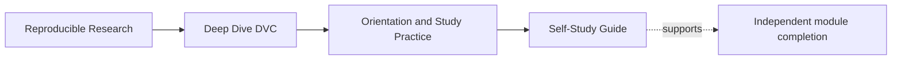
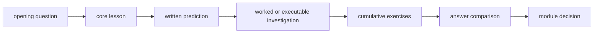
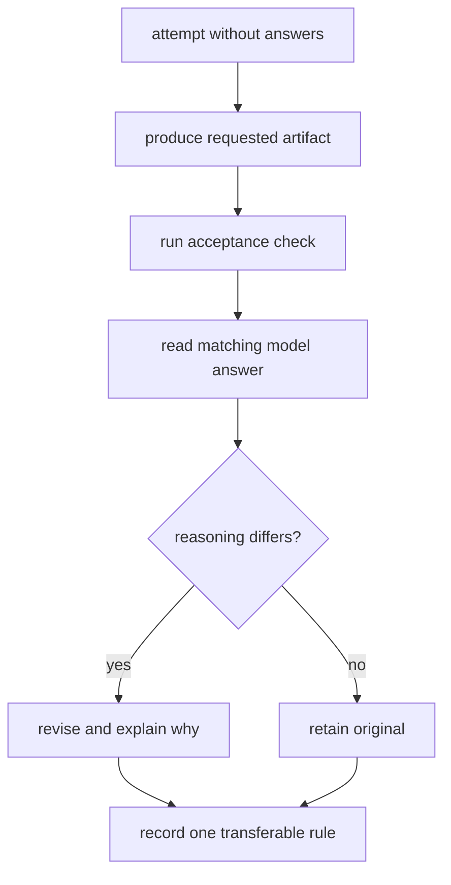

# Self-Study Guide

<!-- page-maps:start -->
## Page Maps




<!-- page-maps:end -->

This guide replaces the coordination an instructor would normally provide: what to read,
when to run evidence, how to use answers, what to record, and how to decide whether to
continue.

It is designed for learners completing the course alone, returning after missed classes,
or studying asynchronously with a review partner.

## Prepare one study workspace

Keep generated material under the repository's `artifacts/` boundary:

```text
artifacts/learning/deep-dive-dvc/
├── questions.md
├── predictions.md
├── module-decisions.md
├── review-packets/
└── command-logs/
```

Do not place learning logs beside course source files. Generated audit routes already
write to `artifacts/audit/reproducible-research/deep-dive-dvc/`.

At the start of a session, record:

```text
date:
module:
question:
time available:
last accepted capability:
known blocker:
```

This takes less than a minute and makes interrupted study resumable.

## Use one complete module rhythm

### Frame the question

Read the module index and write the question you expect the module to answer. If you
cannot state it, use the index's symptom or route table rather than browsing every page.

### Read core lessons in order

The early page defines language used by later pages. On the first pass, do not jump
directly to the most technical file.

For each core lesson, keep two notes:

```text
rule:
failure if violated:
```

If the rule cannot be stated without copying a paragraph, explain it to an imagined
reviewer and revise.

### Predict before observing

Before every worked example or audit, predict:

- which declaration or authority controls the decision;
- which stage, candidate, or artifact should be accepted or rejected;
- which result value or absence will matter;
- what the command cannot establish.

Prediction turns execution into a test of your model. Without it, output can feel
persuasive merely because it is detailed.

### Work the investigation

Follow the evidence in its natural time order:

1. initial declaration or baseline;
2. controlled mutation;
3. pre-repair status or comparison receipt;
4. ordinary execution;
5. semantic result or artifact presence;
6. repaired declaration or policy;
7. replay of the original challenge;
8. convergence or final integrity receipt.

Preserve the original failure. Do not overwrite it with the repaired output.

### Complete all ten exercises

Exercises within a module are cumulative. They usually build one packet rather than ten
unrelated answers.

Use this sequence:



Do not grade by matching wording. Grade whether your artifact:

- names the governing claim;
- cites the right evidence layers;
- distinguishes observation from inference;
- makes a decision;
- states a limit.

### Close with a module decision

Append to `module-decisions.md`:

```text
Module:
Capability accepted:
Evidence route:
Failure I can now diagnose:
Remaining uncertainty:
Next module:
```

If capability is not accepted, record the narrow reason and repeat the relevant lesson
or exercise. Do not restart the whole module automatically.

## Choose a session size

| Time available | Honest scope |
| ---: | --- |
| 20 minutes | one core section plus a written rule and failure mode |
| 45 minutes | one core page plus one evidence prediction |
| 90 minutes | two core pages or one worked investigation |
| 2–3 hours | complete exercise packet and answer review |
| half day | full technical module only if prerequisites are already stable |

Avoid starting an executable investigation when there is no time to preserve and
interpret its receipts. Reading it conceptually is better than rushing through commands
and calling execution proof.

## Recover after a missed class

Use three artifacts:

1. module index completion standard;
2. worked investigation;
3. final cumulative exercise and matching answer.

Try the final exercise first. Its difficulty reveals where to return:

| Difficulty | Return to |
| --- | --- |
| terms are unfamiliar | glossary and earliest core lesson |
| cannot predict command behavior | declaration or state model lesson |
| can predict but cannot interpret receipt | evidence-reading lesson |
| can interpret but cannot decide | boundary or policy lesson |
| decision is sound but proof packet is incomplete | exercises |

This recovery route replaces chronological rereading with capability diagnosis.

## Use answer pages without losing the work

Open an answer only after saving your attempt. Compare:

- Did both answers use the same authority?
- Did both preserve the relevant before-state?
- Did both join tool receipt to semantic meaning?
- Did either claim more than the evidence supports?
- Is the model answer showing one defensible design or a required invariant?

When your answer differs but remains defensible, add a short justification. The goal is
reviewable judgment, not compliance with one implementation.

## Study with a review partner

Exchange artifacts, not conclusions. The reviewer should receive:

- the claim;
- declaration or baseline;
- mutation;
- raw receipt;
- semantic assertion;
- decision and limit.

The reviewer then asks one challenge question. Good challenges attack an authority,
hidden influence, comparison boundary, recovery assumption, or consumer contract.

Do not let the author explain missing evidence orally before the reviewer attempts the
route. The handoff itself is part of the test.

## Handle blocked commands

Classify the block:

| Block | Continue with |
| --- | --- |
| missing tool or platform dependency | platform setup and conceptual prediction |
| network or credential boundary | inspect local evidence; mark remote claim untested |
| test too expensive for current session | run focused audit; schedule full verification |
| generated state conflicts with local work | stop mutation; preserve status; use isolated audit |
| receipt differs from page | inspect structured fields and record version context |

Never replace a blocked claim with an unqualified pass. Record `UNTESTED` and the exact
missing authority or capability.

## Weekly review

At the end of each study week, answer:

- Which capability can I now demonstrate without the page?
- Which claim still depends on a warm workspace or oral explanation?
- Which receipt can another reviewer interpret?
- Which failure would I recognize earlier now?
- What is the earliest unsupported boundary in the course map?

Use the answer to select the next session. Page count is not progress if a prerequisite
claim remains unsupported.

## Self-study completion standard

Independent study is working when you can:

- resume from your evidence packet after an interruption;
- choose a bounded session without instructor scheduling;
- predict before running;
- use answers to audit reasoning rather than copy outcomes;
- classify blocked evidence honestly;
- decide readiness by capability rather than pages viewed.
