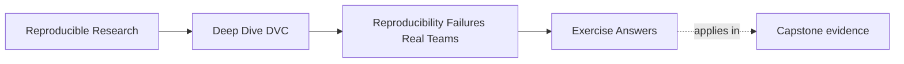

# Exercise Answers

<!-- page-maps:start -->
## Page Maps

<!-- page-maps:end -->

These answers are model explanations, not the only acceptable wording.

## How to use the answer page well

Do not read a model answer first and then reshape your workflow story so it sounds more
confident.

A better rhythm is:

1. finish the exercise with your own claim table and notes
2. write one plain-language explanation of the current workflow truth
3. compare that explanation with the model answer
4. revise where the model answer exposes missing evidence, a blurred boundary, or an
   adoption idea that is too broad

What matters is whether the reasoning makes the workflow story more honest.

Strong Module 01 answers usually do four things:

- they weaken claims when the evidence is still weak
- they expose hidden inputs without pretending they are new
- they respect Git's real authority without overloading it
- they keep DVC adoption narrow and testable

The strongest self-study packets also leave behind six concrete artifacts:

- one weakened claim
- one hidden-input inventory
- one Git-boundary review note
- one DVC-boundary explanation
- one cold-start failure report
- one narrow adoption proposal

If your answers rely only on "DVC will help later," the reasoning is still too thin.

## Answer 1: Separate repeatability from reproducibility

What the claim does show:

- one person achieved a local rerun with a matching result

What it does not show yet:

- whether another person could recover the same result later
- whether the same data identity, environment, and parameters were actually preserved
- whether the repository explains the run without relying on memory

Stronger next question:

- what would another teammate need in order to recover this result from the repository and
  declared artifacts alone

The main lesson is that local rerun success is useful evidence, but it is not the whole
proof.

## Answer 2: Find the hidden state

Strong answers should include items like:

- the exact identity of `train.csv`
- the manual cleaning step that produced `train.csv`
- the threshold sometimes passed via CLI
- the environment used by the original author
- any dependency versions in that environment
- the command history or shell practice used to launch the run
- the exact relationship between the dataset and `results/metrics.csv`

The important point is that the real workflow already includes these influences whether or
not the repository has described them well.

The most dangerous hidden input is often the one that silently changes result meaning,
such as a manual preprocessing step or a CLI-only threshold. The easiest first repair is
usually the one that can be made explicit without redesigning the whole workflow, such as
moving a CLI-only threshold into a declared config file.

## Answer 3: Name Git's real boundary

A strong review note would say:

> Git is preserving source code, visible configs, and textual instructions well. The gap
> is that the full result story still includes data identity, derived artifacts, and
> execution assumptions that source history alone does not make explicit. That matters
> because a team can version code carefully and still fail to recover or defend the result
> later.

The main lesson is to respect Git's strengths while refusing to overload its authority.

## Answer 4: Draw the DVC boundary honestly

What DVC is likely to help with:

- tracked data and artifact identity
- visible pipeline relationships
- recorded stage outputs and recoverable workflow state

What DVC does not settle by itself:

- whether the data is scientifically valid
- whether the workflow is fully deterministic everywhere
- whether the team's published outputs are interpreted responsibly
- whether undocumented manual behavior has been removed

Why the distinction matters:

- it keeps tool expectations honest and makes later workflow design more precise

The disappointment caused by overclaiming is that teams mistake a better state-recording
tool for a complete scientific or operational guarantee.

## Answer 5: Write your first workflow inventory

There is no single correct inventory, but strong answers will clearly name:

- where the source data comes from
- what parameters or defaults shape behavior
- what environment or machine assumptions still matter
- which outputs people actually trust
- which parts of the story still depend on memory, luck, or undeclared state

The main lesson is that the inventory should describe the present workflow truth, not an
imagined future one.

The weakest boundary is usually whichever consumer-facing output still depends on private
memory, undocumented preprocessing, or undeclared execution assumptions.

## Answer 6: Reproduce a result from a cold start

A strong report names concrete blockers such as:

- an unidentified dataset revision
- an unrecorded preprocessing command
- an implicit working directory
- a missing dependency version
- an unexplained output path

It separates evidence found in the repository from facts supplied later by a person.

What this experiment proves is the current recovery limit of the repository as given. It
does not yet prove whether DVC would fix the gap or whether the team has agreed on the
right ownership boundaries.

## Answer 7: Build an evidence ladder

The claims normally strengthen in the order given.

- "the file exists"
- "the script ran"
- "the inputs are identified"
- "another person recovered it"
- "the published result is traceable"

Existence proves almost nothing about origin. A successful command adds execution evidence.
Identified inputs add provenance. Independent recovery tests the handoff. Traceable
publication connects the recovered result to what consumers actually received.

Many teams stop too early at local existence or successful rerun and call the workflow
"reproducible" before another person has actually recovered the result.

## Answer 8: Classify ten workflow facts

The exact facts vary, but every classification needs an owner. Git commonly owns source
and small text controls. DVC can own large data identity and pipeline state. Environment
locks, runtime policy, and scientific interpretation still require explicit owners.

The weakest ownership often appears in environment or process facts because teams rely on
memory and habit there. DVC is a good later owner for large data identity, derived
artifact identity, and pipeline state that teams need to recover reliably.

## Answer 9: Write a failure report without blaming a tool

A useful report states:

- the expected result
- observed command and revision
- first difference
- available evidence
- next discriminating check

It does not assign a cause until evidence distinguishes missing data, changed code,
environment drift, or process error.

Blame language is unhelpful because it hides what is actually known and usually collapses
multiple possible failure layers into one dramatic sentence.

## Answer 10: Design an adoption boundary

A credible proposal starts narrowly, for example with raw and prepared datasets. It names
Git as pointer-history owner, a DVC remote as durable object owner, and environment
management as a separate concern. A clean-clone recovery drill is a better success
criterion than merely committing `.dvc` files.

The first artifact family DVC should own is usually the one that creates the biggest
recovery gap today while still being easy to test independently. What remains outside DVC
for now often includes environment management, scientific interpretation, and broader
publication semantics.

## Self-check

If your answers consistently explain:

- why team-grade reproducibility is harder than a local rerun
- which hidden inputs are influencing the workflow
- what Git is and is not preserving
- what DVC can improve without pretending to own everything

then you are using Module 01 correctly.
