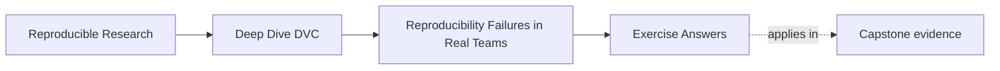
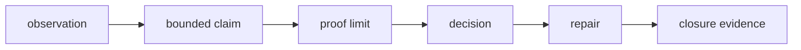

# Exercise Answers

<!-- page-maps:start -->
## Page Maps




<!-- page-maps:end -->

These models show reasoning structure. Your paths and wording may differ. Keep
your answer when it cites direct evidence, limits the inference, and gives a
reviewable closure condition.

## Answer: Bound the repeatability claim

Model:

> `local-run-a.json` and `local-run-b.json` have equal content and digests.
> Both commands exited successfully. This verifies byte-level local
> repeatability for the risk summary in the prepared case workspace. It does
> not verify reconstruction outside that workspace because
> `clean-rebuild.json` is absent. The accurate statement is: “The current
> workspace reruns consistently; team reproducibility remains unverified until
> a clean maintainer rebuilds from recorded evidence.”

Local repeatability would be contradicted if the two runs used the same claimed
inputs and contract but produced different result content beyond the allowed
tolerance. A missing clean run does not contradict local equality.

## Answer: Inventory one trusted result

Model matrix:

| Surface | Role | Identity | Declared? | Recoverable? | Evidence result |
|---|---|---|---:|---:|---|
| `observations.csv` | source records | SHA-256 in workflow record | yes | asserted yes | observed in specimen |
| `params.json` | threshold source | file plus value `0.20` | yes | source bundle | observed |
| `score_incidents.py` | transformation | implementation SHA-256 | yes | source bundle | observed |
| Python runtime | execution | implementation/name/version | yes in record | environment must be recreated | bounded observation |
| `risk-summary.json` | trusted result | output SHA-256 and schema | yes | generated | observed |
| clean rebuild | reconstruction | matching JSON | required | n/a | observed in complete case |

The likely same-path risk is `observations.csv`: its bytes can change without
its role or location changing.

Proof limits:

- the specimen's `input_recoverable: true` is a modeled fact, not a production
  remote drill;
- Python version does not identify every package;
- the result schema does not validate scientific threshold choice;
- local files do not prove access policy or retention.

## Answer: Diagnose the hidden threshold

Model finding:

> The hidden case invokes the scorer without `--threshold` and supplies
> `RISK_THRESHOLD`. The effective value equals the declared `params.json`
> value, so both local results happen to match the control case.
> `workflow-record.json` nevertheless records
> `environment:RISK_THRESHOLD` as the source, while the contract declares
> `params.json`. This breaks the reviewed control surface. Require the CLI
> value from the declared file, or declare and record the external control
> identity. Close the finding with a clean rebuild whose effective threshold
> can be reconstructed from the contract.

The file-based route is preferable when the team controls and reviews the
parameter with the repository. An external control can be appropriate when a
governed runtime system owns it, but its effective identity and influence must
still appear in evidence.

Equal values distinguish neither provenance nor override behavior. The
`control_source` and command receipt do.

## Answer: Prove content identity beyond the path

The current path is `source/observations.csv`. The workflow record contains the
digest from result production. After an additional row is appended, the
current digest differs and `input_identity_matches` fails.

Invalid inference:

> The result sits beside `observations.csv`, so the current file produced it.

Repair:

- if the file is small and suitable, commit the exact version to Git and link
  the result to its revision;
- if it belongs at an artifact boundary, track its content identity with DVC,
  commit metadata with source, and preserve the object in a governed remote.

Renaming the current changed file only creates another path. It does not
identify the historical bytes.

A known digest without reachable bytes supports diagnosis but not
reconstruction. Identity and recovery are independent.

## Answer: Turn manual preprocessing into a contract

Model contract:

```text
input:
  observations.csv with recorded content identity
transformation:
  explicit row-selection implementation with reviewed rule
controls:
  exclusion policy or list, if domain-approved
output:
  prepared-observations.csv with content identity
failure:
  no partial output; validation must pass
verification:
  row count, schema, source identity, exclusion receipt
```

Illustrative stage:

```yaml
stages:
  prepare_observations:
    cmd: python prepare_observations.py
    deps:
      - observations.csv
      - prepare_observations.py
    params:
      - preparation.exclusion_policy
    outs:
      - prepared-observations.csv
```

This proves mechanical lineage only. A domain owner must approve whether
excluding an incident is valid for the analysis.

## Answer: Draw the Git and DVC responsibility boundary

Model map:

| Fact | Authority | Supporting system | Evidence | Not proved |
|---|---|---|---|---|
| scoring source revision | Git | review system | commit identity | result provenance unless linked |
| threshold declaration | Git parameter file | DVC parameter dependency | reviewed value and stage record | scientific validity |
| input path/content link | DVC metadata | Git | pointer at revision | object availability |
| input bytes | governed DVC remote | storage policy | clean pull and digest | access entitlement |
| pipeline declaration | `dvc.yaml` in Git | DVC | stage graph | absence of hidden inputs |
| execution state | `dvc.lock` | Git and DVC | recorded identities | full runtime |
| runtime | environment tool | Git declaration, CI | lock/image and receipt | data recovery |
| scientific approval | domain review | decision record | approved rationale | mechanical reconstruction |

If metadata reaches Git but the object does not reach the remote, collaborators
can identify missing content but cannot materialize it.

## Answer: Separate runtime reconstruction from input recovery

Runtime contract:

```text
Python implementation/version
dependency lock or image digest
relevant locale, hardware, randomness, concurrency
clean execution command
result equality or tolerance
```

Recovery contract:

```text
protected input content identity
governed remote
authorized credential class
empty-cache retrieval
content verification
retention and failure owner
```

`MISSING_RUNTIME` has available input but cannot bound execution context.
`UNRECOVERABLE_INPUT` has runtime and content identity but cannot provide the
bytes to another maintainer.

Neither contract compensates for the other because they protect different
premises: **how computation behaves** and **whether required state exists at
the team boundary**.

## Answer: Write a reproducibility decision

Decision: `REJECT_REPRODUCIBILITY_CLAIM`.

| Premise | Result |
|---|---|
| local outputs agree | verified |
| input identity | verified |
| implementation identity | verified |
| declared controls | verified |
| declared transformations | verified |
| runtime identity | verified |
| clean reconstruction | **unverified** |
| input recovery | verified |

The six recorded surfaces and local equality remain useful. They cannot supply
the missing clean observation.

Next action: reconstruct in a new directory from the recorded boundary and
preserve command plus result verification. A passing clean receipt changes the
bounded decision.

Scientific validity, production safety, and access authorization remain out of
scope even after acceptance.

## Answer: Design a narrow DVC adoption contract

Model using input identity and recovery:

```text
current gap:
  observations.csv is referred to by path and private copy

bounded claim:
  each protected Git revision identifies exact observation bytes,
  and an authorized maintainer can recover them from the shared remote

DVC-owned evidence:
  path/content metadata, remote transfer, materialization

Git-owned evidence:
  source revision, DVC metadata, workflow docs

other owners:
  data meaning, access entitlement, retention

acceptance:
  empty-cache checkout and pull reproduce the recorded digest

adversarial test:
  omit the object from the candidate remote and require recovery to fail

proof limits:
  no claim about runtime, scientific validity, promotion, or deployment
```

Changing input bytes should change recorded artifact state. Editing unrelated
lesson prose should not.

The adoption formalizes an incomplete story if manual preprocessing still
creates the tracked “source” without recorded lineage.

## Answer: Prepare an independent maintainer handoff

Model route:

| Entry | Expected evidence | Failure meaning | Owner | Proof limit |
|---|---|---|---|---|
| `capstone-workflow-evidence-audit` | eight expected decisions | audit or specimen contract drift | workflow maintainer | mechanical specimen only |
| local result pair | equal JSON | local nondeterminism or changed inputs | implementation owner | one workspace |
| same-workspace assessment | missing clean receipt | team reconstruction unverified | workflow maintainer | not contradiction of local reruns |
| hidden-threshold record | external control source | reviewed parameter boundary bypassed | workflow maintainer | value validity not judged |
| changed-input record | digest mismatch | path no longer identifies producing bytes | data owner | recovery separate |
| manual-preprocessing record | undeclared prepared input | lineage gap | workflow/domain owners | domain approval separate |
| responsibility map | one authority per fact | ownership gap or overreach | repository owner | people mapping may be external |
| adoption contract | narrow DVC claim | tool introduced without acceptance evidence | repository maintainer | later course concerns excluded |

Answers:

1. Matching local files prove bounded repeatability in the prepared workspace.
2. Recorded identities, controls, transformations, runtime, clean rebuild, and
   shared recovery make the result transferable.
3. Scientific validity, access policy, and release approval remain outside
   DVC's mechanical evidence.

Any “ask the author” instruction marks missing durable evidence or ownership.

## Final self-check

Keep your own packet if it:

- distinguishes observation from inference;
- preserves verified local evidence;
- exposes the exact missing premise;
- treats path, identity, and recovery separately;
- represents manual work as influence;
- gives Git, DVC, runtime, storage, and domain review distinct roles;
- defines closure evidence;
- adopts DVC around one bounded contract.

The goal is not to produce the same prose. It is to make every conclusion
reviewable from evidence.
