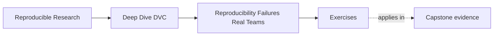

# Exercises

<!-- page-maps:start -->
## Page Maps

<!-- page-maps:end -->

Use these exercises to practice failure diagnosis, not just DVC vocabulary.

The strongest answers will describe what is missing from the workflow story before jumping
to tools.

## Exercise 1: Separate repeatability from reproducibility

A teammate says:

> I reran the notebook on my laptop and the metric matches last week's result, so the
> project is reproducible.

Write a short response that explains:

- what this claim does show
- what it does not show yet
- which stronger question a team should ask next

## Exercise 2: Find the hidden state

A repository contains:

- `train.py`
- `params.yaml`
- `data/train.csv`
- `README.md`
- `results/metrics.csv`

During discussion you learn that:

- `train.csv` was cleaned once by hand
- one threshold is sometimes passed via CLI instead of `params.yaml`
- the original author uses a private Conda environment nobody else has recreated

List at least five inputs or assumptions that should now be treated as part of the real
workflow story.

## Exercise 3: Name Git's real boundary

A team says:

> we do not need anything beyond Git because the code, configs, and README are all versioned.

Write a short review note that explains:

- what Git is preserving well
- what important parts of the result story may still lack a clear owner
- why that gap matters for reproducibility

## Exercise 4: Draw the DVC boundary honestly

Suppose someone on your team says:

> DVC will solve our reproducibility problem once we start tracking the data.

Explain:

- what DVC is likely to help with
- what DVC still does not settle by itself
- why this distinction matters before adopting the tool

## Exercise 5: Write your first workflow inventory

Choose one of your own workflows and write a five-part inventory:

1. source inputs
2. control inputs
3. execution assumptions
4. trusted outputs
5. weak points and missing evidence

The goal is not to fix the workflow yet. The goal is to describe it honestly enough that a
future DVC design would have something real to improve.

## Exercise 6: Reproduce a result from a cold start

Exchange a small analysis repository with a classmate or use a clean directory. Attempt
the documented result without using shell history or files outside the repository.
Record the first five points where you need missing information.

## Exercise 7: Build an evidence ladder

For one result, order these claims from weakest to strongest: "the file exists," "the
script ran," "the inputs are identified," "another person recovered it," and "the
published result is traceable." Explain what evidence advances each claim.

## Exercise 8: Classify ten workflow facts

Find ten facts in a real project and classify each as source, data, parameter,
environment, process, or output. Mark which facts Git records and which need another
owner.

## Exercise 9: Write a failure report without blaming a tool

Describe a failed reproduction using observed facts, missing evidence, and the next
smallest diagnostic action. Do not use phrases such as "DVC broke" or "the environment
was weird."

## Exercise 10: Design an adoption boundary

Write a one-page DVC adoption proposal for the workflow from Exercise 5. Name the first
artifact family DVC should own, what remains outside DVC, one recovery test, and one
criterion for deciding whether adoption helped.

## Mastery check

You have a strong grasp of this module if your answers consistently keep four ideas
visible:

- rerunning locally is weaker than team-grade reproducibility
- hidden inputs and assumptions are part of the workflow whether or not they are recorded
- Git's boundary should be respected rather than mythologized
- DVC helps with explicit state and recovery, not every question a workflow team can ask
