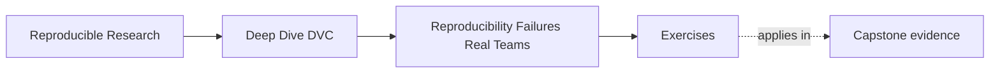
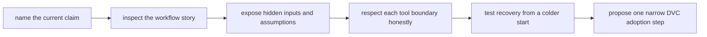

# Exercises


<!-- page-maps:start -->
## Page Maps




<!-- page-maps:end -->

Use these exercises to practice failure diagnosis, not just DVC vocabulary. The goal is
to make the current workflow story honest before you start improving it.

## How to work through this set

Treat the ten exercises as one full lab day on reproducibility failure analysis.

Before each answer:

1. write the claim the team thinks is true
2. separate observed evidence from missing evidence
3. state the next stronger question the workflow should be able to answer

If you skip that progression, the day turns into tool enthusiasm instead of disciplined
workflow diagnosis.

Do the exercises in order. The day is one progression:

- Exercises 1-3 separate local reruns from team-grade recovery and respect Git's true
  boundary
- Exercises 4-6 decide what DVC can improve and where the current workflow story is still
  weak
- Exercises 7-8 build stronger evidence ladders and ownership maps
- Exercises 9-10 turn failure reporting into a narrow adoption boundary the team can test

Keep one workflow-truth packet as you go. By the end of the day it should contain:

- one claim you weakened from "reproducible" to a more honest statement
- one hidden-input inventory
- one Git-boundary review note
- one DVC-boundary explanation that does not overclaim
- one cold-start failure report
- one narrow DVC adoption proposal with a recovery test

If those six artifacts are missing, you are probably describing the workflow people wish
they had instead of the workflow they actually run.

## Recommended working layout

If you want one lab tree that can support the whole day, use something like:

```text
module01-lab/
├── train.py
├── params.yaml
├── data/
├── results/
├── notes/
└── artifacts/
```

Keep one evidence table while you work:

| Claim | Evidence already present | Missing evidence | Stronger next question |
| --- | --- | --- | --- |

Also keep one ownership table:

| Workflow fact | Who owns it today | Is that owner explicit | What failure follows if it stays hidden |
| --- | --- | --- | --- |

That second table matters because hidden inputs do not stop being real inputs just because
nobody wrote them down yet.



Use that route on purpose. It keeps the day centered on educational honesty instead of on
premature tool selection.

## Exercise 1: Separate repeatability from reproducibility

A teammate says:

> I reran the notebook on my laptop and the metric matches last week's result, so the
> project is reproducible.

Write a short response that explains:

- what this claim does show
- what it does not show yet
- which stronger question a team should ask next
- one sentence explaining why local success is still useful evidence

Study note:
The point is not to dismiss local reruns. The point is to place them at the right level
of confidence.

## Exercise 2: Find the hidden state

A repository contains:

- `train.py`
- `params.yaml`
- `data/train.csv`
- `README.md`
- `results/metrics.csv`

During discussion you learn that:

- `train.csv` was cleaned once by hand
- one threshold is sometimes passed via CLI instead of `params.yaml`
- the original author uses a private Conda environment nobody else has recreated

List at least five inputs or assumptions that should now be treated as part of the real
workflow story.

What to hand in:

- the hidden-input list
- one sentence explaining which hidden input is currently most dangerous
- one sentence explaining which hidden input would be easiest to make explicit first

Study note:
This is where many students realize the workflow already has more state than the
repository admits.

## Exercise 3: Name Git's real boundary

A team says:

> We do not need anything beyond Git because the code, configs, and README are all versioned.

Write a short review note that explains:

- what Git is preserving well
- what important parts of the result story may still lack a clear owner
- why that gap matters for reproducibility
- one sentence explaining why respecting Git's boundary is better than mythologizing it

Study note:
Git is powerful. It is just not the sole owner of every workflow truth a team may care
about.

## Exercise 4: Draw the DVC boundary honestly

Suppose someone on your team says:

> DVC will solve our reproducibility problem once we start tracking the data.

Explain:

- what DVC is likely to help with
- what DVC still does not settle by itself
- why this distinction matters before adopting the tool
- one sentence explaining what kind of disappointment follows from overclaiming

Study note:
This exercise should make your eventual adoption proposal narrower and stronger.

## Exercise 5: Write your first workflow inventory

Choose one of your own workflows and write a five-part inventory:

1. source inputs
2. control inputs
3. execution assumptions
4. trusted outputs
5. weak points and missing evidence

The goal is not to fix the workflow yet. The goal is to describe it honestly enough that a
future DVC design would have something real to improve.

What to hand in:

- the five-part inventory
- one sentence naming the weakest boundary in the current story
- one sentence explaining which output consumers currently trust most

Study note:
Do not clean the story up while you inventory it. Module 01 wants the present truth, not
the future cleaned version.

## Midday self-check

Before you move into cold-start recovery and adoption design, make sure your packet can
already answer these questions cleanly:

- which claim in your workflow is currently stronger than the evidence supports
- which hidden input is most likely to surprise a teammate
- what Git is preserving and what it is not
- what one narrow problem DVC could improve without solving everything

If you cannot answer those four questions in plain language, return to Exercises 1-5 and
make the packet more explicit before continuing.

## Exercise 6: Reproduce a result from a cold start

Exchange a small analysis repository with a classmate or use a clean directory. Attempt
the documented result without using shell history or files outside the repository. Record
the first five points where you need missing information.

What to hand in:

- the cold-start route you attempted
- the first five missing facts
- one sentence explaining which missing fact should be documented first
- one sentence explaining what this experiment proves and what it does not

Study note:
This is not yet a DVC exercise. It is a truth-telling exercise about what another person
can or cannot recover today.

## Exercise 7: Build an evidence ladder

For one result, order these claims from weakest to strongest: "the file exists," "the
script ran," "the inputs are identified," "another person recovered it," and "the
published result is traceable." Explain what evidence advances each claim.

What to hand in:

- the ordered ladder
- one evidence item per step
- one sentence explaining where many teams stop too early

Study note:
This ladder is meant to make you more precise about what kind of trust each piece of
evidence actually earns.

## Exercise 8: Classify ten workflow facts

Find ten facts in a real project and classify each as source, data, parameter,
environment, process, or output. Mark which facts Git records and which need another
owner.

What to hand in:

- the ten classified facts
- one sentence explaining which category currently has the weakest ownership
- one sentence explaining which facts DVC would be a good candidate to own later

Study note:
Ownership clarity is more important than category perfection. The categories are there to
force you to stop saying everything is just "part of the repo."

## Exercise 9: Write a failure report without blaming a tool

Describe a failed reproduction using observed facts, missing evidence, and the next
smallest diagnostic action. Do not use phrases such as "DVC broke" or "the environment
was weird."

What to hand in:

- the observed failure
- the evidence already available
- the smallest next diagnostic action
- one sentence explaining why blame language is unhelpful here

Study note:
This is practice for keeping reports useful when the real cause is still unknown.

## Exercise 10: Design an adoption boundary

Write a one-page DVC adoption proposal for the workflow from Exercise 5. Name the first
artifact family DVC should own, what remains outside DVC, one recovery test, and one
criterion for deciding whether adoption helped.

What to hand in:

- the narrow adoption proposal
- the first artifact family DVC should own
- one recovery test
- one decision criterion for success
- one sentence explaining what must remain outside DVC for now

Study note:
The strongest proposals begin with one artifact family the team can actually verify, not a
promise to transform the whole workflow at once.

## Mastery check

You have a strong grasp of this module if your answers consistently keep four ideas
visible:

- rerunning locally is weaker than team-grade reproducibility
- hidden inputs and assumptions are part of the workflow whether or not they are recorded
- Git's boundary should be respected rather than mythologized
- DVC helps with explicit state and recovery, not every question a workflow team can ask
