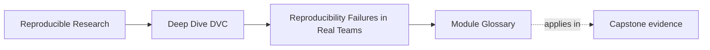
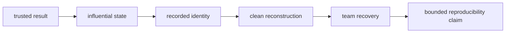

# Module Glossary

<!-- page-maps:start -->
## Page Maps

<!-- page-maps:end -->

Use this glossary when an early workflow claim sounds plausible but its
evidence boundary is unclear. The distinctions determine what a rerun, digest,
Git revision, DVC record, or recovery test can actually support.

## Claim and evidence terms

### Claim

A statement someone asks another person to trust.

Example: “Another maintainer can reconstruct this risk summary.”

The claim should name result, boundary, and expected evidence.

### Bounded claim

A claim limited to the conditions its evidence tests.

“Two runs in this prepared workspace produced equal JSON” is bounded.
“The whole workflow is reproducible everywhere” is not.

### Evidence

An observed fact relevant to a claim: file identity, command receipt, parameter
value, runtime record, clean rebuild, or recovery result.

Evidence does not carry its conclusion automatically. Equal outputs are
evidence of local repeatability, not scientific validity.

### Receipt

A durable record connecting an action to identities and result. A command
receipt may include invocation, status, runtime, inputs, and output digest.

A README command is an intended route. It becomes a receipt only when an
execution is recorded.

### Verified

Direct evidence supports the bounded claim.

### Contradicted

Direct evidence shows the claim is false. A current input digest different from
the recorded producing digest contradicts an identity match.

### Unverified

Required evidence has not been collected. The same-workspace case has no clean
rebuild receipt, so reconstruction is unverified.

### Unavailable

Required state is identified but cannot be obtained through the promised
boundary. This differs from an unknown identity.

### Out of scope

The route does not promise to answer the question. Scientific threshold
validity is out of scope for the workflow evidence audit.

### Proof limit

The boundary beyond which evidence does not support inference.

Example: a Python version record does not prove every dependency or hardware
influence.

### Closure evidence

The observation that changes a finding's result. For a missing clean rebuild,
closure requires the clean execution and matching verified output, not a prose
promise to run it later.

## Repeatability and reconstruction terms

### Local repeatability

The same operator can execute a workflow again in substantially the same
workspace and obtain the same bounded result.

It may inherit private data, environment, caches, and memory.

### Team reproducibility

Another authorized maintainer can obtain recorded state, reconstruct the
result outside the author's private workspace, and explain the match.

This is the operational definition used in this course; other disciplines may
use the term differently.

### Determinism

The property that equal effective inputs and execution assumptions produce
equal output. Determinism helps repeatability but does not supply missing
inputs or recovery.

### Clean reconstruction

Execution from a boundary that excludes unreviewed private workspace state and
uses recorded inputs, controls, implementation, and runtime evidence.

“Delete the output and rerun here” is not automatically clean.

### Independent execution

A reconstruction performed by another actor or shared system at the promised
team boundary. It tests transfer beyond the original operator.

### Mechanical reproducibility

The ability to identify and reconstruct workflow state and result. It makes
semantic and scientific review possible against stable evidence but does not
approve those concerns.

### Scientific validity

Whether the method, data, assumptions, and interpretation support the research
claim. DVC evidence can stabilize the objects under review; it does not decide
validity.

## State and influence terms

### Influential state

Any file, value, condition, decision, or prior state with the power to change
the trusted result.

### Hidden state

Influential state absent from the recorded contract. It may be stable and
deterministic while still hidden.

### Undeclared input

An influential file or value not represented in the workflow's input or
control boundary.

Examples include a prepared file, environment threshold, optional lookup, or
database snapshot.

### Control input

A value that chooses workflow behavior: threshold, seed, feature list, profile,
or parameter. Controls should have effective values and sources.

### Effective value

The value computation actually used after defaults and overrides. The value in
`params.json` is not effective if an environment variable replaces it.

### Manual transformation

A human-performed operation that changes state between source and result.
Manual work can be valid; reproducibility requires its behavior, authority, and
lineage to be represented.

### Runtime influence

An execution-context property that can change the result: language, package,
tool, locale, hardware, concurrency, or randomness.

### External state

Influential data or behavior owned outside the repository, such as a database
snapshot, API response, object version, or hosted model.

## Identity and recovery terms

### Path

A location or role name such as `data/current.csv`. A path can remain stable
while content changes.

### Content identity

Evidence distinguishing exact bytes, commonly a cryptographic digest or
content-addressed object identity.

### Role

How the workflow uses state: raw input, parameter, derived output, metric, or
promoted release.

### Provenance

The recorded connection from a result to the implementation, inputs, controls,
runtime evidence, and decisions that produced it.

### Reconstruction

Executing recorded computation to produce a result.

### Recovery

Obtaining required historical state after local absence or loss.

Reconstruction can fail with available data and an unknown runtime. Recovery
can fail with a perfect workflow and unavailable input bytes.

### Recoverability

The supported ability for an authorized maintainer to retrieve and verify
protected state through the promised boundary.

### Social memory

Workflow knowledge available mainly through people's recollection: the real
command, correct extract, manual filter, or location of historical data.

An interview can discover social memory. A contract and receipt must replace
it as the durable interface.

## Git, scripts, and DVC terms

### Source revision

A Git-identified state of tracked source, configuration, documentation, and
DVC metadata.

It does not automatically identify external artifact bytes unless the recorded
metadata connects them.

### Script behavior

The computation implemented by source code. A script can expose logic without
declaring all input roles, controls, output contracts, or execution evidence.

### Intended route

A documented command sequence describing how a workflow should run. It is not
evidence that a historical result used that route.

### Artifact boundary

The identity, storage, recovery, and retention boundary for data and derived
files that do not belong in ordinary source history.

### DVC metadata

Lightweight repository state connecting paths, pipeline declarations, or
recorded execution to artifact identities. Metadata without reachable objects
supports diagnosis but not materialization.

### DVC remote

A configured content storage boundary used for transfer and recovery. Its
existence does not by itself define access, retention, or recovery objectives.

### Pipeline declaration

A reviewed statement of commands, dependencies, parameters, and outputs.
Declarations can be incomplete; controlled invalidation tests challenge their
truthfulness.

### Recorded execution state

Observed input and output identities associated with a pipeline execution,
such as DVC lock state. It records what DVC observed under the declaration, not
every possible hidden influence.

### Adoption contract

The narrow claim a team chooses DVC to support first, with evidence,
acceptance route, adversarial test, owners, and proof limits.

## Workflow inventory terms

### Trusted result

An output used in a decision, review, publication, or downstream contract.
Trust role determines which evidence deserves protection.

### Evidence inventory

A present-state record of source inputs, controls, transformations, runtime,
outputs, reconstruction, recovery, owners, and unknowns.

### Evidence gap

A required identity, declaration, receipt, recovery route, or owner missing
from the current claim.

### Repair boundary

The smallest complete change that restores one affected contract.

Example: declare and test a threshold control rather than redesigning the whole
pipeline.

### Responsibility map

A record assigning one authority to each fact: Git source history, DVC artifact
identity, environment runtime, storage retention, domain validity, and
governance approval.

## Common distinctions

| Do not collapse | Distinction |
|---|---|
| local rerun and clean reconstruction | one inherits workspace; one starts from recorded boundary |
| repeatability and team reproducibility | one proves stability here; one proves transfer |
| determinism and reproducibility | stable behavior does not supply missing state |
| path and content identity | location can stay while bytes change |
| identity and recovery | knowing which bytes does not make them obtainable |
| script and workflow contract | behavior is not the full declared interface |
| README command and execution receipt | intention differs from observation |
| Git revision and result provenance | source state needs an explicit result connection |
| DVC metadata and remote object | reference differs from available content |
| clean rebuild and scientific validity | reconstruction does not approve method |
| unverified and contradicted | missing observation differs from observed mismatch |
| mechanical and semantic trust | stable state does not define correct meaning |

When a sentence overreaches, rewrite it with both sides of the relevant
distinction.
