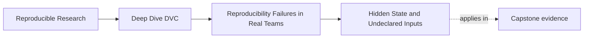
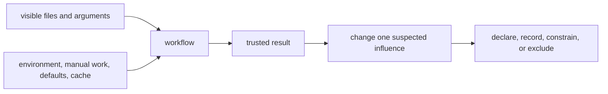
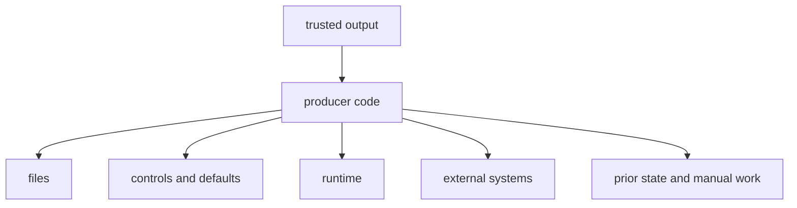

# Hidden State and Undeclared Inputs

<!-- page-maps:start -->
## Page Maps




<!-- page-maps:end -->

The visible script is not the workflow. The workflow is the set of influences
with the power to change the result.

Hidden state appears when one of those influences is absent from the recorded
contract. It may be perfectly stable on the author's machine. Hidden does not
mean random; it means unavailable to the evidence used to explain and rebuild
the result.

## Use a causal definition

Ask of a file, value, service, or condition:

> If this changed while the declared workflow stayed the same, could the
> trusted result change?

If yes, it is influential state. The team must decide whether to:

- declare it as an input or control;
- record its immutable identity;
- constrain it through an environment;
- verify it at execution;
- deliberately exclude its effect from the result contract.

Ignoring it is not a fifth strategy.

## Hidden state has several shapes

| Shape | Example | Why ordinary review misses it |
|---|---|---|
| content | `data/current.csv` contains new bytes | path and filename look unchanged |
| control | threshold entered in shell or notebook | value never reaches reviewed config |
| transformation | one-off filtering before the script | prepared file looks like a source |
| runtime | package, locale, hardware, thread count | environment is inherited |
| execution | notebook memory, cache, prior output | state survives between runs |
| discovery | unsorted directory or changing query | input set is assembled dynamically |
| external | API, database table, model download | remote system changes independently |
| human | manual approval, label correction, file selection | decision lives in conversation |

These categories overlap. The purpose is to widen the search, not force every
influence into one box.

## Reproduce a hidden control

The course specimen accepts a declared threshold:

```console
python score_incidents.py \
  --input observations.csv \
  --threshold 0.20 \
  --output risk-summary.json
```

It also accepts an environment value:

```console
RISK_THRESHOLD=0.20 python score_incidents.py \
  --input observations.csv \
  --output risk-summary.json
```

Both routes are deterministic. The second hides a result-changing control from
`params.json`.

Run the audit:

```console
make PROGRAM=reproducible-research/deep-dive-dvc \
  capstone-workflow-evidence-audit
```

Then inspect:

```console
jq '{
  local_repeatability,
  decision,
  failed_checks
}' artifacts/audit/reproducible-research/deep-dive-dvc/workflow-evidence/workspace/hidden-threshold/assessment.json
```

The local reruns match. `controls_are_declared` fails. Stability does not make
the control visible.

## Find hidden state from both directions

### Trace inward from the result

Choose one output the team trusts and ask:

- Which code wrote it?
- Which files did that code read?
- Which parameters and defaults affected branches?
- Which runtime libraries or tools affected computation?
- Which external calls supplied state?
- Which earlier manual actions prepared its inputs?

This traces provenance backward.

### Trace outward from suspected influences

Search code and execution routes for:

- environment reads;
- filesystem globs;
- hard-coded paths;
- network calls;
- current time;
- random generators;
- global configuration;
- cache reads;
- optional files;
- notebook state;
- prompts or manual choices.

Then ask which trusted outputs each influence can affect.



Using both directions reduces two errors: missing an influence and recording
irrelevant environment trivia.

## Probe instead of guessing

Static reading tells you what code appears to use. Controlled probes tell you
what changes observable behavior.

| Probe | Observation | Likely gap |
|---|---|---|
| change declared input bytes | output changes but workflow stays “unchanged” | input identity or dependency |
| unset environment variable | result changes or command fails | hidden control/runtime |
| run in empty directory | missing file appears | undeclared local dependency |
| clear cache | output or duration changes materially | cache is influential |
| reorder input files | result changes | discovery order |
| rerun notebook top-to-bottom | saved result changes | execution state |
| disconnect network | download or query appears | external dependency |
| alter timezone/locale | parsing or grouping changes | runtime assumption |

A probe does not automatically reveal the correct repair. It establishes an
influence worth representing.

## Paths conceal identity

`CHANGED_INPUT_SAME_PATH` adds a row to `observations.csv` after the result was
recorded. The name stays the same. Its SHA-256 digest changes.

The audit rejects the claim on `input_identity_matches`.

This distinction recurs throughout the course:

```text
path = current location
identity = which content
role = how the workflow uses it
recovery = where an authorized maintainer obtains it
```

A complete input record may need all four.

## Manual work is still workflow state

In `MANUAL_PREPROCESSING`, an operator removes one incident into
`prepared-observations.csv` and runs the scoring script on that file. The output
is repeatable. The transformation is not declared.

Weak repair:

> Save the prepared CSV somewhere.

Stronger repair:

- preserve raw input identity;
- represent the filtering rule as code or a documented decision;
- declare prepared output as derived state;
- record the edge from raw to prepared;
- test reconstruction from raw input.

The goal is not to eliminate human decisions. It is to make consequential
decisions attributable and reviewable.

## Not every influence needs the same treatment

Classify by effect and ownership:

| Influence | Treatment |
|---|---|
| changes result and team controls it | declare as input or parameter |
| changes result but external system controls it | record immutable snapshot or external identity |
| changes performance but not result contract | record for operations when relevant |
| changes logs only | exclude explicitly if trusted output is unaffected |
| sensitive value affects access, not result | record credential class, never secret |
| human approval changes release status | preserve decision record, not as a data dependency |

Tracking everything creates noise. Tracking too little creates unexplained
results. The result contract tells you what matters.

## Notebooks need an execution boundary

Notebook risks include:

- cells executed out of order;
- memory values with no visible producer;
- files edited between cells;
- parameters changed interactively;
- saved outputs from an older kernel;
- exploratory code treated as a production route.

A notebook can be part of reproducible work when the team defines:

- declared source inputs;
- clean execution order;
- parameter injection;
- environment;
- exported result contract;
- a route that runs without inherited kernel memory.

The issue is not the `.ipynb` extension. It is whether state transitions are
recoverable.

## External systems need snapshot semantics

“Read from the database” does not identify an input. Useful identities include:

- query text and transaction snapshot;
- table version;
- extraction timestamp under a stable append-only policy;
- object-store version ID;
- dataset release identifier;
- API response digest and request parameters.

The appropriate identity depends on what the source can guarantee. A timestamp
alone is weak when historical queries are not stable.

If the team cannot recover the source state, say so. An unavailable but
identified input is different from an unidentified input.

## Randomness is a contract decision

Recording a seed can help, but it is not a universal solution. Results may
still differ across libraries, hardware, parallel schedules, or algorithms.

Choose an honest contract:

- byte-identical output under a pinned runtime;
- equal deterministic summary;
- metric within a declared tolerance;
- stable distribution across repeated runs;
- exact promoted artifact identity even if retraining varies.

Then record the randomness and runtime evidence required by that contract.

## Write a hidden-state finding

Use evidence, effect, and repair:

> `score_incidents.py` can read `RISK_THRESHOLD`, but the workflow contract
> declares `params.json` as the control source. Two local runs agree because
> both inherited the same environment. A clean maintainer cannot explain the
> effective threshold from the reviewed files. Require the threshold as a
> declared parameter or record the external control identity, then repeat the
> clean rebuild.

Avoid:

> Environment variables are bad.

The first finding names the actual contract. The second creates a style rule
without causal evidence.

## Reader checkpoint

You can audit hidden state when you can:

- define an input by its power to affect the trusted result;
- search backward from outputs and outward from suspected influences;
- use controlled probes to confirm influence;
- distinguish path, identity, role, and recovery;
- represent manual transformations rather than hiding their origin;
- choose proportional treatment for files, controls, runtime, and human state;
- write a finding about the broken contract rather than the technology used.

Hidden state becomes manageable when the team replaces “what is usually here”
with observable identities, controls, and boundaries.
