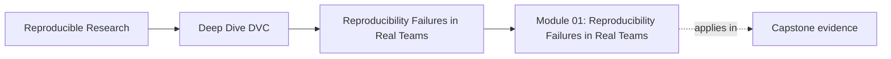
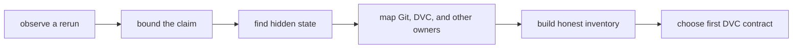

# Module 01: Reproducibility Failures in Real Teams

<!-- page-maps:start -->
## Page Maps




<!-- page-maps:end -->

This module begins before `dvc add` or `dvc repro`. Its job is to make the
current workflow explainable enough that tool adoption repairs a real evidence
gap.

You will investigate a workflow whose local result is identical in every case.
Only one case supports a team reproducibility claim. The rejected cases show
why hidden controls, changed content, manual transformations, runtime,
recovery, and stale implementation must be considered independently.

## Module question

> What does the current evidence prove, what still depends on private state,
> and which narrow responsibility should DVC own first?

If the answer is only “we need better versioning,” keep investigating.

## What you need before starting

You should be able to:

- run shell commands from the repository root;
- read a small JSON file;
- distinguish a file path from its contents;
- use Git at the level described in Module 00;
- create files under `artifacts/`.

You do not need prior DVC command experience. The module explains why the tool
is introduced before asking you to use its data and pipeline commands.

## Learning outcomes

By the end, you should be able to:

- state a local repeatability claim without overstating it;
- describe the transfer required by team reproducibility;
- find hidden state by causal influence;
- distinguish path, content identity, role, and recovery;
- explain what Git and scripts already preserve;
- identify the artifact and pipeline evidence DVC can add;
- keep runtime, data meaning, access, and approval outside DVC's authority;
- produce a workflow inventory with evidence results and proof limits;
- design one narrow DVC adoption contract.

## The executable contrast

The specimen scores five incident observations:

```text
observations.csv + threshold + score_incidents.py
    -> risk-summary.json
```

The audit constructs:

| Finding | Local reruns | Reproducibility decision | Isolated gap |
|---|---:|---|---|
| complete evidence | equal | accept | none |
| same-workspace rerun | equal | reject | no clean rebuild |
| hidden threshold | equal | reject | control source |
| changed input at same path | equal | reject | input identity |
| manual preprocessing | equal | reject | undeclared transformation input |
| missing runtime | equal | reject | runtime record |
| unrecoverable input | equal | reject | shared recovery |
| stale implementation | equal | reject | implementation identity |

This is not a survey. You will inspect the actual results, workflow records,
and assessments.

## Prepare the environment

From the repository root:

```console
make PROGRAM=reproducible-research/deep-dive-dvc \
  capstone-workflow-evidence-audit

make PROGRAM=reproducible-research/deep-dive-dvc \
  capstone-workflow-evidence-selftest
```

The evidence bundle is:

```text
artifacts/audit/reproducible-research/deep-dive-dvc/workflow-evidence/
```

Confirm that:

- eight findings exist;
- every `local_repeatability` value is `true`;
- only `COMPLETE_EVIDENCE` is accepted;
- every rejected case names one failed check.

If the route fails, preserve its error under `artifacts/` and use the capstone
README's install route. Do not continue by imagining the expected evidence.

## Serious-session route

Plan about four hours.

| Time | Study | Work product |
|---:|---|---|
| 25 min | overview and audit guide | bounded module question |
| 35 min | repeatability lesson | evidence ladder |
| 40 min | hidden-state lesson | influence inventory |
| 35 min | Git and scripts lesson | responsibility map |
| 35 min | DVC ownership lesson | first adoption boundary |
| 40 min | workflow inventory lesson | evidence matrix |
| 40 min | worked investigation | claim decision and repair |
| 50 min | exercises | ten-artifact learning packet |
| 20 min | answer review | corrected proof limits |

Pause after the first lesson if you cannot explain why all eight cases are
locally repeatable. Pause after the DVC lesson if your ownership map assigns
scientific approval or access policy to DVC.

## Reading route

| Page | Purpose | Keep open |
|---|---|---|
| [Repeatability Versus Reproducibility](repeatability-versus-reproducibility.md) | builds claim-sized definitions and an evidence ladder | audit report |
| [Hidden State and Undeclared Inputs](hidden-state-and-undeclared-inputs.md) | finds causal influences through tracing and probes | hidden, changed-input, and manual cases |
| [Why Git and Scripts Are Not Enough](why-git-and-scripts-are-not-enough.md) | preserves their strengths while identifying missing artifact and execution evidence | stale implementation case |
| [What DVC Does and Does Not Own](what-dvc-does-and-does-not-own.md) | maps gaps to fitting tool and system owners | all rejected cases |
| [The First Honest Workflow Inventory](the-first-honest-workflow-inventory.md) | turns observations and unknowns into an adoption boundary | complete and manual workflow records |
| [Worked Investigation: Rejecting a Repeatable Workflow Claim](worked-investigation-rejecting-a-repeatable-workflow.md) | investigates equal local outputs and a missing clean reconstruction | same-workspace case |
| [Exercises](exercises.md) | produces a cumulative workflow-foundations packet | full audit bundle |
| [Exercise Answers](exercise-answers.md) | models evidence-to-decision reasoning | your completed packet |
| [Glossary](glossary.md) | keeps early evidence terms distinct | use when claims blur |

Read in order on the first pass. Later, enter through the problem:

- “it runs twice” → repeatability;
- “we do something manually first” → hidden state;
- “everything is in Git” → Git and scripts;
- “DVC will make it reproducible” → DVC ownership;
- “where do we start?” → workflow inventory.

## How to read the audit

Begin with:

```console
jq '.findings[] | {
  finding,
  local_repeatability,
  decision,
  failed_checks
}' artifacts/audit/reproducible-research/deep-dive-dvc/workflow-evidence/report.json
```

For one case:

1. read `assessment.json`;
2. read `evidence/workflow-record.json`;
3. compare the two local results;
4. inspect only the source related to the failed check;
5. write the supported claim and proof limit;
6. inspect audit code last.

This order keeps the lesson focused on evidence rather than trusting a test
status you have not reconstructed.

## Evidence result language

Use:

| Result | Meaning |
|---|---|
| verified | direct evidence supports the bounded claim |
| contradicted | direct evidence shows the claim is false |
| unverified | required evidence was not collected |
| unavailable | state is identified but cannot be obtained |
| out of scope | the route does not promise to answer the question |

Examples:

- equal local outputs: verified;
- current input digest matching the recorded digest in the changed-input case:
  contradicted;
- clean reconstruction in the same-workspace case: unverified;
- recoverability in the unrecoverable-input case: unavailable by contract;
- scientific threshold validity: out of scope.

## The first workflow inventory

Your inventory should contain:

```text
trusted result and consumer
source inputs and identities
effective controls and sources
transformations, including manual work
runtime and external state
outputs classified by trust role
reconstruction route
recovery route
evidence gaps and consequence
repair and closure proof
first DVC adoption boundary
```

Do not turn it into a future architecture wishlist. Record present truth first.

## Choosing the first DVC contract

Fitting beginnings include:

### Input identity and recovery

> At a protected Git revision, DVC metadata identifies the observation bytes,
> and an authorized maintainer can retrieve them from the governed remote.

### Truthful scoring stage

> The scoring stage declares its input, implementation, threshold parameter,
> and result; changing any influential surface invalidates the result.

Choose one. Prove it with an adversarial test. Leave experiments, promotion,
deployment, and governance for their later modules.

## What this module proves

The local specimen proves:

- all cases can rerun consistently in prepared workspaces;
- one missing evidence premise is enough to reject a stronger claim;
- the modeled complete case can pass a clean reconstruction check;
- adversarial tests enforce the decision boundary.

It does not prove:

- scientific validity;
- complete environment portability;
- production recovery objectives;
- real organization access policy;
- that every hidden influence in another workflow has been found;
- readiness for promotion or deployment.

State these limits in your exercises.

## Common early mistakes

| Mistake | Better move |
|---|---|
| call any second run reproducibility | state local boundary and test transfer |
| inventory only visible files | trace causal influences from trusted output |
| call every unknown a failure | separate contradicted, unverified, unavailable |
| blame Git | preserve source authority and add artifact boundary |
| ask DVC to discover workflow truth | inventory before declaring stages |
| track prepared data as unexplained source | represent raw-to-derived transformation |
| treat remote existence as recovery | test empty-cache retrieval |
| solve all course concerns at once | choose one adoption contract |

## Completion standard

You have completed Module 1 when you can, without instructor help:

- run and navigate the workflow evidence audit;
- explain exactly what its matching local results prove;
- identify why each rejected case fails;
- write a hidden-state finding from causal evidence;
- map Git, DVC, runtime, storage, and domain responsibilities;
- inventory one trusted result from source through consumer;
- reject an overstatement without discarding verified evidence;
- design a narrow first DVC contract with acceptance, adversarial test, and
  proof limits;
- hand the reasoning to another maintainer.

The foundation is not a command. It is the ability to say what the current
workflow can defend before adding machinery.
