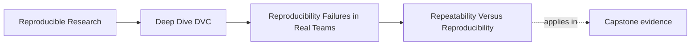
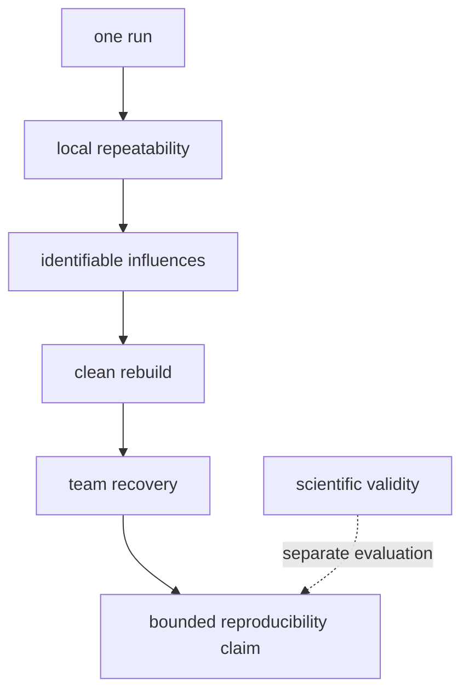

# Repeatability Versus Reproducibility

<!-- page-maps:start -->
## Page Maps




<!-- page-maps:end -->

“I ran it again and got the same result” is useful evidence. It is not the same
claim as “another maintainer can reconstruct this result later.”

The first is local repeatability. The second is team reproducibility. Confusing
them lets a private workspace, remembered command, or surviving data copy stand
in for an evidence system.

## Use claim-sized definitions

In this course:

**Local repeatability** means the current operator can execute the workflow
again in substantially the same workspace and obtain the same bounded result.

**Team reproducibility** means another authorized maintainer can obtain the
recorded inputs, implementation, controls, and runtime evidence, rebuild the
result outside the author's private workspace, and explain why it matches.

The words are used differently across scientific disciplines and standards.
Always state the operational claim instead of arguing from the label alone.

## The transfer is the real test

Compare the boundaries:

| Question | Local repeatability | Team reproducibility |
|---|---|---|
| who runs it? | usually the original operator | another authorized maintainer |
| where? | familiar workspace | clean reconstruction boundary |
| when? | while local state still exists | after time, turnover, or machine loss |
| inputs | whatever is currently present | recorded identities with recovery routes |
| controls | remembered or implicit values may survive | effective values are declared |
| runtime | inherited environment | bounded and recorded environment evidence |
| result claim | equal local output | explainable, recoverable output |

Reproducibility has to survive a transfer of knowledge and state. A second run
in the same directory does not cross that boundary.

## Run the eight-case contrast

From the repository root:

```console
make PROGRAM=reproducible-research/deep-dive-dvc \
  capstone-workflow-evidence-audit
```

Inspect the summary:

```console
jq '.findings[] | {
  finding,
  local_repeatability,
  decision,
  failed_checks
}' artifacts/audit/reproducible-research/deep-dive-dvc/workflow-evidence/report.json
```

Every case has `local_repeatability: true`. Only `COMPLETE_EVIDENCE` receives
`ACCEPT_REPRODUCIBILITY_CLAIM`.

That contrast is the lesson. Equal reruns can coexist with:

- no clean reconstruction;
- a hidden threshold;
- changed bytes behind the same filename;
- manual preprocessing absent from the workflow;
- no runtime identity;
- an input nobody else can recover;
- a result produced by an older implementation.

## Build an evidence ladder

Do not jump from “ran once” to “reproducible.” Increase the claim as evidence
grows.

| Evidence available | Honest claim |
|---|---|
| command exited successfully | this command produced a result once |
| two equal local outputs | this workspace is locally repeatable for this result |
| input and implementation identities | the main source state is identifiable |
| declared effective controls | result-changing choices are reviewable |
| runtime record | execution context is bounded |
| clean rebuild | recorded evidence can reconstruct the result now |
| shared input recovery | another maintainer can obtain protected state |
| independent execution receipt | the team boundary has exercised the route |

Each row depends on the rows above it. An independent run with an unidentified
dataset may show operational success, but not reconstruction of the claimed
historical result.



## Determinism is related but different

A deterministic program returns the same output for the same effective inputs
and runtime assumptions. Determinism helps repeatability, but it does not
guarantee reproducibility.

A deterministic script is irreproducible to the team when its input exists
only on one laptop.

A non-deterministic training workflow may still support a bounded
reproducibility claim if it records:

- randomness controls or distributional expectations;
- environment and hardware;
- acceptable output tolerance;
- repeated-run evidence;
- the exact promoted result.

Do not force every workflow into byte-for-byte equality when the real contract
is statistical. Do not use statistical behavior as an excuse to omit input and
runtime identity.

## Similar output is not the same result

Suppose two runs both report `accuracy: 0.91`. That value alone cannot show
they reconstructed the same result.

They may differ in:

- dataset population;
- split;
- label definition;
- threshold;
- metric implementation;
- source code;
- runtime;
- promoted artifact.

Reproducibility starts with identities and semantics, not numeric resemblance.
Later modules develop metric comparability and promotion in detail.

## Clean means outside private state

A clean reconstruction should not inherit unreviewed state from the original
workspace.

Weak “clean” test:

```text
delete output file -> rerun in same environment and cache
```

Stronger test:

```text
new directory
-> recorded source revision
-> declared controls
-> promised data recovery route
-> bounded runtime
-> executed workflow
-> result verification
```

The exact isolation depends on the claim. A container can still mount an
author's private data. A fresh Git clone can still use an undeclared global
package. Name what the boundary excludes.

## Diagnose failure without blame

When a teammate cannot rebuild a result, distinguish:

| Outcome | Meaning |
|---|---|
| contradicted | direct evidence shows an identity or result claim is false |
| unverified | a required observation was never collected |
| unavailable | identified state cannot be obtained through the promised route |
| out of scope | the workflow never promised this property |

“It failed for me” is the beginning of the investigation. Record which premise
failed.

Example:

> Both local result files match, but no clean rebuild receipt exists. The
> workflow is locally repeatable. Team reproducibility remains unverified.

That sentence is more accurate than either “works fine” or “completely broken.”

## Reproducibility does not prove validity

A perfectly reconstructed analysis can still:

- use biased data;
- ask the wrong question;
- leak evaluation information;
- apply an invalid metric;
- produce an unsafe decision.

Mechanical reproducibility makes those choices inspectable. It does not approve
them.

Keep separate review questions:

| Review | Question |
|---|---|
| mechanical | can we identify and rebuild the result? |
| semantic | do inputs, metrics, and outputs mean what the claim says? |
| scientific | is the method valid for the question? |
| operational | is the artifact safe and supported for consumers? |

DVC primarily strengthens the mechanical state story. Other review boundaries
remain necessary.

## A conversation that stays honest

When someone says:

> This workflow is reproducible because I reran it.

Respond with:

> The matching rerun establishes local repeatability. To test the team claim,
> let us reconstruct it from recorded input, implementation, control, runtime,
> and recovery evidence outside this workspace.

This response preserves the evidence they already produced and asks for the
next observation. It does not turn terminology into a personal correction.

## Reader checkpoint

You understand the distinction when you can:

- state a bounded local repeatability claim;
- describe the transfer required by team reproducibility;
- explain why equal output is weaker than equal result identity;
- separate determinism from reconstruction;
- design a clean boundary that excludes private state;
- increase a claim only as the evidence ladder grows;
- keep mechanical reproducibility separate from scientific validity.

Treat a local rerun as evidence, not as the end of the inquiry.
