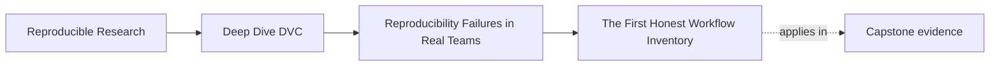
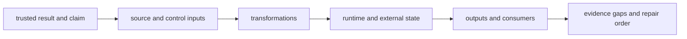
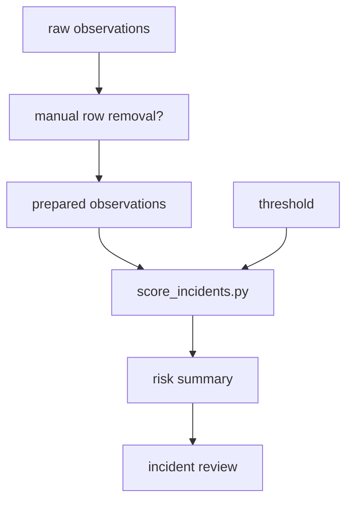

# The First Honest Workflow Inventory

<!-- page-maps:start -->
## Page Maps




<!-- page-maps:end -->

Before adopting DVC, describe the workflow that exists—not the workflow the
README suggests and not the workflow the team intends to build.

An honest inventory identifies the result people trust, traces the influences
that created it, marks which evidence is available, and separates observations
from assumptions. It gives tool adoption a concrete boundary.

## Begin with one trusted result

Do not inventory the whole repository at once. Choose one result used in a
decision:

- a metric in a report;
- a trained model;
- a cleaned dataset;
- a figure in a paper;
- a release bundle;
- an alert threshold.

Write:

```text
trusted result:
consumer:
decision supported:
current location:
current identity:
rebuild claim:
```

If nobody uses the output, it may not deserve the first reproducibility
investment. If several outputs support different decisions, inventory them
separately.

## Keep observations and assumptions apart

Use result words consistently:

| Result | Meaning |
|---|---|
| observed | direct file, command, receipt, or owner evidence |
| contradicted | direct evidence shows the current claim is false |
| unverified | required evidence is absent |
| unavailable | identity is known but state cannot be recovered |
| out of scope | the workflow does not promise this property |

Example:

> `observations.csv` exists at the documented path: observed.
>
> The file contains the same bytes used for last month's summary: unverified.
>
> Its recorded digest differs from the current file: contradicted.

An inventory that turns every unknown into “probably fine” becomes a
confidence document rather than evidence.

## Inventory source inputs

For each raw or external input, record:

| Field | Question |
|---|---|
| role | how does this input affect the result? |
| location | where does the workflow read it now? |
| identity | what distinguishes the exact content or snapshot? |
| origin | who or what produced it? |
| recovery | how does an authorized maintainer obtain it? |
| access owner | who controls permission? |
| retention | how long must this identity remain available? |
| evidence result | observed, contradicted, unverified, unavailable, out of scope |

Weak:

> Input is `data/final.csv`.

Useful:

> The scorer reads `data/final.csv`. Its path and current size are observed.
> No digest, source snapshot, or shared recovery route connects last month's
> result to exact bytes; historical input identity is unverified.

## Inventory control inputs

Controls choose behavior without necessarily supplying records:

- parameters;
- thresholds;
- seeds;
- feature lists;
- configuration profiles;
- command flags;
- defaults;
- environment values;
- manual choices.

Record:

| Control | Effective value | Source | Reviewed? | Historical evidence |
|---|---|---|---:|---|

The **effective value** matters. A config file can say `0.20` while an
environment override supplies `0.40`.

For the course specimen:

| Control | Effective value | Source | Reviewed? | Historical evidence |
|---|---:|---|---:|---|
| error-rate threshold | 0.20 | `params.json` | yes | workflow record |
| error-rate threshold in hidden case | 0.20 | `RISK_THRESHOLD` | no | command environment only |

Equal values do not make the second source declared.

## Inventory transformations

List every operation between source and trusted result:

| Transformation | Inputs | Outputs | Implementation | Invocation | Failure behavior |
|---|---|---|---|---|---|

Include:

- scripts;
- notebook sections;
- SQL queries;
- spreadsheet operations;
- manual filtering;
- copy or rename operations;
- format conversion;
- external service calls.

If a transformation is described as “we clean it,” expand it until another
maintainer can identify the input, operation, and output.



The question mark is an evidence gap, not a proposed future architecture.

## Inventory runtime and external state

Record only runtime facts with plausible power to change the trusted result:

- language and dependency environment;
- system tools;
- operating system or architecture;
- hardware or accelerator;
- locale and timezone;
- randomness and concurrency;
- external datasets or APIs;
- caches and global configuration;
- credentials class when access changes reachable state.

Use columns:

| Influence | Current evidence | Potential effect | Required treatment |
|---|---|---|---|

Do not store secrets in the inventory. Record that the workflow requires a
read-only research-data credential class, then point to the governed access
system.

## Inventory outputs by trust role

Not every generated file needs the same protection.

Classify:

| Role | Meaning | Typical treatment |
|---|---|---|
| disposable intermediate | can be regenerated and is not reviewed directly | declare producer/consumer edge |
| diagnostic | helps inspect a run but does not define the decision | retain as needed for review |
| trusted result | supports a scientific or business decision | identity, verification, provenance |
| promoted release | approved for downstream consumers | immutable bundle and decision record |
| operational log | supports runtime diagnosis | operational retention and access policy |

Ask who consumes each output and what they assume about it. A file becomes
important through a contract, not its extension.

## Inventory reconstruction and recovery separately

**Reconstruction** asks whether recorded workflow evidence can produce the
result.

**Recovery** asks whether required historical state can be obtained after local
loss.

| Question | Current evidence |
|---|---|
| can the command run again here? |  |
| can it run in a clean directory? |  |
| can another maintainer obtain input bytes? |  |
| can they obtain the required runtime? |  |
| can they verify the rebuilt result? |  |
| can a protected historical revision be restored? |  |

A pipeline declaration without reachable data fails recovery. A data backup
without the implementation and controls fails reconstruction.

## Record social memory explicitly

Ask maintainers:

- What command do you never type exactly as documented?
- Which file must already exist?
- Which result do people call “the real one”?
- Which parameter is usually changed?
- Who knows where historical data lives?
- Which failure can only one person repair?
- What do reviewers ask every time?

Translate answers into inventory entries.

Example:

> “Ask Leila which customer extract to use.”

Becomes:

> Input selection depends on one maintainer's memory. Dataset identity,
> selection rule, and recovery owner are unverified.

Do not preserve a person's name as the durable workflow interface. Preserve a
role and a decision route.

## Create an evidence matrix

For each influential surface:

| Surface | Identity | Declared role | Recovery | Verification | Owner | Result |
|---|---|---|---|---|---|---|
| raw input |  |  |  |  |  |  |
| parameters |  |  |  |  |  |  |
| implementation |  |  |  |  |  |  |
| runtime |  |  |  |  |  |  |  |
| trusted output |  |  |  |  |  |  |

Blank cells are useful. They show what the current workflow cannot defend.

## Use the audit as a worked inventory source

Build:

```console
make PROGRAM=reproducible-research/deep-dive-dvc \
  capstone-workflow-evidence-audit
```

Compare:

```text
workspace/complete-evidence/evidence/workflow-record.json
workspace/manual-preprocessing/evidence/workflow-record.json
```

The manual case lists `prepared-observations.csv` among influential files,
while the contract declares `observations.csv`. That is an inventory finding:

> The trusted summary consumes a manually prepared input whose transformation
> and raw-to-derived edge are absent from the declared workflow.

The audit does not tell you whether removing `INC-142` was scientifically
correct. It shows that the decision cannot be reconstructed from the contract.

## Rank gaps by trust consequence

Do not repair gaps by how easy they are to edit.

| Consequence | Example | Response |
|---|---|---|
| result identity unknown | current path may contain different bytes | block historical attribution |
| influential operation missing | manual filtering shapes result | represent transformation before comparison |
| state unavailable | input exists only on one machine | establish governed recovery |
| runtime unbounded | version differences can change output | record or constrain environment |
| output role unclear | team shares an arbitrary intermediate | define trusted result and consumer |
| cosmetic inconsistency | naming differs but claim remains clear | defer unless it causes misuse |

Protect the decision-bearing result first.

## Map gaps to repair boundaries

Complete:

| Gap | Smallest complete repair | DVC role | Other owner |
|---|---|---|---|
| path without content identity | track exact input state | strong | data owner |
| no shared artifact recovery | governed remote and clean pull | strong | storage/access |
| hidden threshold | declared parameter | strong supporting role | workflow maintainer |
| manual preprocessing | explicit transformation stage | strong supporting role | domain owner |
| missing runtime | environment record and clean execution | dependency input only | environment/CI |
| invalid label meaning | data-quality review | stable identity only | domain owner |

This table prevents “install DVC” from becoming the repair for every row.

## Inventory template

Store the completed packet under `artifacts/learning/` for the exercise, or in
the repository's governed documentation if it becomes a maintained contract:

```markdown
# Workflow inventory

## Trusted result and claim
Result, consumer, decision, current identity, rebuild claim.

## Source inputs
Role, identity, origin, recovery, access, retention, evidence result.

## Controls
Effective value, source, override order, historical evidence.

## Transformations
Input/output edges, implementation, invocation, failure behavior.

## Runtime and external state
Influence, evidence, effect, treatment.

## Outputs and consumers
Trust role, identity, verification, consumer.

## Reconstruction and recovery
Local rerun, clean rebuild, shared recovery, historical recovery.

## Evidence gaps
Observation, consequence, smallest repair, closure proof, owner.

## Adoption boundary
What DVC should own first and what remains elsewhere.
```

## Reader checkpoint

Your inventory is ready when:

- it begins with one trusted result and consumer decision;
- paths are not mistaken for content identities;
- effective controls include overrides and defaults;
- manual and external transformations appear;
- runtime evidence is proportional to the result contract;
- outputs are classified by trust role;
- reconstruction and recovery are evaluated separately;
- unknowns remain visibly unverified;
- each high-consequence gap has a repair, closure proof, and owner;
- the first DVC adoption boundary follows from evidence.

An honest inventory is not a confession of failure. It is the first artifact
another maintainer can use without inheriting the team's private memory.
