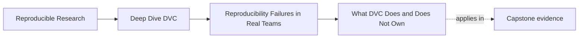
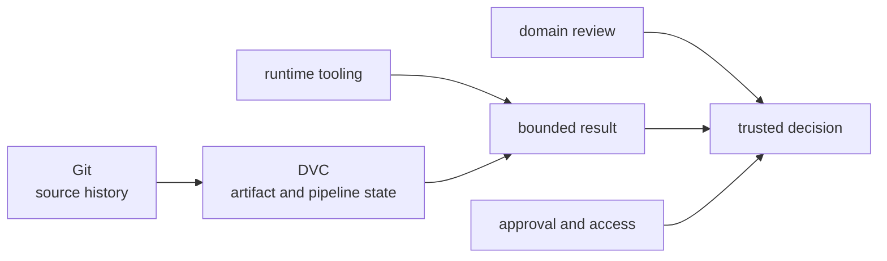
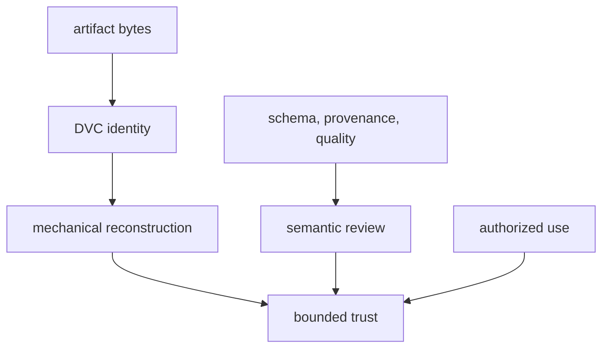

# What DVC Does and Does Not Own

<!-- page-maps:start -->
## Page Maps




<!-- page-maps:end -->

DVC is useful when the missing evidence concerns data and artifact identity,
declared computation, recorded pipeline state, comparison, or recovery. It does
not turn every unknown influence into a declared input and it does not approve
the meaning or use of a result.

Learn the boundary before the commands. Then every command has a reason.

## Start from responsibilities

DVC is designed to help with:

| Responsibility | What DVC contributes |
|---|---|
| artifact identity | connects a repository path to content-addressed state |
| large-file collaboration | stores lightweight metadata in Git while bytes live in a configured remote |
| pipeline declaration | records commands, dependencies, parameters, and outputs |
| recorded execution state | captures input and output identities in lock state |
| selective reconstruction | determines which stages are stale and materializes tracked state |
| experiment evidence | organizes parameter and metric records for comparison |
| artifact recovery | retrieves tracked content from a shared remote |

Each responsibility depends on honest configuration. DVC cannot identify a file
the workflow reads secretly or recover an object nobody pushed.

## DVC does not discover truth automatically

If a script reads:

```python
threshold = os.environ["RISK_THRESHOLD"]
```

but the stage declares only `params.json`, DVC sees the declaration, not the
author's intention. The stage contract is incomplete.

Likewise, DVC cannot infer:

- that a notebook was manually run before the pipeline;
- that `data/current.csv` came from a particular query;
- that an optional file changed the result;
- that the team treats one report as authoritative;
- that a model is scientifically valid.

The workflow inventory supplies the truth DVC should represent.

## Map the audit gaps to owners

The workflow evidence audit isolates seven rejected claims:

| Finding | Primary gap | DVC contribution | Other required owner |
|---|---|---|---|
| same-workspace rerun | no clean reconstruction | declared pipeline and reproducible materialization | CI or independent reviewer |
| hidden threshold | control absent from record | parameter dependency | maintainer must declare the control |
| changed input at same path | content identity | tracked artifact identity | source/data owner |
| manual preprocessing | missing transformation | explicit stage and output edge | maintainer/domain owner |
| missing runtime | environment identity | can depend on lock/image declaration | environment tool and CI |
| unrecoverable input | shared artifact bytes | remote push/pull | storage, access, retention owners |
| stale implementation | result provenance | lock state beside Git revision | Git and verification route |

DVC participates in most repairs. It is the sole owner of none of the broader
trust decisions.

## Artifact identity is not data meaning

Suppose DVC records the exact bytes of `observations.csv`. That supports:

> This repository state refers to this content.

It does not support:

- incident labels are correct;
- collection was unbiased;
- the data may legally be used;
- the dataset represents the target population;
- missing values were handled appropriately.



Mechanical evidence makes semantic review possible against a stable object. It
does not replace that review.

## A declared pipeline is not a complete runtime

`dvc.yaml` can name:

- command;
- source dependencies;
- parameter keys;
- outputs;
- metrics.

The command still executes inside a runtime. Environment evidence may come
from:

- a dependency lock;
- a Conda environment;
- a container image digest;
- Nix or another environment description;
- CI runner identity;
- external tool version receipts.

DVC can declare those files as dependencies and call the runtime. It does not
build a complete environment merely because a stage exists.

## A remote is not retention or authorization policy

A DVC remote gives the client a content storage boundary. It does not by itself
decide:

- who should have access;
- how credentials are issued;
- which revisions must be retained;
- when objects may be deleted;
- what recovery time is promised;
- which sensitive data may leave an environment.

Those responsibilities belong to storage, identity, security, and governance
owners. The DVC route must operate within their policies.

“`dvc push` succeeded” proves transfer. A recovery drill from an empty cache
tests whether the promised team boundary can retrieve the state.

## Experiments are not scientific approval

DVC can help record:

- changed parameters;
- resulting metrics;
- source revision;
- experiment names or identities.

The team still must decide:

- whether runs are semantically comparable;
- whether the metric is valid;
- whether the observed difference matters;
- whether the experiment should be retained;
- whether a candidate may be promoted.

Later modules build those decisions. In Module 1, remember that visibility is
not approval.

## Tracking an output does not make it a release

A model or report can be:

- a stage output;
- an experiment artifact;
- a reviewed candidate;
- a promoted release;
- a deployed runtime object.

These are different states. DVC can preserve artifact lineage through them.
Promotion, consumer contract, deployment, and runtime monitoring need their own
evidence and authorities.

Avoid:

> DVC tracks `model.json`, so it is production ready.

Use:

> DVC identifies the model and its pipeline lineage. Release verification and
> owner approval determine whether consumers may use it.

## DVC cannot repair an unknown workflow

A common adoption failure looks like:

1. run `dvc add` on a folder called `data/final`;
2. create stages around existing shell commands;
3. push outputs;
4. declare the workflow reproducible.

If the folder was created manually, controls remain hidden, and trusted outputs
are unknown, the new metadata formalizes an incomplete story.

Inventory first:

- source and derived inputs;
- controls;
- runtime;
- transformations;
- trusted outputs;
- recovery boundary;
- unresolved evidence.

Then choose what DVC should own.

## Introduce DVC around one contract

For a first adoption, choose a narrow pressure:

### Data identity pressure

Claim:

> `observations.csv` at this repository revision identifies exact bytes.

Evidence:

- DVC metadata in Git;
- content in a governed remote;
- clean pull receipt.

### Pipeline truth pressure

Claim:

> Changing the declared input or threshold invalidates the incident summary.

Evidence:

- stage dependencies and parameter declaration;
- lock state;
- controlled invalidation tests.

### Recovery pressure

Claim:

> An authorized maintainer can restore the protected result after local loss.

Evidence:

- protected Git revision;
- reachable remote objects;
- clean recovery and verification receipt.

Do not attempt data identity, experiments, release registry, production
deployment, and governance redesign in one first change.

## Decide whether DVC fits

| Situation | DVC fit | Reason |
|---|---|---|
| small inputs and outputs already versioned effectively in Git | optional | existing boundary may be sufficient |
| large data changes independently from source | strong | content-addressed artifact metadata complements Git |
| pipeline edges live in memory | strong after inventory | stages can declare relationships |
| external database cannot reproduce snapshots | partial | DVC can track extracts, not repair source semantics |
| runtime drifts | partial | declare environment evidence; use an environment tool |
| model decision is scientifically disputed | not the deciding tool | domain review owns validity |
| production rollout is unsafe | not the rollout owner | deployment system owns runtime change |
| shared artifacts cannot be recovered | strong with governed storage | remote routes support recovery |

“Partial” means DVC contributes evidence while another boundary remains
necessary.

## Read DVC files as claims

As you progress through the course:

- `.dvc` files claim a path-to-content relationship;
- `dvc.yaml` claims stage dependencies, controls, commands, and outputs;
- `dvc.lock` records observed state for an execution;
- `params.yaml` exposes reviewed controls;
- metric files expose comparison surfaces;
- remote configuration names a transfer boundary.

None should be trusted merely because it exists. Later modules test whether the
claims are truthful.

## An honest adoption statement

Prefer:

> We are introducing DVC to identify and recover the incident input, then to
> declare how the threshold and scoring implementation produce the summary.
> The environment lock, data-quality review, access policy, and release
> approval remain separate responsibilities.

Avoid:

> We added DVC, so the workflow is reproducible now.

The first statement gives reviewers a boundary and a way to find gaps.

## Reader checkpoint

You understand DVC's starting boundary when you can:

- name the artifact and pipeline responsibilities DVC supports;
- explain why declarations must be authored honestly;
- separate content identity from data meaning;
- connect a DVC stage to separate runtime evidence;
- distinguish remote transfer from access and retention policy;
- keep experiment visibility separate from scientific and release approval;
- choose one adoption contract based on actual workflow pressure;
- identify a small workflow for which DVC may be unnecessary.

DVC is strongest when the team can say exactly which mechanical evidence it
owns and which trust decisions remain elsewhere.
