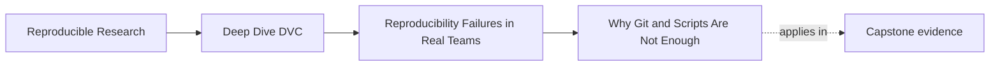
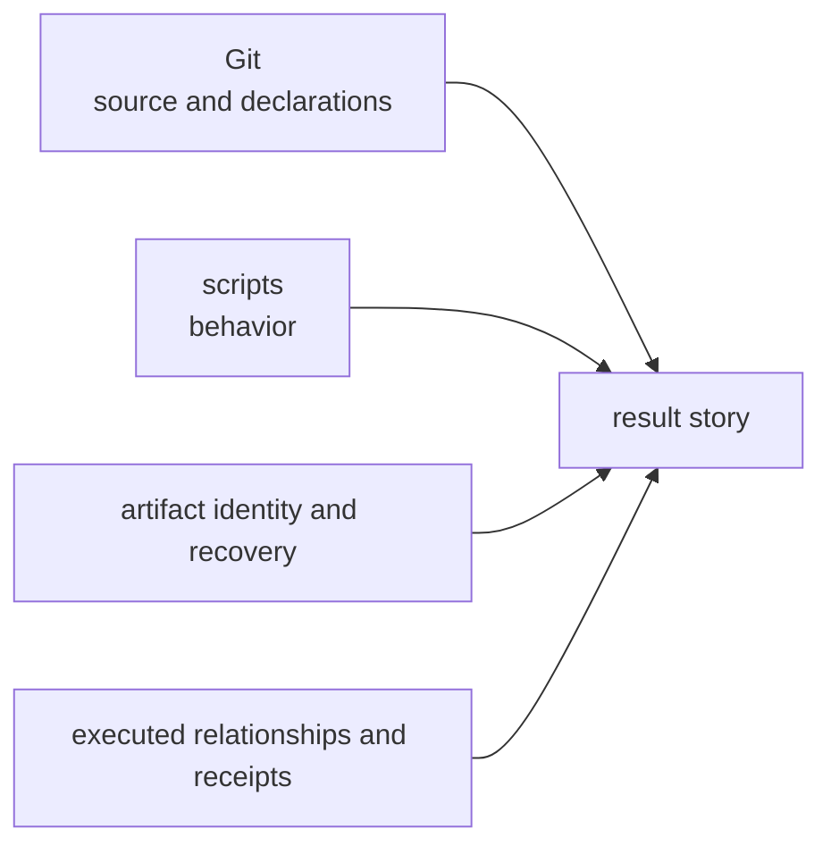
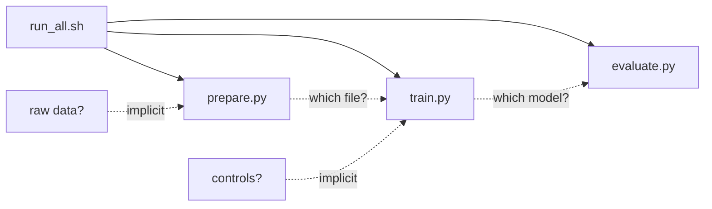
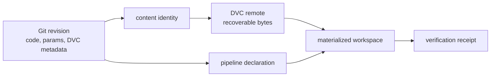

# Why Git and Scripts Are Not Enough

<!-- page-maps:start -->
## Page Maps




<!-- page-maps:end -->

Git and scripts are essential parts of a reproducible workflow. The failure
begins when a team asks them to prove claims they do not explicitly represent.

The right conclusion is not “Git is bad” or “scripts are obsolete.” It is:

> Source history and executable behavior are necessary evidence, but the
> result story also needs artifact identity, declared relationships, effective
> controls, execution receipts, and recovery.

## Start with what Git proves well

For tracked source, Git can answer:

- which revision contains this code and configuration;
- who changed a line and how revisions relate;
- what reviewers approved;
- which branch or tag names a repository state;
- whether a tracked file differs from that state.

That is powerful evidence. Preserve it.

Git can also store small data files. The limitation is not a magical rule that
“Git cannot version data.” The practical boundary appears when data and derived
artifacts are:

- large or numerous;
- regenerated frequently;
- unsuitable for ordinary source diffs;
- retained under different policies;
- shared through storage that is not the Git object database;
- sensitive or licensed under separate access controls.

The team needs a complementary artifact boundary rather than contempt for
source control.

## A Git revision is not automatically result provenance

Suppose a result sits beside `score_incidents.py` in a clean Git checkout.
Which revision produced it?

Possible answers:

- the current revision;
- an earlier revision whose output was copied forward;
- uncommitted code;
- current code with a different input;
- a script invoked with a hidden threshold.

Proximity does not establish provenance. The result needs a recorded connection
to the implementation, inputs, and controls that produced it.

`STALE_IMPLEMENTATION` demonstrates this:

```console
jq '{
  local_repeatability,
  decision,
  failed_checks
}' artifacts/audit/reproducible-research/deep-dive-dvc/workflow-evidence/workspace/stale-implementation/assessment.json
```

Both local result files match. The current script digest differs from the
recorded implementation digest. “The script is in Git” is true but incomplete.

## Scripts encode behavior, not necessarily a workflow contract

A script can contain correct computation and still leave these facts obscure:

- which files are official inputs;
- which optional files alter behavior;
- where parameter values originate;
- which outputs are trusted;
- which earlier transformation creates an input;
- when an output becomes stale;
- how to recover non-source artifacts.

Reading code may reveal some of these facts. Reconstructing them from control
flow is different from declaring them as a reviewable interface.

Example:

```python
threshold = float(os.getenv("RISK_THRESHOLD", "0.20"))
rows = load_csv("data/current.csv")
write_summary(rows, threshold)
```

The script reveals two dependencies to a careful reader. It still does not
record which input bytes or environment value produced a historical summary.

## Shell wrappers preserve order weakly

A `run_all.sh` can be a useful entry point:

```sh
python prepare.py
python train.py
python evaluate.py
```

It tells a reader an intended order. By itself it may not tell them:

- which outputs connect the commands;
- whether `train.py` also reads an undeclared local file;
- whether a command can be skipped safely;
- which parameter change invalidates which output;
- whether a failed command left a partial artifact;
- which outputs belong to this invocation;
- whether recovery can materialize prior state.

A linear command list is not yet a dependency graph or execution record.



The dotted questions are where social memory accumulates.

## README commands are guidance, not receipts

A README may correctly say:

```console
python score_incidents.py \
  --input observations.csv \
  --threshold 0.20 \
  --output risk-summary.json
```

That records an intended route. It does not prove:

- that this command produced a specific historical result;
- that the input still has the same bytes;
- that the environment matches;
- that the command exited successfully;
- that the output passed its contract.

Keep the README for teaching and entry. Add execution evidence for claims about
what actually happened.

## File paths solve naming, not identity

Git-plus-script workflows often rely on names such as:

```text
data/final.csv
models/best.pkl
reports/latest.json
```

These names communicate a role. They are dangerous when treated as immutable
identity.

Ask:

| Question | Path can answer? | Additional evidence |
|---|---:|---|
| where should the workflow read? | yes | role contract |
| which exact bytes were used? | no | content identity |
| which revision named those bytes? | not for external artifacts | pointer/provenance |
| can another maintainer obtain them? | no | recovery route |
| are they still the approved release? | no | promotion record |

DVC helps connect repository paths to content-addressed artifact state. Later
modules develop the mechanics.

## “Everything in Git” still leaves environment and execution

A tiny workflow may legitimately commit its data, source, parameters, and
expected result to Git. That can be a sound design.

It still needs an answer for:

- runtime and dependencies;
- execution order or graph;
- hidden controls;
- clean verification;
- result semantics;
- whether saved output belongs to the current revision.

DVC is not mandatory for every repository. Reproducibility evidence is.

## “DVC will fix it” is also too broad

Adding `.dvc` files while preserving manual preprocessing, hidden thresholds,
and an unknown runtime moves only one boundary.

Compare repairs:

| Gap | Fitting first repair |
|---|---|
| input bytes have no durable identity | artifact tracking such as DVC |
| input identified but unavailable to team | governed remote and recovery test |
| hidden threshold | declared parameter or recorded external control |
| manual preprocessing | explicit transformation contract |
| unknown environment | runtime lock, image, or verified environment record |
| stale output | dependency and verification route |
| invalid analysis | scientific review, not artifact tooling |

Tool adoption should follow the diagnosed contract.

## Git and DVC form a joined boundary

A DVC repository normally uses both:



Git preserves lightweight declarations and history. DVC metadata connects
paths to content identities and pipeline state. A remote supplies shared
artifact bytes. Verification checks the bounded claim.

If Git metadata is shared but DVC objects are not, collaboration is incomplete.
If objects exist without the correct Git revision, the intended workflow state
is unclear.

## Decide from workflow pressure

DVC becomes valuable when several of these are true:

- data or artifacts do not fit ordinary Git collaboration;
- paths are being mistaken for identity;
- pipeline edges live mainly in scripts or memory;
- teams need selective reruns from declared state;
- experiment parameters and metrics need structured comparison;
- protected results must be restored after workspace loss.

Do not manufacture those pressures to justify the tool. A small deterministic
analysis with committed inputs and a reliable environment may need only Git,
a build command, and tests.

## Audit the current division of labor

Create a table:

| Evidence need | Git | Script | DVC | Other owner | Gap |
|---|---|---|---|---|---|
| source revision | authoritative | references | records alongside metadata |  |  |
| input content identity | possible for committed file | reads path | suited for tracked artifact | external dataset registry |  |
| behavior | stores implementation | authoritative implementation | invokes stage command |  |  |
| runtime | stores lock/image declaration | runs inside it | can declare files as dependencies | environment tool |  |
| artifact recovery | source objects only | no | remote pull | storage policy |  |
| scientific validity | stores review text | implements method | no | domain review |  |

Do not force an entry in every tool column. Name one authority for each fact.

## Reader checkpoint

You understand the boundary when you can:

- defend Git's role in source history and review;
- explain why source proximity is not result provenance;
- distinguish script behavior from a declared workflow contract;
- treat README commands as intended routes rather than execution receipts;
- separate path, content identity, and recovery;
- choose a repair based on the evidence gap;
- describe how Git, DVC metadata, remote objects, and verification work
  together;
- recognize a workflow that does not need DVC.

The goal is not to replace Git and scripts. It is to stop asking them to carry
an artifact and execution contract that remains implicit.
