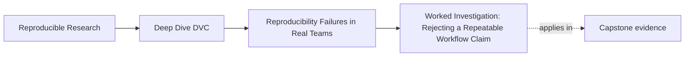
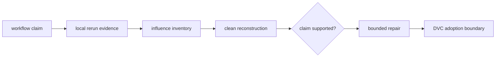
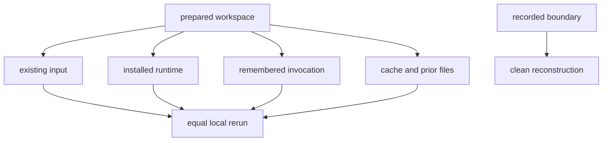

# Worked Investigation: Rejecting a Repeatable Workflow Claim

<!-- page-maps:start -->
## Page Maps




<!-- page-maps:end -->

A maintainer submits this review statement:

> The incident scoring workflow is reproducible. I ran it twice and both JSON
> files were identical.

The observation is true. The conclusion is too broad. We will reproduce the
equal reruns, inspect the result story, identify the missing evidence, reject
only the unsupported claim, and define the smallest repair.

## Establish what the workflow does

The specimen contains:

```text
workflow-evidence/
├── observations.csv
├── params.json
├── score_incidents.py
└── workflow-contract.json
```

`score_incidents.py` counts observations whose error rate meets a threshold.
The declared route is:

```console
python score_incidents.py \
  --input observations.csv \
  --threshold 0.20 \
  --output risk-summary.json
```

The expected result is:

```json
{
  "error_rate_threshold": 0.2,
  "high_risk_incidents": [
    "INC-117",
    "INC-129",
    "INC-155"
  ],
  "observation_count": 5
}
```

This is a mechanical workflow. The investigation does not judge whether
error-rate thresholding is a valid incident policy.

## Build the evidence packet

From the repository root:

```console
make PROGRAM=reproducible-research/deep-dive-dvc \
  capstone-workflow-evidence-audit
```

The bundle appears under:

```text
artifacts/audit/reproducible-research/deep-dive-dvc/workflow-evidence/
```

It contains eight workspaces. Begin with the report, not the audit code:

```console
jq '.findings[] | {
  finding,
  local_repeatability,
  decision,
  failed_checks
}' artifacts/audit/reproducible-research/deep-dive-dvc/workflow-evidence/report.json
```

Every `local_repeatability` value is `true`. Seven reproducibility claims are
still rejected.

## Reproduce the submitted observation

Open:

```text
workspace/same-workspace-rerun/evidence/local-run-a.json
workspace/same-workspace-rerun/evidence/local-run-b.json
```

Compare their digests:

```console
shasum -a 256 \
  artifacts/audit/reproducible-research/deep-dive-dvc/workflow-evidence/workspace/same-workspace-rerun/evidence/local-run-a.json \
  artifacts/audit/reproducible-research/deep-dive-dvc/workflow-evidence/workspace/same-workspace-rerun/evidence/local-run-b.json
```

The digests match. The maintainer has proved:

> Two executions in the prepared case workspace produced byte-identical JSON.

Preserve this as verified evidence. Do not weaken the investigation by
pretending the reruns disagree.

## Read the claim contract

Open:

```text
specimen/workflow-contract.json
```

The claim is stronger:

> A clean maintainer can rebuild and explain the incident risk summary from
> recorded evidence.

It requires:

- current input identity matches the recorded identity;
- implementation identity matches;
- controls are declared;
- every influential file is declared;
- runtime is recorded;
- clean rebuild matches;
- input is recoverable.

The claim includes transfer beyond the original prepared workspace.

## Locate the decisive evidence gap

Inspect:

```console
jq . \
  artifacts/audit/reproducible-research/deep-dive-dvc/workflow-evidence/workspace/same-workspace-rerun/assessment.json
```

The only failed check is:

```text
clean_rebuild_matches
```

The local run receipts exist. `clean-rebuild.json` does not.

We can now classify:

| Claim | Result | Reason |
|---|---|---|
| command ran successfully | verified | both command receipts have zero status |
| current workspace is locally repeatable | verified | local JSON files match |
| clean maintainer can reconstruct result | unverified | no clean rebuild receipt |
| workflow result is scientifically valid | out of scope | audit has no domain-validity contract |

The correct decision is not “workflow broken.” It is
`REJECT_REPRODUCIBILITY_CLAIM`.

## Explain why the local workspace is weaker

The same workspace may supply state the record does not:



The local equality shows those influences were stable across the two runs. It
does not show they were recorded.

## Write the finding

Use claim, evidence, gap, consequence, repair, and closure:

> **Claim:** Another maintainer can rebuild and explain the incident risk
> summary from recorded evidence.
>
> **Evidence:** `local-run-a.json` and `local-run-b.json` are identical, so the
> prepared workspace is locally repeatable. The assessment has no
> `clean-rebuild.json` and records `clean_rebuild_matches: false`.
>
> **Gap:** The workflow has not crossed a clean reconstruction boundary.
>
> **Consequence:** The team cannot distinguish sufficient recorded evidence
> from state inherited from the author's workspace.
>
> **Decision:** Reject the team reproducibility claim while retaining the
> verified local-repeatability result.
>
> **Repair:** Rebuild in a new directory from recorded source, input,
> parameters, runtime, and shared recovery routes.
>
> **Closure:** Attach the clean command receipt and matching verified result.

This finding tells the maintainer exactly what new observation changes the
decision.

## Compare with the accepted control

Inspect:

```console
jq '{
  decision,
  failed_checks,
  checks,
  evidence
}' artifacts/audit/reproducible-research/deep-dive-dvc/workflow-evidence/workspace/complete-evidence/assessment.json
```

`COMPLETE_EVIDENCE` includes the clean rebuild and passes every check. The
accepted case matters: the audit is not rejecting reproducibility on principle.
It defines a reachable evidence boundary.

## Test alternative failure explanations

The initial finding addresses only the clean-rebuild gap. Other cases show what
a clean run must inspect.

### Hidden threshold

```console
jq '{decision, failed_checks}' \
  artifacts/audit/reproducible-research/deep-dive-dvc/workflow-evidence/workspace/hidden-threshold/assessment.json
```

Both reruns inherit `RISK_THRESHOLD`. The missing premise is declared control,
not determinism. Repair it by moving the effective value into the reviewed
parameter surface or recording the external control as part of the contract.

### Changed bytes behind the same path

```console
jq '{decision, failed_checks}' \
  artifacts/audit/reproducible-research/deep-dive-dvc/workflow-evidence/workspace/changed-input-same-path/assessment.json
```

The result was created before `observations.csv` gained another row. A current
reader who sees only the filename can attribute the old result to new bytes.
Repair requires content identity and provenance.

### Manual preprocessing

```console
jq '{decision, failed_checks}' \
  artifacts/audit/reproducible-research/deep-dive-dvc/workflow-evidence/workspace/manual-preprocessing/assessment.json
```

The actual input is `prepared-observations.csv`; the contract declares
`observations.csv`. Saving the prepared file is insufficient. Represent the
raw-to-prepared transformation.

### Missing runtime

```console
jq '{decision, failed_checks}' \
  artifacts/audit/reproducible-research/deep-dive-dvc/workflow-evidence/workspace/missing-runtime/assessment.json
```

Input, code, and threshold identities pass. Execution context remains
unbounded. The fitting repair is an environment record and clean execution,
not another data copy.

### Unrecoverable input

```console
jq '{decision, failed_checks}' \
  artifacts/audit/reproducible-research/deep-dive-dvc/workflow-evidence/workspace/unrecoverable-input/assessment.json
```

The input identity is known, but another maintainer cannot obtain the bytes
through the promised boundary. This is where DVC remote recovery can contribute.

### Stale implementation

```console
jq '{decision, failed_checks}' \
  artifacts/audit/reproducible-research/deep-dive-dvc/workflow-evidence/workspace/stale-implementation/assessment.json
```

The saved result belongs to an earlier script identity. Git can preserve the
implementation revision; the result record must point to it.

## Create the workflow inventory

For the rejected same-workspace claim:

| Surface | Observation | Result | Repair boundary |
|---|---|---|---|
| trusted output | two matching risk summaries | verified locally | retain output verification |
| source input | current file and recorded digest exist | verified in this case | track identity durably |
| control | threshold comes from `params.json` | verified | declare parameter dependency |
| implementation | recorded and current digests agree | verified | connect to Git revision |
| runtime | Python identity recorded | verified for bounded specimen | use environment record in real workflow |
| clean rebuild | no receipt | unverified | execute outside prepared workspace |
| recovery | input marked recoverable | asserted in specimen | exercise shared pull in real workflow |

The inventory prevents one gap from turning into an unbounded redesign.

## Choose the first DVC adoption boundary

The audit reveals two pressures especially suited to DVC:

1. identify `observations.csv` by content rather than current path;
2. recover that content outside the author's workspace.

A narrow adoption claim:

> At each Git revision, DVC metadata identifies the incident input bytes, and
> an authorized maintainer can retrieve them from the governed remote.

Evidence needed:

- tracked metadata committed with source;
- remote object available;
- clean pull from empty cache;
- digest or DVC status confirming identity.

Do not claim yet that:

- the threshold is scientifically correct;
- the runtime is fully portable;
- the data is legally authorized;
- the result is a promoted release.

Those remain separate inventory rows.

## Define the next pipeline boundary

After input identity and recovery:

> The incident summary stage declares the scoring implementation, input,
> threshold parameter, and result.

Test it by changing one surface at a time:

| Change | Expected observation |
|---|---|
| input bytes | stage becomes stale |
| threshold | stage becomes stale |
| scoring implementation | stage becomes stale |
| unrelated README prose | stage remains unchanged |

This turns the causal inventory into a truthful stage contract.

## Keep the review note bounded

Final note:

> The scoring workspace is locally repeatable: two executions produced
> identical JSON. The submitted team reproducibility claim is unverified
> because no clean reconstruction receipt exists. The larger audit also shows
> that path-only input identity, hidden controls, manual preprocessing, runtime,
> recovery, and implementation provenance are independent premises. Introduce
> DVC first around incident-input identity and shared recovery, then declare the
> scoring stage from the completed inventory. Scientific threshold validity,
> access policy, and release approval remain outside that adoption claim.

This note respects both the working parts and the missing evidence.

## Inspect enforcement last

After reconstructing the decisions, inspect:

```text
capstone/scripts/audit_workflow_evidence.py
capstone/tests/test_workflow_evidence_audit.py
```

Run:

```console
make PROGRAM=reproducible-research/deep-dive-dvc \
  capstone-workflow-evidence-selftest
```

The tests require all eight cases to be locally repeatable and only the
complete evidence case to support the stronger claim.

## Reader checkpoint

You have completed the investigation when you can explain:

- exactly what the matching local files prove;
- why the clean reconstruction claim is still unverified;
- why hidden control, content identity, manual work, runtime, recovery, and
  implementation are independent premises;
- which evidence would close the initial finding;
- why input identity and recovery are fitting first DVC boundaries;
- which scientific, access, and release decisions remain outside DVC.

Rejecting an unsupported claim does not erase useful evidence. It replaces one
overstatement with a precise repair route.
