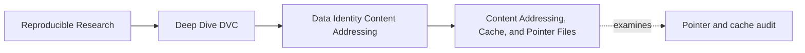
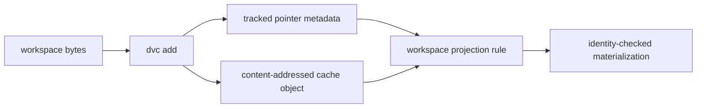
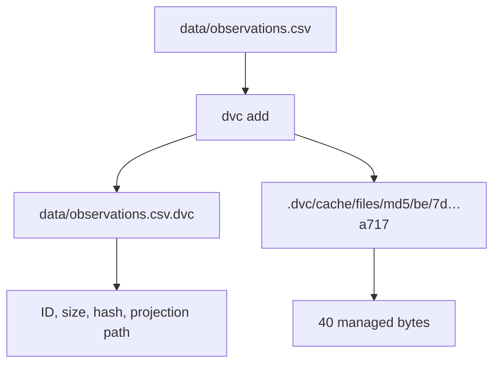
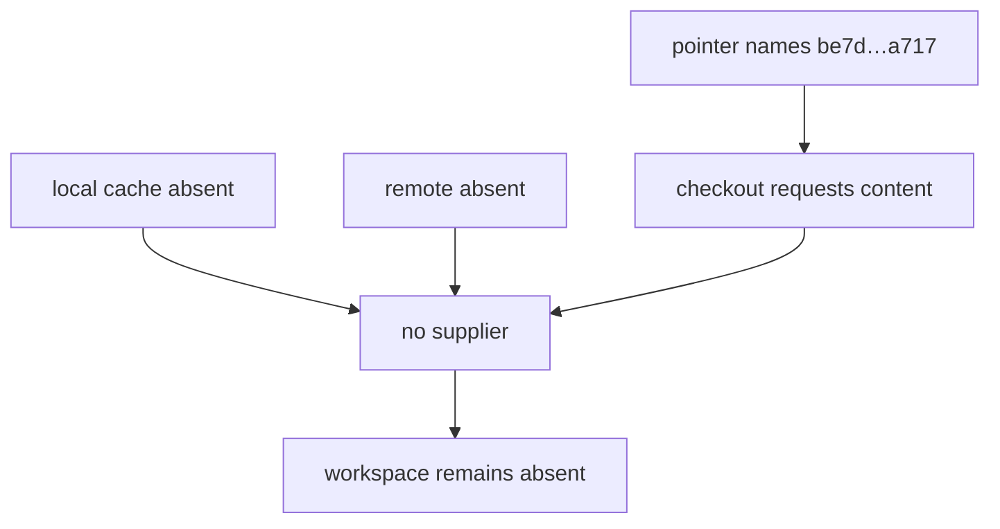

# Content Addressing, Cache, and Pointer Files

<!-- page-maps:start -->
## Page Maps




<!-- page-maps:end -->

Content addressing organizes managed data by what the bytes are rather than only by where
a user wants them projected. A DVC pointer connects that content identity to a workspace
path; the local cache holds the corresponding managed bytes when available.

The model has three distinct pieces:

| Piece | Role | Common overclaim |
| --- | --- | --- |
| pointer | records identity, size, hash type, projection path | pointer contains the data |
| cache object | stores managed content under content-derived address | cache is durable shared storage |
| workspace file | gives tools a familiar path | existing file proves recorded identity |

## Observe `dvc add` as a split

Run the data-identity audit:

```bash
make PROGRAM=reproducible-research/deep-dive-dvc capstone-data-identity-audit
audit=artifacts/audit/reproducible-research/deep-dive-dvc/data-identity
```

Inspect the baseline case:

```bash
case="$audit/workspace/pointer-cache"
cat "$case/data/observations.csv.dvc"
find "$case/.dvc/cache/files/md5" -type f
```

After `dvc add data/observations.csv`, the project has:



Git can track the small pointer. DVC can use its ID to find managed content. The workspace
path remains convenient for ordinary tools.

## Decode the cache address

The content ID:

```text
be7d1d8e728323219fd8315dcbfea717
```

becomes:

```text
.dvc/cache/files/md5/be/7d1d8e728323219fd8315dcbfea717
```

The leading two characters form a directory; the remainder forms the object filename.
This layout is implementation evidence for the audited DVC version, not a public API to
manipulate by hand.

Use DVC commands for normal operations. Direct cache inspection is appropriate here
because the lesson asks you to connect pointer identity with stored bytes.

## Verify pointer-to-cache agreement

```bash
jq '.findings[] |
  select(.finding == "POINTER_NAMES_CACHED_CONTENT")' "$audit/report.json"
```

The audit checks:

- the pointer contains a content ID;
- the named cache object exists;
- recorded size matches workspace size;
- independently calculated SHA-256 agrees for cache and workspace bytes.

A four-link proof:

```text
pointer ID -> cache address -> existing object -> equal bytes
```

If you inspect only the pointer, you prove recorded identity but not local availability.
If you inspect only the workspace, you prove current bytes exist but not that they match
recorded state.

## Understand deduplication without overpromising

The same-content case adds identical bytes at two paths. Both pointers name one content
identity.

```bash
jq '.findings[] |
  select(.finding == "SAME_BYTES_SHARE_IDENTITY")' "$audit/report.json"
```

Content-addressed storage can reuse one object identity for equal content. This supports:

- avoiding duplicate managed objects;
- detecting content changes independent of path;
- restoring several projections from matching content.

It does not prove:

- physical storage always uses exactly one copy;
- remote backends never duplicate data internally;
- directory handling is identical to single-file handling;
- hash collision risk is zero;
- equal bytes have equal scientific meaning in every context.

## Distinguish pointer validity from recoverability

The pointer-only case preserves:

```text
data/observations.csv.dvc
```

It removes:

- workspace file;
- local cache object;
- any configured remote recovery source.

Then:

```bash
jq '.findings[] |
  select(.finding == "POINTER_ONLY_IS_NOT_RECOVERABLE")' "$audit/report.json"
```

The pointer still names `be7d…a717`. Checkout fails because no accessible layer can supply
those bytes.



Metadata can survive loss and still be valuable diagnostic evidence. It is not a backup.

## Track pointer changes as data changes

When bytes change at the same path and `dvc add` runs again:

```text
before: be7d…a717
after:  dae5…00ae
```

The pointer diff is a review signal:

- dataset identity changed;
- a new cache object exists;
- dependent pipeline state may need reproduction;
- remote publication must include the new object if the change is shared.

Review the pointer with the data-change claim. Do not accept a changed digest as sufficient
explanation of why the dataset changed.

## Choose authority by question

| Question | Best evidence |
| --- | --- |
| which content was recorded? | pointer or lock identity |
| are those bytes in local managed storage? | named cache object plus digest comparison |
| where should tools see the data? | pointer path and workspace state |
| can another machine recover it? | configured remote and cache-cold pull |
| is it valid research data? | schema, provenance, and domain checks |
| should dependent results be trusted? | pipeline staleness and result evidence |

No layer is universally authoritative. Authority is claim-specific.

## Avoid manual cache mythology

Do not teach:

- editing cache objects directly;
- renaming cache files to simulate identity;
- copying unknown bytes into an expected cache path;
- treating `.dvc/cache` as a user-facing dataset directory;
- committing cache contents to Git by default.

Manual inspection can explain the model. Managed commands and verified receipts should
drive normal recovery.

## Review record template

```text
Recorded pointer:
Path, content ID, size, hash type.

Local materialization:
Workspace existence and independent digest.

Cache availability:
Named object existence and independent digest.

Remote availability:
Remote role, push/pull receipt, cache-cold evidence.

Meaning:
Schema, provenance, and claim checks outside byte identity.

Decision:
Which bounded identity or recovery claim is accepted or rejected?

Limits:
Which availability, durability, or scientific claims remain untested?
```

## Review checkpoint

You understand content addressing when you can:

- derive the cache address from the pointer ID;
- explain why pointer, cache, and workspace are separate;
- prove the cache object matches workspace bytes;
- explain same-content identity across paths;
- explain pointer changes at a stable path;
- reject pointer-only recovery without calling the pointer useless.

The durable model is:

> A pointer records which managed content should appear where; recoverability depends on
> at least one accessible layer actually holding those bytes.
