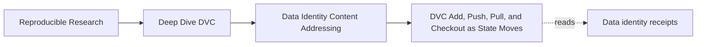
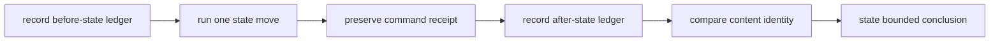
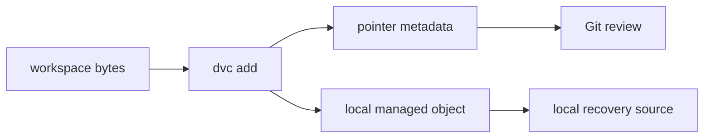
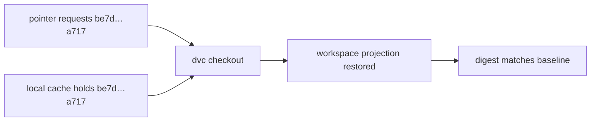

# DVC Add, Push, Pull, and Checkout as State Moves

<!-- page-maps:start -->
## Page Maps




<!-- page-maps:end -->

Command names are easier to remember when you understand which layer supplies which state.
A command receipt is useful only when paired with before-state, after-state, and identity
evidence.

| Command | Primary bounded move |
| --- | --- |
| `dvc add` | workspace bytes into managed local identity plus pointer metadata |
| `dvc push` | local cache objects into configured remote |
| `dvc pull` | remote objects into local cache and requested workspace projections |
| `dvc checkout` | available local cache objects into workspace projections |

These are models for the audited cases, not promises that every invocation moves every
possible object.

## Read `dvc add` as identity recording

Before:

```text
workspace: data/observations.csv
pointer: absent
cache object: absent
```

After:

```text
workspace: data/observations.csv
pointer: data/observations.csv.dvc
cache object: .dvc/cache/files/md5/be/7d…a717
```

The command:

```bash
dvc add data/observations.csv
```

creates an inspectable relationship among workspace bytes, pointer identity, and cache
object. It does not publish the object or validate scientific meaning.



## Read `dvc push` as remote publication

For the remote-recovery case:

```bash
cat "$audit/evidence/remote-recovery-push.stdout.txt"
```

A push receipt supports:

> The selected local cache object was transferred or already present in the configured
> remote according to this command.

Pair it with:

- pointer content ID;
- remote role and configuration;
- command exit status;
- later cache-cold recovery.

Push does not:

- repair a missing workspace projection;
- prove another identity has read authority;
- prove future retention;
- make untracked pointers visible in Git;
- publish unrelated objects automatically;
- validate the dataset.

## Read `dvc checkout` as local projection

The cache-recovery case deletes only the workspace file. The named cache object survives.

```bash
cat "$audit/evidence/cache-recovery-checkout.stdout.txt"
jq '.findings[] |
  select(.finding == "CACHE_RESTORES_WORKSPACE")' "$audit/report.json"
```

The proof requires:

- workspace absent before checkout;
- cache object present;
- checkout succeeds;
- workspace restored;
- restored SHA-256 matches source;
- pointer content ID unchanged.



Checkout does not prove remote durability because it can succeed entirely from local
cache.

## Read `dvc pull` as remote-backed local recovery

The remote-recovery case first pushes, then removes workspace and the named local cache
object.

```bash
cat "$audit/evidence/remote-recovery-pull.stdout.txt"
jq '.findings[] |
  select(
    .finding == "REMOTE_RESTORES_AFTER_CACHE_LOSS" or
    .finding == "REMOTE_RECOVERY_PRESERVES_IDENTITY"
  )' "$audit/report.json"
```

After pull:

- local cache is repopulated;
- workspace is restored;
- restored SHA-256 matches baseline;
- pointer content ID remains baseline identity.

The loss of the local supplier is what makes the remote causal for this recovery claim.

## Choose commands from the missing layer

| Current state | Goal | Appropriate move | Why |
| --- | --- | --- | --- |
| workspace bytes unmanaged | record identity | `dvc add` | creates pointer/cache relation |
| cache has recorded object; remote lacks it | publish shared content | `dvc push` | transfers managed object outward |
| pointer and cache exist; workspace absent | restore projection | `dvc checkout` | local supplier is sufficient |
| pointer exists; cache absent; remote has object | restore local content | `dvc pull` | remote repopulates local layers |
| pointer exists; cache and remote absent | recover bytes | none of these alone | no accessible supplier exists |

The last row is essential. A command vocabulary cannot create lost content.

## Use the narrowest command whose proof matches the claim

If the claim is “local cache can restore the workspace,” use checkout after removing only
the workspace.

If the claim is “remote survives local cache loss,” remove workspace and cache, then pull.

If the claim is “the object is published,” push and later test from an isolated reader.

Using pull when cache remains may succeed without proving remote supply, depending on
state and behavior. Design the before-state so alternative suppliers are absent.

## Preserve raw receipts and semantic checks

A state-move packet should include:

```text
claim.txt
before-state.tsv
pointer.yaml
command.stdout.txt
command.stderr.txt
command-exit.txt
after-state.tsv
workspace.sha256
cache.sha256
decision.md
```

The exact layout can follow repository convention. The invariant is that exit code,
materialization, and identity comparison are all visible.

## Interpret failure as bounded evidence

The pointer-only checkout returns `255`:

```bash
cat "$audit/evidence/pointer-only-checkout.stderr.txt"
jq '.findings[] |
  select(.finding == "POINTER_ONLY_IS_NOT_RECOVERABLE")' "$audit/report.json"
```

The failure is expected because:

- pointer survives;
- cache object is absent;
- remote supplier is absent;
- checkout cannot materialize bytes;
- workspace remains absent.

Do not translate the result as “checkout is broken.” Translate it as:

> Checkout cannot satisfy this pointer without accessible matching content.

## Avoid command substitutions

### “I ran add, so the team has the data”

Add records local managed state. Shared recovery still needs remote publication and
tracked pointer state.

### “I ran push, so my workspace is safe”

Push supplies remote durability for selected objects. Workspace recovery still requires
pointer, configuration, authorization, and verified pull or checkout.

### “Checkout worked, so the remote is healthy”

Checkout may use local cache only. Remove or isolate it before testing remote recovery.

### “Pull worked, so every project object is available”

The receipt covers requested state in that repository and time. It does not audit every
historical object.

### “The command exited zero, so recovery is exact”

Compare restored bytes with the recorded identity and claim-relevant semantics.

## Write a state-move explanation

A strong explanation:

> The pointer continued to name `be7d…a717`. Before pull, the workspace and named cache
> object were absent while the configured remote retained the published object. Pull
> returned zero, repopulated the cache, restored the workspace, and produced the baseline
> SHA-256. This supports remote recovery for the audited object at this time; it does not
> establish future retention or scientific validity.

It names:

- before-state;
- supplier;
- command;
- after-state;
- identity check;
- limit.

## Review checkpoint

You understand commands as state moves when you can:

- predict which layers change after each command;
- distinguish local checkout from remote pull;
- remove alternative suppliers before causal recovery tests;
- pair exit status with materialization and identity evidence;
- explain why pointer-only checkout must fail;
- choose a command from the missing layer rather than habit.

The durable question is:

> Which layer has the required bytes now, which layer should have them after the command,
> and what evidence proves the exact identity moved?
