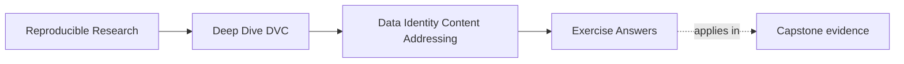

# Exercise Answers

<!-- page-maps:start -->
## Page Maps

<!-- page-maps:end -->

These answers are model explanations, not the only acceptable wording.

## How to use the answer page well

Do not read a model answer first and then collapse every trust question back into "the
repo" or "the data."

A better rhythm is:

1. finish the exercise with your own authority table and notes
2. write one plain-language explanation of the layer distinction
3. compare that explanation with the model answer
4. revise where the model answer exposes weaker layer naming, overclaiming, or missing
   recovery limits

What matters is whether the reasoning keeps identity, state layers, and recovery claims
separate.

Strong Module 02 answers usually do four things:

- they explain why paths are weaker than identity
- they keep pointer, cache, workspace, remote, and publish layers separate
- they describe commands as state moves instead of magical fixes
- they treat recovery as strong but bounded evidence

The strongest self-study packets also leave behind six concrete artifacts:

- one path-versus-identity explanation
- one pointer or cache inspection
- one authority table
- one state-move explanation
- one empty-cache recovery proof
- one state-authority diagram

If your answers rely only on "DVC tracks the data," the reasoning is still too thin.

## Answer 1: Explain why the path is too weak

What the path does tell you:

- where a file is expected to exist in the workspace right now

What it does not tell you:

- whether the bytes changed over time
- whether the same data exists at a different path elsewhere
- whether the path now points to a new export or overwrite

Why that matters:

- reproducibility needs an identity claim that survives rename, move, overwrite, and
  cross-machine transfer

The main lesson is that location is useful but weaker than identity. The path is still
useful as a workspace locator and consumer entry point, just not as the whole identity
story.

## Answer 2: Separate pointer, cache, and workspace

Strong explanation:

- the `.dvc` file records the tracked identity reference
- the cache stores the actual tracked content in DVC's local durable layer
- the workspace file is the local projection you see and use day to day

Why this matters:

- the pointer, cache, and workspace participate in one story, but they are not the same
  layer and should not be treated as interchangeable

Calling the pointer "the data" is misleading because the pointer is a reference to tracked
content, not the content itself.

## Answer 3: Name the authoritative layer

1. what did the pipeline actually record as executed?
   - recorded execution state, usually `dvc.lock`
2. what may a downstream reviewer safely trust?
   - published release state such as `publish/v1/`
3. what survives local cache loss?
   - remote-backed recovery durability
4. what files are visible in the working tree right now?
   - workspace state

The main lesson is to stop answering every question with "the repo." The same answer would
be wrong for a different question because visibility, recovery, publication, and recorded
execution are different kinds of authority.

## Answer 4: Explain the commands as state moves

Strong explanation:

- `dvc push`
  - moves tracked content from local cache into remote durability
- `dvc pull`
  - restores tracked content from remote into local cache
- `dvc checkout`
  - rebuilds the workspace from tracked content already available locally

What new trust they add:

- `push`
  - adds durable off-machine recovery
- `pull`
  - reestablishes local durable state
- `checkout`
  - realigns the workspace, but does not by itself prove remote durability

The command that helps recovery most directly is `dvc pull`. The command that does not
prove durability by itself is `dvc checkout`, because it may succeed entirely from local
state.

## Answer 5: Diagnose a recovery claim

What the success does prove:

- tracked content was recoverable and the workspace could be rebuilt

What it does not prove yet:

- that the full published release contract and the whole repository story are identical
- that every possible internal or semantic question is settled

What the team may be confusing:

- remote-backed recovery durability with downstream release trust or full repository
  meaning

The main lesson is that recovery is strong evidence, but still a bounded kind of evidence.
That bounded proof is still valuable because it answers one important recovery question
cleanly without pretending to answer every other trust question too.

## Answer 6: Inspect a pointer by hand

The `.dvc` file is small Git-tracked metadata. Its hash identifies content stored under
the cache layout, while the size supports integrity checks. The workspace file is a
materialized copy or link. None of these locations alone should be confused with the whole
recovery contract.

If only the pointer survived, what would still be missing is accessible content storage.
Metadata can name the object honestly and still fail to provide the bytes.

## Answer 7: Prove checkout changes workspace state

Git changes the pointer revision. `dvc checkout` then materializes the content named by
that pointer from available cache state. The cache may retain both versions, while only
one appears at the workspace path. This is why path equality is weaker than content
identity.

Workspace state and cache state are not interchangeable because the cache can preserve
multiple tracked versions while the workspace exposes only the currently materialized one.

## Answer 8: Test a remote from an empty cache

Strong evidence begins from a genuinely empty local cache, runs `dvc pull`, and compares
the recovered checksum or DVC status with the source revision. A successful recovery
proves more than a push command that happened to exit zero.

What this proves about the remote is that it held the required tracked object for the
recovery route you tested. What it does not prove is that every published artifact or
workflow interpretation boundary is now automatically correct.

## Answer 9: Diagnose a missing-object failure

The pointer can still name a valid object even when no accessible storage currently
contains it. The failure is availability, not necessarily metadata corruption. Repair
means restoring the object from a durable copy or revising an invalid recovery claim.

The recovery claim that has now failed is the claim that the tracked object is actually
recoverable from the currently available storage layers.

## Answer 10: Draw a state-authority diagram

A sound diagram distinguishes `dvc add`, `push`, `pull`, and `checkout`. Git governs
pointer history; the cache accelerates local materialization; the remote supports shared
recovery; published bundles serve consumers. Authority must be stated explicitly rather
than inferred from whichever copy is nearby.

Downstream trust usually begins at the published bundle or another declared consumer
boundary, not merely at the existence of tracked content in cache. The node many teams
overtrust is often the workspace, because it is the most visible layer even though it is
only one local materialization.

## Self-check

If your answers consistently explain:

- why paths are weaker than identity
- how pointer, cache, workspace, remote, and publish layers differ
- what each major DVC command really moves
- what recovery proves and what it does not

then you are using Module 02 correctly.
