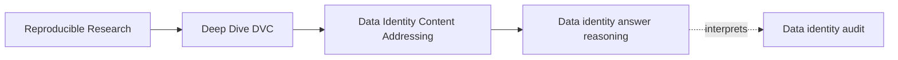
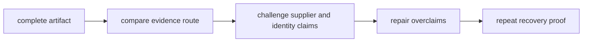
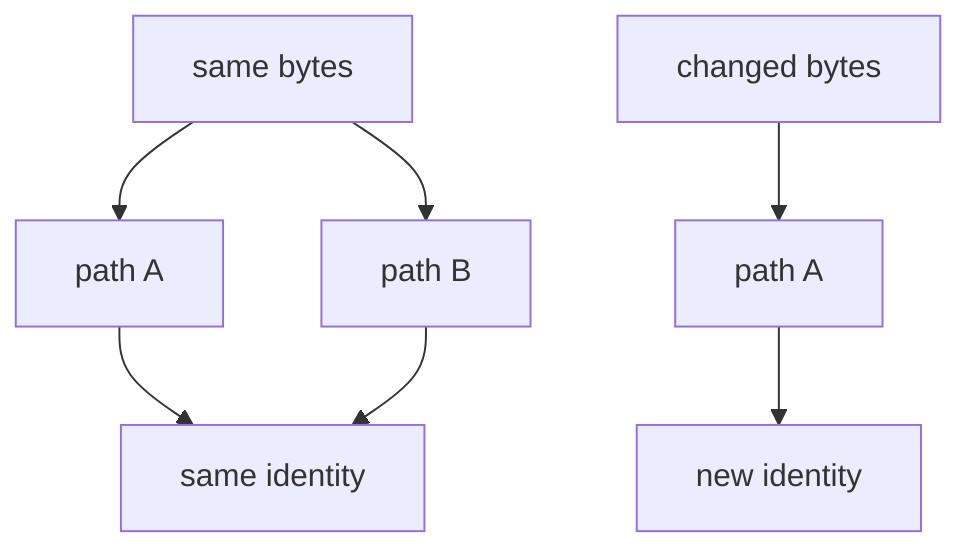

# Exercise Answers

<!-- page-maps:start -->
## Page Maps




<!-- page-maps:end -->

These answers model reasoning. Compare your claim boundaries, evidence, and limits rather
than copying wording.

## Answer: Bound the data identity claim

A suitable claim:

> The pointer records baseline content ID `be7d…a717`, size 40, and workspace projection
> `observations.csv`. The named cache object and workspace independently share SHA-256
> `9771…2fb4`. Paired contrasts show identity follows bytes rather than path. Recovery
> claims additionally require an accessible supplier and verified materialization.

Model distinctions:

| Question | Evidence | Limit |
| --- | --- | --- |
| which bytes recorded? | pointer ID and size | does not prove availability |
| where projected? | pointer path | does not identify bytes |
| locally available? | named cache object plus digest | not shared durability |
| remotely recoverable? | cache-cold pull after local loss | time/object bounded |
| scientifically suitable? | schema, provenance, domain checks | not proved by digest |

Unsupported claims include universal remote completeness, future retention, scientific
validity, and identical runtime interpretation.

## Answer: Trace a pointer to matching bytes

Model trace:

| Surface | Value | Evidence role |
| --- | --- | --- |
| pointer path | `observations.csv` | projection location |
| hash type | `md5` | DVC addressing scheme in specimen |
| content ID | `be7d1d8e728323219fd8315dcbfea717` | managed identity |
| size | `40` | recorded size check |
| cache path | `.dvc/cache/files/md5/be/7d1d8e728323219fd8315dcbfea717` | local object address |
| workspace SHA-256 | `977190…12fb4` | independent byte evidence |
| cache SHA-256 | `977190…12fb4` | independent equality evidence |

The content ID splits after two characters to form the cache path. DVC's MD5 locates its
managed object; the audit's SHA-256 independently compares workspace and cache bytes.

The proof is not simply “hashes exist.” It joins pointer ID, derived address, object
existence, size, and byte equality.

## Answer: Disprove path-based identity

The same-content contrast changes location while holding bytes fixed:

```text
data/observations.csv -> be7d…a717
archive/renamed.csv   -> be7d…a717
```

Inference: different paths do not require different content identity.

The changed-content contrast holds location fixed while changing bytes:

```text
data/observations.csv: be7d…a717 -> dae5…00ae
```

Inference: stable path does not preserve content identity after byte change.

Together:



Neither contrast proves semantic equivalence across different dataset roles. Equal bytes
can be used under different claims.

## Answer: Build a state-layer ledger

Model ledger:

| Moment | Pointer | Workspace | Cache | Remote | Supplier | Decision |
| --- | --- | --- | --- | --- | --- | --- |
| baseline after add | present | present | present | not configured | cache | local identity recorded |
| cache case before checkout | present | absent | present | not needed | cache | recoverable |
| cache case after checkout | present | present | present | not needed | cache | local recovery accepted |
| remote case after push | present | present | present | present | cache/remote | remote published |
| remote case after loss | present | absent | absent | present | remote | recoverable |
| remote case after pull | present | present | present | present | remote | remote recovery accepted |
| pointer-only before checkout | present | absent | absent | not configured | none | unrecoverable |
| pointer-only after checkout | present | absent | absent | not configured | none | rejection confirmed |

The ledger prevents pointer presence from being mistaken for supplier availability.

## Answer: Interpret commands as state moves

Model:

| Command | Before | After | Required verification |
| --- | --- | --- | --- |
| add | unmanaged workspace bytes | pointer plus local cache object | pointer/cache/workspace agreement |
| push | cache object present, remote not yet evidenced | selected object remotely published | receipt plus later clean read |
| checkout | pointer/cache present, workspace absent | workspace projected | restored digest and identity |
| pull | pointer present, local cache/workspace absent, remote supplied | cache and workspace restored | supplier isolation and digest |

Command choice:

- unmanaged workspace: add;
- workspace absent, cache present: checkout;
- workspace/cache absent, remote present: pull;
- pointer only, no supplier: no command can recreate the bytes.

Exit zero is command evidence. Recovery requires after-state and identity comparison.

## Answer: Prove cache-only recovery

Model argument:

> The pointer retained baseline ID `be7d…a717`. Before checkout, the workspace projection
> was absent and the named cache object remained. Checkout succeeded, recreated the
> workspace, preserved pointer identity, and produced baseline SHA-256. Accept local cache
> recovery for this object.

Why it is causal:

- workspace supplier absent;
- cache supplier present;
- remote not needed;
- restored identity matches.

Limit:

> This does not prove remote availability, cross-machine recovery, future cache retention,
> or data validity.

## Answer: Prove remote recovery after local loss

Model argument:

> Push supplied baseline object `be7d…a717` to the isolated remote. The audit then removed
> both workspace and named local cache object. Pull repopulated the cache and workspace.
> Recovered content ID equals baseline, and independent SHA-256 equals `9771…2fb4`.
> Accept bounded remote recovery for this object and audit time.

Removing local cache rules out it as supplier. That makes the remote necessary in the
tested route.

Not proved:

- other objects exist;
- other users are authorized;
- future retention;
- remote disaster recovery;
- scientific suitability.

## Answer: Defend negative recovery evidence

Model:

**Survives**

- pointer path, content ID, size, and hash type.

**Absent**

- workspace projection;
- matching local cache object;
- configured remote supplier.

**Intervention**

- checkout returns `255`;
- stderr identifies unavailable cache-backed content.

**After**

- workspace remains absent;
- cache remains absent.

The audit result is `PASS` because every expected negative check succeeded. The recovery
decision is `REJECT` because metadata alone cannot materialize content.

Useful searches include trusted teammate caches, governed remotes, archives, and published
bundles by exact identity. If no trustworthy matching copy exists, record original
identity as unrecoverable. Recollected data is a new identity.

## Answer: Design a recovery manifest

Model shape:

```json
{
  "schema": "data-recovery-manifest/v1",
  "recovery_id": "example-recovery-identity",
  "git_commit": "example-git-sha",
  "required": {
    "pointer": "data/observations.csv.dvc",
    "content_id": "be7d1d8e728323219fd8315dcbfea717",
    "hash_type": "md5",
    "size": 40,
    "baseline_sha256": "977190e4a0791b539f5eb50abc726b8d00195c0f4a0c2b39acfdd92d41512fb4"
  },
  "loss": {
    "workspace": "absent",
    "local_cache": "absent"
  },
  "supplier": {
    "type": "dvc_remote",
    "role": "recovery"
  },
  "receipts": {
    "state_move": "example-pull-receipt",
    "cache_identity": "example-cache-check",
    "workspace_identity": "example-workspace-check",
    "semantic_validation": "example-schema-check"
  },
  "decision": "ACCEPT_BOUNDED_RECOVERY",
  "limits": [
    "future retention not established",
    "scientific validity reviewed separately"
  ],
  "started_at": "2030-01-01T12:00:00Z",
  "completed_at": "2030-01-01T12:02:00Z",
  "verifier": "recovery-policy-identity"
}
```

The recovery ID joins one loss, supplier, move, and verification. The manifest records a
remote role rather than credentials.

## Answer: Assemble an independent identity review

A strong opening:

> This packet distinguishes workspace location, recorded content identity, and supplier
> availability. Paired contrasts show identity follows bytes. Cache and remote cases
> isolate two recovery suppliers. Pointer-only failure proves metadata cannot replace
> missing content.

Artifact purposes:

| Artifact | Purpose |
| --- | --- |
| `identity-claim.md` | bounds identity and meaning |
| `pointer-trace.tsv` | connects metadata to bytes |
| `path-contrasts.md` | disproves locator identity |
| `state-ledger.tsv` | records surviving layers |
| `command-receipts.md` | explains bounded moves |
| `cache-recovery.md` | proves local supplier |
| `remote-recovery.md` | proves remote supplier |
| `negative-recovery.md` | preserves rejected claim |
| `recovery-manifest.json` | joins recovery evidence |

Unresolved risks:

- remote retention and access policy;
- integrity for unaudited objects;
- schema/provenance coverage;
- dependent result currency;
- published bundle completeness;
- runtime interpretation.

Verification:

```bash
make PROGRAM=reproducible-research/deep-dive-dvc capstone-data-identity-audit
make PROGRAM=reproducible-research/deep-dive-dvc capstone-data-identity-selftest
jq empty artifacts/learning/deep-dive-dvc/data-identity/recovery-manifest.json
```

## Self-review standard

Your packet should distinguish:

- locator from identity;
- pointer metadata from content;
- workspace projection from cache object;
- local cache from shared remote;
- command success from verified state move;
- identity recovery from semantic validity;
- current remote availability from retention;
- audit `PASS` from recovery `ACCEPT`.

Those distinctions are the practical skill of Module 02.
