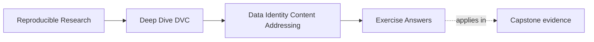
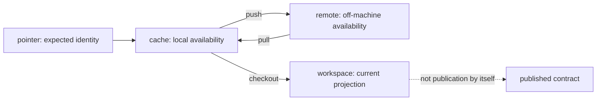

# Exercise Answers

<!-- page-maps:start -->
## Page Maps

<!-- page-maps:end -->

These answers are model explanations, not the only acceptable wording.

## How to use the answer page well

Do not read a model answer first and then collapse every trust question back into "the
repo" or "the data."

A better rhythm is:

1. finish the exercise with your own authority table and notes
2. write one plain-language explanation of the layer distinction
3. compare that explanation with the model answer
4. revise where the model answer exposes weaker layer naming, overclaiming, or missing
   recovery limits

What matters is whether the reasoning keeps identity, state layers, and recovery claims
separate.

Strong Module 02 answers usually do four things:

- they explain why paths are weaker than identity
- they keep pointer, cache, workspace, remote, and publish layers separate
- they describe commands as state moves instead of magical fixes
- they treat recovery as strong but bounded evidence

The strongest self-study packets also leave behind six concrete artifacts:

- one path-versus-identity explanation
- one pointer or cache inspection
- one authority table
- one state-move explanation
- one empty-cache recovery proof
- one state-authority diagram

If your answers rely only on "DVC tracks the data," the reasoning is still too thin.

## Answer 1: Explain why the path is too weak

What the path does tell you:

- where a file is expected to exist in the workspace right now

What it does not tell you:

- whether the bytes changed over time
- whether the same data exists at a different path elsewhere
- whether the path now points to a new export or overwrite

Why that matters:

- reproducibility needs an identity claim that survives rename, move, overwrite, and
  cross-machine transfer

The main lesson is that location is useful but weaker than identity. The path is still
useful as a workspace locator and consumer entry point, just not as the whole identity
story.

## Answer 2: Separate pointer, cache, and workspace

Strong explanation:

- the `.dvc` file records the tracked identity reference
- the cache stores the actual tracked content in DVC's local durable layer
- the workspace file is the local projection you see and use day to day

Why this matters:

- the pointer, cache, and workspace participate in one story, but they are not the same
  layer and should not be treated as interchangeable

Calling the pointer "the data" is misleading because the pointer is a reference to tracked
content, not the content itself.

## Answer 3: Name the authoritative layer

1. what did the pipeline actually record as executed?
   - recorded execution state, usually `dvc.lock`
2. what may a downstream reviewer safely trust?
   - published release state such as `publish/v1/`
3. what survives local cache loss?
   - remote-backed recovery durability
4. what files are visible in the working tree right now?
   - workspace state

The main lesson is to stop answering every question with "the repo." The same answer would
be wrong for a different question because visibility, recovery, publication, and recorded
execution are different kinds of authority.

## Answer 4: Explain the commands as state moves

Strong explanation:

- `dvc push`
  - moves tracked content from local cache into remote durability
- `dvc pull`
  - restores tracked content from remote into local cache
- `dvc checkout`
  - rebuilds the workspace from tracked content already available locally

What new trust they add:

- `push`
  - adds durable off-machine recovery
- `pull`
  - reestablishes local durable state
- `checkout`
  - realigns the workspace, but does not by itself prove remote durability

The command that helps recovery most directly is `dvc pull`. The command that does not
prove durability by itself is `dvc checkout`, because it may succeed entirely from local
state.

## Answer 5: Diagnose a recovery claim

What the success does prove:

- tracked content was recoverable and the workspace could be rebuilt

What it does not prove yet:

- that the full published release contract and the whole repository story are identical
- that every possible internal or semantic question is settled

What the team may be confusing:

- remote-backed recovery durability with downstream release trust or full repository
  meaning

The main lesson is that recovery is strong evidence, but still a bounded kind of evidence.
That bounded proof is still valuable because it answers one important recovery question
cleanly without pretending to answer every other trust question too.

## Answer 6: Predict the identity audit

The expected decisions are:

| Finding | Result | Decision | Reason |
| --- | --- | --- | --- |
| `POINTER_NAMES_CACHED_CONTENT` | `PASS` | `ACCEPT` | pointer ID, size, cache object, and independent digest agree |
| `SAME_BYTES_SHARE_IDENTITY` | `PASS` | `ACCEPT` | relocated equal bytes receive the same DVC ID |
| `CHANGED_BYTES_CHANGE_IDENTITY` | `PASS` | `ACCEPT` | appending a row changes the ID at the stable path |
| `CACHE_RESTORES_WORKSPACE` | `PASS` | `ACCEPT` | checkout restores matching bytes from surviving cache |
| `REMOTE_RESTORES_AFTER_CACHE_LOSS` | `PASS` | `ACCEPT` | pull repopulates cache and workspace after both were removed |
| `REMOTE_RECOVERY_PRESERVES_IDENTITY` | `PASS` | `ACCEPT` | recovered pointer ID and digest match baseline |
| `POINTER_ONLY_IS_NOT_RECOVERABLE` | `PASS` | `REJECT` | the audit successfully reproduces a recovery claim the course rejects |

`PASS / REJECT` is not contradictory. The checker passed because checkout failed for the
intended reason and the workspace stayed absent. A production claim that pointer metadata
alone guarantees recovery should be rejected.

If a prediction expected pointer-only checkout to succeed, the missing concept is content
availability. If it expected remote recovery to change the ID, the missing concept is
identity preservation across storage moves.

## Answer 7: Disprove path-based identity

A correct contrast looks like:

| Case | Path changed? | Bytes changed? | Pointer ID changed? | Conclusion |
| --- | --- | --- | --- | --- |
| same content | yes | no | no | location is not identity |
| changed content | no | yes | yes | bytes determine identity |

Use the actual generated IDs because they connect the argument to reviewable pointers.

The first row controls content while changing location. The second controls location while
changing content. Together they support a causal argument: the DVC identity follows bytes,
not the workspace path.

Do not argue only that “hashes match.” Explain what variable changed and what remained
fixed.

## Answer 8: Trace cache and remote recovery

The cache-recovery timeline is:

1. `dvc add` creates pointer and cache object.
2. The audit deletes only `data/observations.csv`.
3. `dvc checkout` reads the surviving cache object.
4. The workspace returns with the source SHA-256.
5. No remote is configured or needed.

The remote-recovery timeline is:

1. `dvc add` creates local pointer and cache object.
2. `dvc push` copies the object to `.identity-remote`.
3. The audit deletes the workspace and entire local cache.
4. `dvc pull` retrieves the object from the remote.
5. The local cache and workspace return.
6. Checkout confirms the available cache can project the recorded state.

Cache-only recovery cannot prove remote durability because the remote is outside its causal
path. Remote recovery after cache deletion is stronger than push success because the
consumer operation demonstrates that the pushed object can actually be retrieved and
verified.

The final workspace is insufficient evidence by itself. The deletion setup, receipts,
repopulated cache, pointer ID, and digest close different parts of the argument.

## Answer 9: Diagnose pointer-only failure

This is an **availability failure**, not an identity disagreement:

- the `.dvc` pointer still records a content ID
- no conflicting workspace bytes exist
- the cache object is absent
- no remote is configured to supply it
- checkout returns nonzero and reports that the cache-backed target is unavailable

A repair that preserves identity is to restore the exact named object from a verified
backup or remote and then run checkout.

A concealing action is to create arbitrary replacement bytes at the path and run
`dvc add`. That records a new identity instead of recovering the missing one. It may be a
legitimate new revision after explicit review, but it is not recovery.

The failed claim is narrow: the named content is not recoverable from the currently
available storage layers. The pointer can still be valid metadata.

## Answer 10: Defend a bounded recovery claim

A minimal reviewer packet contains:

1. `summary.tsv`
2. the remote-recovery `.dvc` pointer
3. push, pull, and checkout receipts
4. the repopulated cache-object location
5. report evidence for restored SHA-256
6. pointer-only checkout stderr

A sound authority diagram separates the directions:

A model conclusion is:

> After loss of the workspace projection and local cache, the configured remote supplied
> the pointer's original content ID. Pull and checkout receipts, a repopulated cache
> object, and a matching SHA-256 confirm the restored bytes. The pointer-only control
> rules out metadata as the byte source. This proves remote recoverability for the tested
> object. It does not prove scientific meaning, environment equivalence, or downstream
> publication approval.

The follow-up proof before publication belongs to the publish-contract or release-review
route, not to another cache inspection.

## Self-check

If your answers consistently explain:

- why paths are weaker than identity
- how pointer, cache, workspace, remote, and publish layers differ
- what each major DVC command really moves
- what recovery proves and what it does not

then you are using Module 02 correctly.
