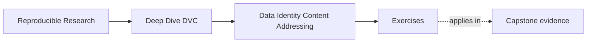
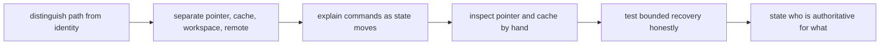

# Exercises


<!-- page-maps:start -->
## Page Maps




<!-- page-maps:end -->

Use these exercises to practice identity and state-layer judgment, not only DVC command
vocabulary. The goal is to make different trust questions stop collapsing into "the repo"
or "the data."

## How to work through this set

Treat the ten exercises as one full lab day on state authority and recovery boundaries.

Before each answer:

1. name the trust question you are trying to answer
2. decide which layer should answer it first
3. explain what that layer can and cannot prove by itself

If you skip the layer question, DVC pointers, cache objects, workspace files, remotes,
and published bundles all blur together.

Do the exercises in order. The day is one progression:

- Exercises 1-3 separate paths, identity, and state-authority questions
- Exercises 4-6 explain DVC commands as state moves and inspect pointers by hand
- Exercises 7-8 test checkout and remote recovery honestly
- Exercises 9-10 diagnose missing objects and draw a full authority diagram

Keep one state-authority packet as you go. By the end of the day it should contain:

- one explanation of why a path is weaker than identity
- one plain-language separation of pointer, cache, and workspace
- one authoritative-layer table
- one hand inspection of a pointer and its cache object
- one empty-cache remote recovery drill
- one state-authority diagram with commands and recovery claims

If those six artifacts are missing, you are probably memorizing DVC terms instead of
learning how the layers answer different questions.

## Recommended working layout

If you want one lab tree that can support the whole day, use something like:

```text
module02-lab/
├── data/
├── dvc.yaml
├── notes/
├── publish/
└── artifacts/
```

Keep one authority table while you work:

| Question | First authoritative layer | Evidence route | What it still cannot prove |
| --- | --- | --- | --- |

Also keep one state-move table:

| Command | Layer changed | New trust added | Trust not added |
| --- | --- | --- | --- |

Those two tables matter because Module 02 is where many students first stop treating all
copies of "the data" as equivalent.



Use that route on purpose. It keeps the day centered on trust and authority instead of on
surface-level command memory.

## Exercise 1: Explain why the path is too weak

A teammate says:

> The dataset is `data/train.csv`, so as long as that file exists, the identity problem is solved.

Write a short response that explains:

- what the path does tell you
- what it does not tell you
- why that difference matters for reproducibility
- one sentence explaining when the path is still useful

Study note:
The point is not to dismiss paths. The point is to stop mistaking location for identity.

## Exercise 2: Separate pointer, cache, and workspace

Suppose you have run `dvc add data/raw.csv`.

Explain in plain language:

- what the `.dvc` file is doing
- what the cache is doing
- why the workspace file is still a different layer from both
- one sentence explaining why calling the pointer "the data" is misleading

Your answer should avoid jargon where possible.

Study note:
This exercise is about conceptual clarity. If the language stays fuzzy here, later remote
and recovery reasoning will also stay fuzzy.

## Exercise 3: Name the authoritative layer

For each question below, say which layer you would inspect first:

1. what did the pipeline actually record as executed?
2. what may a downstream reviewer safely trust?
3. what survives local cache loss?
4. what files are visible in the working tree right now?

Use the vocabulary from the module rather than generic phrases like "the repo."

What to hand in:

- the four layer assignments
- one sentence per assignment explaining why that layer comes first
- one sentence explaining why the same answer would be wrong for a different question

Study note:
This is where many students realize that "where should I look?" is itself a trust
question.

## Exercise 4: Explain the commands as state moves

Write a short explanation of what changes when you run:

- `dvc push`
- `dvc pull`
- `dvc checkout`

Your answer should focus on which layer each command affects and what new trust it adds or
does not add.

What to hand in:

- the three command explanations
- one sentence explaining which command helps recovery most directly
- one sentence explaining which command does not prove durability by itself

Study note:
The commands matter less than the state movement they perform.

## Exercise 5: Diagnose a recovery claim

A team says:

> We rebuilt the workspace after deleting local files, so the published release and the full repository are both fully proven.

Explain:

- what this recovery success does prove
- what it does not prove yet
- which additional boundary the team may be confusing with recovery
- one sentence explaining why bounded proof is still valuable

Study note:
Recovery is strong evidence. It is just not infinite evidence.

## Midday self-check

Before you move into pointer inspection, revision switching, and missing-object diagnosis,
make sure your packet can already answer these questions cleanly:

- why a path is weaker than identity
- what each of pointer, cache, and workspace contributes to the workflow story
- which layer you would inspect first for at least two different trust questions
- what kind of claim a recovery success still cannot justify

If you cannot answer those four questions in plain language, return to Exercises 1-5 and
make the packet more explicit before continuing.

## Exercise 6: Inspect a pointer by hand

Track a small file with DVC. Open the resulting `.dvc` file, locate its object identifier
and size, then find the corresponding cache object. Explain the relationship without
calling the pointer "the data."

What to hand in:

- the pointer fields you inspected
- the matching cache-object location
- one sentence explaining the relationship
- one sentence explaining what would still be missing if only the pointer survived

Study note:
This is the exercise where content addressing should stop feeling abstract.

## Exercise 7: Prove checkout changes workspace state

Create two Git revisions that point to different versions of one dataset. Switch between
the revisions and use `dvc checkout`. Record what changes in Git, the workspace, and the
cache at each step.

What to hand in:

- the two revisions and their pointer difference
- what changed in the workspace
- what remained in cache
- one sentence explaining why workspace state and cache state are not interchangeable

Study note:
This is a good exercise for seeing why path equality is weaker than content identity.

## Exercise 8: Test a remote from an empty cache

Push a tracked artifact, clone into a clean directory with an empty DVC cache, and recover
it. Capture the commands and checksums that prove the remote held the required object.

What to hand in:

- the empty-cache recovery route
- the commands you used
- the checksum or equivalent identity evidence
- one sentence explaining what this proves about the remote and what it does not prove

Study note:
The key lesson is that a successful push is weaker than a successful clean recovery.

## Exercise 9: Diagnose a missing-object failure

Remove or isolate one required cache object without changing the pointer. Run the
appropriate status or pull command and explain why metadata can remain valid while content
is unavailable.

What to hand in:

- the simulated failure setup
- the command and observed failure
- the explanation of how metadata can stay valid
- one sentence explaining which recovery claim has now failed

Study note:
This is the exercise where availability and identity finally separate cleanly in most
students' heads.

## Exercise 10: Draw a state-authority diagram

Draw Git, workspace, cache, remote, and published bundle as separate nodes. Label the
commands that move or materialize state and mark which node is authoritative for recovery
under your chosen policy.

What to hand in:

- the full diagram
- one sentence per node explaining its authority
- one sentence explaining where downstream trust begins
- one sentence explaining which node many teams overtrust

Study note:
The best diagrams answer concrete trust questions instead of merely showing arrows between
tools.

## Mastery check

You have a strong grasp of this module if your answers consistently keep four ideas
visible:

- paths are locators, not identity
- content identity needs recorded references and storage layers
- different repository layers answer different trust questions
- recovery is a bounded proof, not a magic guarantee about everything
