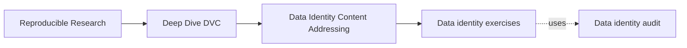
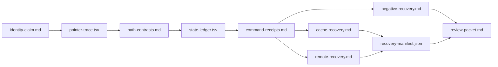

# Exercises

<!-- page-maps:start -->
## Page Maps




<!-- page-maps:end -->

These exercises form one cumulative data-identity review. Every recovery claim must name
required identity, surviving supplier, state move, restored-byte verification, and limits.

## Working directory

```bash
make PROGRAM=reproducible-research/deep-dive-dvc capstone-data-identity-audit
audit=artifacts/audit/reproducible-research/deep-dive-dvc/data-identity
learning=artifacts/learning/deep-dive-dvc/data-identity
mkdir -p "$learning"
```

Produce:

```text
data-identity/
├── identity-claim.md
├── pointer-trace.tsv
├── path-contrasts.md
├── state-ledger.tsv
├── command-receipts.md
├── cache-recovery.md
├── remote-recovery.md
├── negative-recovery.md
├── recovery-manifest.json
└── review-packet.md
```

## Exercise: Bound the data identity claim

Write `identity-claim.md`.

Include:

- baseline content ID, size, path, and independent SHA-256;
- distinction among locator, identity, and availability;
- result supported by equal-byte and changed-byte contrasts;
- required recovery evidence;
- semantic checks outside byte identity;
- four claims the audit does not support.

Add:

| Question | Evidence | Limit |
| --- | --- | --- |
| which bytes recorded? | | |
| where projected? | | |
| locally available? | | |
| remotely recoverable? | | |
| scientifically suitable? | | |

**Success condition**

The claim never treats a path, pointer, or successful command as sufficient alone.

## Exercise: Trace a pointer to matching bytes

Write `pointer-trace.tsv`:

```text
surface	value	evidence_role	verification
```

Include pointer path, hash type, content ID, size, derived cache path, workspace SHA-256,
and cache SHA-256.

Inspect:

```bash
cat "$audit/workspace/pointer-cache/data/observations.csv.dvc"
jq '.findings[] |
  select(.finding == "POINTER_NAMES_CACHED_CONTENT")' "$audit/report.json"
```

**Success condition**

Another learner can derive the cache address and explain why the audit uses both DVC's MD5
and an independent SHA-256 comparison.

## Exercise: Disprove path-based identity

Write `path-contrasts.md` comparing:

- same bytes at `data/observations.csv` and `archive/renamed.csv`;
- changed bytes at stable `data/observations.csv`.

For each contrast, state:

- controlled fact;
- changed fact;
- observed IDs;
- inference;
- unsupported overclaim.

Include a diagram and this conclusion in your own words:

> Location change neither requires nor prevents content-identity change.

**Success condition**

The reasoning uses both contrasts; it does not generalize from only one.

## Exercise: Build a state-layer ledger

Write `state-ledger.tsv`:

```text
case_moment	pointer	workspace	cache	remote	supplier	recoverable	decision
```

Include:

- baseline after add;
- cache case before and after checkout;
- remote case after push;
- remote case after workspace/cache loss;
- remote case after pull;
- pointer-only case before and after failed checkout.

Use `present`, `absent`, or `not-configured` consistently.

**Success condition**

Every recovery decision follows from a named supplier, and pointer-only state is marked
identifiable but unrecoverable.

## Exercise: Interpret commands as state moves

Write `command-receipts.md` for `add`, `push`, `checkout`, and `pull`.

For each command:

```text
Before state
Command receipt
Expected moved identity
After state
Verification
Supported claim
Unsupported claim
```

Use receipts from `$audit/evidence/`.

Add a decision table choosing the narrowest command for:

- unmanaged workspace data;
- missing workspace with cache present;
- missing workspace/cache with remote present;
- missing workspace/cache/remote with pointer present.

**Success condition**

The last scenario has no invented recovery command.

## Exercise: Prove cache-only recovery

Write `cache-recovery.md`.

Include:

- required identity;
- before-state proving workspace absence and cache presence;
- checkout receipt;
- restored workspace evidence;
- pointer-identity comparison;
- restored SHA-256 comparison;
- decision and limits.

Explain why this case cannot prove remote durability.

**Success condition**

Your argument names the local cache as causal supplier and does not mention remote recovery
as observed fact.

## Exercise: Prove remote recovery after local loss

Write `remote-recovery.md`.

Include:

- publication receipt;
- before-state with workspace and named cache object absent;
- configured remote role;
- pull receipt;
- cache repopulation;
- workspace restoration;
- baseline and recovered identity comparison;
- decision, time boundary, and limits.

Explain why removing local cache strengthens the causal claim.

**Success condition**

The conclusion is bounded to the audited object and does not claim all remote history or
future retention.

## Exercise: Defend negative recovery evidence

Write `negative-recovery.md` for the pointer-only case.

Include:

- what metadata survives;
- what content layers are absent;
- checkout command, exit, and stderr;
- post-failure workspace/cache state;
- why audit result is `PASS`;
- why recovery decision is `REJECT`;
- useful next searches;
- when to declare the original identity unrecoverable.

**Success condition**

The pointer remains valuable diagnostic evidence but is never described as a backup.

## Exercise: Design a recovery manifest

Create valid `recovery-manifest.json` with placeholder identities:

- schema;
- recovery identifier;
- Git revision;
- pointer path, content ID, size, hash type;
- independent baseline digest;
- loss boundary;
- supplier type and role;
- command receipt identity;
- restored cache and workspace identities;
- semantic validation receipts;
- decision;
- limits;
- timestamps;
- verifier.

Validate:

```bash
jq empty "$learning/recovery-manifest.json"
```

**Success condition**

The manifest joins one loss event, one required identity, one supplier, and one verified
decision without secrets.

## Exercise: Assemble an independent identity review

Write `review-packet.md`.

Include:

- bounded identity claim;
- audit regeneration command;
- artifact map;
- seven-finding matrix;
- locator/identity/availability distinction;
- cache and remote recovery arguments;
- pointer-only rejection;
- semantic verification boundary;
- recovery manifest route;
- unresolved risks;
- completion commands.

Add:



Verify:

```bash
test -s "$learning/identity-claim.md"
test -s "$learning/pointer-trace.tsv"
test -s "$learning/path-contrasts.md"
test -s "$learning/state-ledger.tsv"
test -s "$learning/command-receipts.md"
test -s "$learning/cache-recovery.md"
test -s "$learning/remote-recovery.md"
test -s "$learning/negative-recovery.md"
jq empty "$learning/recovery-manifest.json"
test -s "$learning/review-packet.md"
```

**Success condition**

A missed-class learner can regenerate the audit, locate exact bytes from the pointer,
identify the supplier in each recovery, reproduce the rejected case, and state where byte
identity stops.

## Completion standard

Your packet demonstrates:

- path is a locator rather than identity;
- pointer identity maps to matching managed bytes;
- same and changed content contrasts are paired;
- state layers are recorded before intervention;
- commands are explained as bounded moves;
- local and remote suppliers are isolated;
- negative evidence remains inspectable;
- restored identity precedes semantic trust;
- recovery evidence is joined in a manifest;
- review works without oral explanation.
