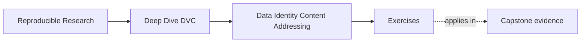

# Exercises

<!-- page-maps:start -->
## Page Maps

<!-- page-maps:end -->

Use these exercises to practice identity and state-layer judgment, not only DVC command
vocabulary.

The strongest answers will explain which layer is being discussed and what kind of trust
claim is actually being made.

## Exercise 1: Explain why the path is too weak

A teammate says:

> the dataset is `data/train.csv`, so as long as that file exists, the identity problem is solved.

Write a short response that explains:

- what the path does tell you
- what it does not tell you
- why that difference matters for reproducibility

## Exercise 2: Separate pointer, cache, and workspace

Suppose you have run `dvc add data/raw.csv`.

Explain in plain language:

- what the `.dvc` file is doing
- what the cache is doing
- why the workspace file is still a different layer from both

Your answer should avoid jargon where possible.

## Exercise 3: Name the authoritative layer

For each question below, say which layer you would inspect first:

1. what did the pipeline actually record as executed?
2. what may a downstream reviewer safely trust?
3. what survives local cache loss?
4. what files are visible in the working tree right now?

Use the vocabulary from the module rather than generic phrases like "the repo."

## Exercise 4: Explain the commands as state moves

Write a short explanation of what changes when you run:

- `dvc push`
- `dvc pull`
- `dvc checkout`

Your answer should focus on which layer each command affects and what new trust it adds or
does not add.

## Exercise 5: Diagnose a recovery claim

A team says:

> we rebuilt the workspace after deleting local files, so the published release and the full repository are both fully proven.

Explain:

- what this recovery success does prove
- what it does not prove yet
- which additional boundary the team may be confusing with recovery

## Exercise 6: Inspect a pointer by hand

Track a small file with DVC. Open the resulting `.dvc` file, locate its object identifier
and size, then find the corresponding cache object. Explain the relationship without
calling the pointer "the data."

## Exercise 7: Prove checkout changes workspace state

Create two Git revisions that point to different versions of one dataset. Switch between
the revisions and use `dvc checkout`. Record what changes in Git, the workspace, and the
cache at each step.

## Exercise 8: Test a remote from an empty cache

Push a tracked artifact, clone into a clean directory with an empty DVC cache, and recover
it. Capture the commands and checksums that prove the remote held the required object.

## Exercise 9: Diagnose a missing-object failure

Remove or isolate one required cache object without changing the pointer. Run the
appropriate status or pull command and explain why metadata can remain valid while
content is unavailable.

## Exercise 10: Draw a state-authority diagram

Draw Git, workspace, cache, remote, and published bundle as separate nodes. Label the
commands that move or materialize state and mark which node is authoritative for recovery
under your chosen policy.

## Mastery check

You have a strong grasp of this module if your answers consistently keep four ideas
visible:

- paths are locators, not identity
- content identity needs recorded references and storage layers
- different repository layers answer different trust questions
- recovery is a bounded proof, not a magic guarantee about everything
