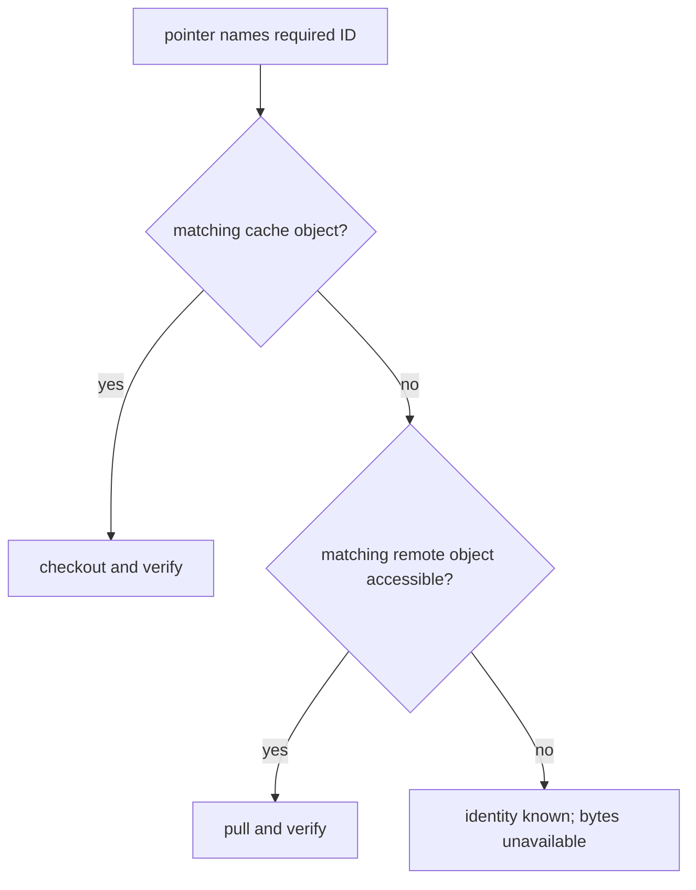

# Failure Modes, Recovery, and Trust

<!-- page-maps:start -->
## Page Maps


<!-- page-maps:end -->

Recovery is not “the file exists again.” A trustworthy recovery establishes:

- which exact content was required;
- which layers were lost and survived;
- which surviving layer supplied the bytes;
- whether restored bytes match recorded identity;
- whether the data still satisfies its semantic contract;
- which future durability claims remain unsupported.

## Classify loss before acting

| Loss | Pointer | Workspace | Cache | Remote | Immediate route |
| --- | --- | --- | --- | --- | --- |
| workspace only | present | absent | present | optional | checkout from cache |
| workspace and cache | present | absent | absent | contains object | pull from remote |
| pointer only survives | present | absent | absent | absent | no content recovery source |
| pointer lost, cache object survives | absent | uncertain | present | optional | recover identity from trusted history before use |
| remote object lost, local cache survives | present | present/absent | present | absent | preserve and republish verified object |
| all copies exist but bytes disagree | conflicting | present | present | present | stop and resolve identity conflict |

The command follows from the layer ledger. Do not begin by trying every DVC verb.

## Compare successful and failed recovery

Generate:

```bash
make PROGRAM=reproducible-research/deep-dive-dvc capstone-data-identity-audit
audit=artifacts/audit/reproducible-research/deep-dive-dvc/data-identity
```

Three cases form a recovery ladder:

| Case | Surviving supplier | Expected decision |
| --- | --- | --- |
| cache recovery | local cache | accept bounded local recovery |
| remote recovery | configured remote | accept bounded remote recovery |
| pointer only | none | reject recoverability claim |



Metadata narrows what is missing. It cannot supply the missing content.

## Preserve the incident ledger

Before repair, record:

```text
Claim:
Which data or result must be recovered?

Recorded identity:
Pointer, lock, size, and independent digest if available.

Workspace:
Presence, digest, and modification state.

Cache:
Named object presence and digest.

Remote:
Configured role, authorization, object evidence, and time.

Published copies:
Manifest and content identity, if relevant.

Interventions:
Commands and state changes in order.
```

Copying a file from somewhere before recording the ledger can destroy proof of which layer
was actually lost.

## Prove cache-only recovery

Inspect:

```bash
cat "$audit/evidence/cache-recovery-checkout.stdout.txt"
jq '.findings[] |
  select(.finding == "CACHE_RESTORES_WORKSPACE")' "$audit/report.json"
```

The bounded argument:

1. pointer identity survives;
2. workspace file is removed;
3. matching local cache object survives;
4. checkout succeeds;
5. restored workspace SHA-256 matches immutable source;
6. pointer identity stays unchanged.

This proves local materialization from cache for one object. It does not prove shared or
remote recovery.

## Prove remote recovery causally

The audit:

- pushes the object;
- removes workspace;
- removes the named local cache object;
- pulls;
- confirms cache repopulation and workspace restoration;
- compares content identity and SHA-256 with baseline.

```bash
cat "$audit/evidence/remote-recovery-push.stdout.txt"
cat "$audit/evidence/remote-recovery-pull.stdout.txt"
```

Removing local cache is essential. Otherwise a successful materialization could have used
the local supplier and would not isolate the remote.

A strong statement:

> After the named local cache object and workspace projection were absent, pull from the
> configured audit remote repopulated both. Restored SHA-256 and pointer content identity
> match baseline.

## Treat pointer-only failure as a required result

Inspect raw negative evidence:

```bash
cat "$audit/evidence/pointer-only-checkout.stderr.txt"
jq '.findings[] |
  select(.finding == "POINTER_ONLY_IS_NOT_RECOVERABLE")' "$audit/report.json"
```

The row is `PASS / REJECT`:

- `PASS`: audit reproduced all expected checks;
- `REJECT`: production claim “pointer alone can recover content” must be rejected.

The pointer retains diagnostic value:

- exact missing identity;
- expected path;
- recorded size;
- basis for searching caches, remotes, archives, or collaborators.

It does not retain the bytes.

## Separate unavailable from untrusted

Recovery can fail in different ways:

| Finding | Meaning | Response |
| --- | --- | --- |
| object unavailable | no accessible matching supplier | locate trusted copy or declare loss |
| object available but identity mismatched | supplier has different bytes | quarantine and investigate |
| identity matches but schema invalid | exact recorded bytes are semantically defective | reject data claim, not identity recovery |
| identity and schema pass but provenance absent | origin cannot be defended | limit or reject research use |
| restored result stale for current inputs | bytes recovered but execution claim outdated | reproduce and review |

Exact recovery can faithfully restore bad data. Trust needs content identity plus
claim-relevant validation.

## Verify beyond byte restoration

After identity check, apply:

- format readability;
- schema;
- row/record constraints;
- domain ranges;
- provenance;
- privacy/access rules;
- dependency and result staleness;
- published manifest checks where relevant.

Order them:


If identity fails, do not continue as though the bytes were the recorded dataset.

## Design recovery acceptance

A recovery acceptance record:

```text
Decision:
Accept or reject which bounded recovery claim?

Required identity:
Which pointer or lock ID?

Loss boundary:
Which layers were absent?

Supplier:
Which surviving cache, remote, or archive?

Receipts:
Which commands moved content?

Identity verification:
Which recorded and independent digests match?

Semantic verification:
Which schema, provenance, or domain checks pass?

Result impact:
Which dependent stages or publications require review?

Limits:
Which retention, coverage, and scientific claims remain untested?
```

## Improve recovery design from failure

| Observed failure | Durable improvement |
| --- | --- |
| pointer survives but no content copy | publish to governed remote and test restoration |
| only one author's cache has object | assign shared publication ownership |
| remote contains object but clean clone cannot find it | track non-secret route configuration |
| remote retention deleted required history | define protected revisions and archive policy |
| restored bytes cannot be interpreted | add schema and provenance contracts |
| recovery succeeds only with admin credentials | design read-only recovery identity |
| no one can identify dependent results | make pipeline dependencies truthful |

Do not respond to every loss by retaining everything forever. Match retention and
replication to the lifetime and value of the claim.

## Know when recovery is impossible

If no trustworthy copy of the required content identity survives:

- preserve pointer and failure evidence;
- search governed caches, remotes, archives, and published bundles;
- avoid substituting plausible but unverified bytes;
- identify affected results and claims;
- record the object as unrecoverable if search fails;
- decide whether recollection creates a new dataset and new result history.

Reconstructed or recollected data may be useful, but it is not recovery of the original
identity.

## Review checkpoint

You understand recovery and trust when you can:

- classify loss from a state ledger;
- prove which layer supplied restored content;
- isolate remote recovery by removing local cache;
- treat pointer-only failure as expected negative evidence;
- distinguish unavailable, identity-mismatched, and semantically invalid data;
- verify meaning after bytes;
- declare unrecoverable content honestly.

The recovery standard is:

> Restore only from a trustworthy supplier, prove exact identity, then evaluate the
> semantic contract and downstream claims before calling the result trusted.
