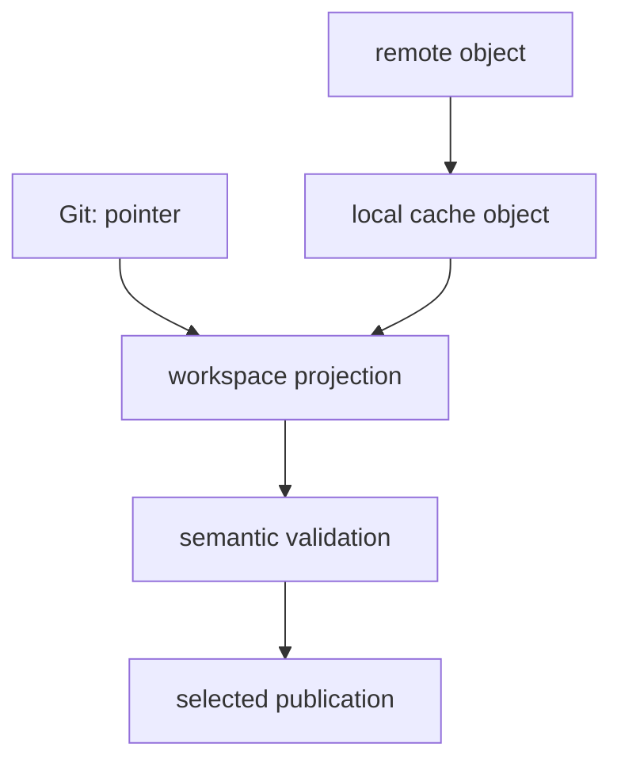

# Glossary

<!-- page-maps:start -->
## Page Maps


<!-- page-maps:end -->

Use these terms to prevent a path from standing in for identity, metadata from standing in
for content, or successful materialization from standing in for scientific trust.

## Identity terms

### Path

A location at which content is projected for users or tools.

A path can remain stable while bytes change or change while bytes remain equal.

### Locator

Information describing where to find or project something.

The pointer's `path` field is a locator relative to the pointer file.

### Content identity

An identity derived from content bytes according to a recorded algorithm.

In the audit, DVC records MD5 content IDs. Content identity does not establish scientific
meaning or availability.

### Content addressing

Organizing and retrieving managed objects by content-derived identity rather than only by
human-facing location.

### Independent digest

A separately calculated hash used to corroborate byte equality across layers.

The audit uses SHA-256 independently from DVC's recorded MD5 addressing.

### Byte equality

The condition that two materializations contain exactly the same bytes.

It is stronger than filename equality and narrower than semantic validity.

### Semantic identity

Equality according to a claim-relevant interpretation, such as parsed records, schema, or
domain values.

The module primarily proves byte identity; semantic checks follow.

## Pointer and cache terms

### DVC pointer

A small tracked metadata file naming managed content identity, size, hash type, and
workspace projection.

It does not contain the managed content bytes.

### Pointer identity

The content ID recorded in a pointer.

It remains useful when bytes are unavailable because it says exactly what is missing.

### Workspace projection

The materialized file or directory presented at the path used by ordinary tools.

It can be deleted and restored without changing content identity.

### Local DVC cache

Machine-local managed content storage used for reuse and workspace materialization.

It is a local supplier, not automatically shared durability.

### Cache object

Managed content stored at an address derived from content identity.

For `be7d…a717`, the audited path is:

```text
.dvc/cache/files/md5/be/7d…a717
```

Treat layout as inspectable implementation evidence, not a file API to edit manually.

### Cache repopulation

Restoring an absent local cache object from an available remote supplier.

The remote recovery audit proves both cache repopulation and workspace restoration.

## State-layer terms

### Workspace state

Current materialized files and modifications visible to tools.

Presence does not prove recorded identity.

### Git state

Tracked pointers, declarations, code, parameters, policies, and contracts.

Git can preserve required content identity while the large bytes remain elsewhere.

### Remote state

Managed objects present in configured shared DVC storage.

Remote object presence does not prove tracked route discovery, authorization, or future
retention.

### Published state

Selected artifacts and contracts exposed to consumers at a release or publication
boundary.

It can be complete for a consumer claim while insufficient for full workflow recovery.

### State ledger

A before-and-after record of pointer, workspace, cache, remote, and published layers.

It identifies the actual supplier in a recovery argument.



## Command terms

### `dvc add`

Records workspace content as managed local state, creating or updating pointer metadata
and local cache content.

It does not publish to a shared remote.

### `dvc push`

Transfers selected managed cache objects to configured remote storage.

It does not prove another identity can restore them or that retention is durable.

### `dvc checkout`

Materializes recorded workspace projections from available local cache content.

Success can be entirely local and therefore does not prove remote health.

### `dvc pull`

Retrieves required objects from a configured remote into local cache and materializes
requested workspace state.

Its recovery claim is strongest when matching local cache content was absent beforehand.

### State move

A bounded transfer or projection of a named identity from one layer to another.

A command receipt, before-state, after-state, and identity comparison prove the move.

### Command receipt

Recorded command, exit status, stdout, stderr, and execution context.

It establishes behavior but needs state and identity evidence to prove recovery.

## Availability and recovery terms

### Availability

The condition that an accessible layer can supply the exact required content.

Identity can remain known while availability is lost.

### Supplier

The cache, remote, archive, or other trustworthy layer that provides required bytes during
recovery.

### Cache-only recovery

Restoration of a missing workspace projection from surviving local cache content.

### Remote recovery

Restoration from remote content after local suppliers are absent.

### Pointer-only state

Metadata survives while workspace, cache, and remote copies are unavailable.

It supports diagnosis but not content materialization.

### Negative evidence

A preserved failure that establishes a claim boundary.

The pointer-only checkout failure proves metadata alone is not recoverability.

### Recoverability

The demonstrated ability to restore exact required content from an accessible trustworthy
supplier and verify it.

### Unrecoverable identity

A known required content identity for which no trustworthy matching bytes can be found.

Plausible replacement content creates a new identity rather than recovering the old one.

### Recovery manifest

A structured record joining required identity, loss boundary, supplier, state move,
restored identity, semantic checks, decision, and limits.

## Trust terms

### Identity verification

Comparing restored bytes with recorded content identity and independent digest evidence.

It comes before semantic trust.

### Schema validation

Checking structure, fields, types, and constraints required to interpret the data.

Exact bytes can still fail their expected schema.

### Provenance

Evidence about origin, collection, transformation, custody, and authorization.

Content identity does not reveal provenance by itself.

### Domain validation

Claim-specific checks for plausible values, population, units, ethics, or research use.

### Bounded trust

Acceptance limited to the identity, validation, supplier, time, and claim actually tested.


## Evidence decisions

### `PASS / ACCEPT`

The audit established its expected checks and the bounded identity or recovery claim is
accepted.

### `PASS / REJECT`

The audit successfully reproduced a condition whose production claim must be rejected.

Pointer-only recovery is the module example.

### Claim limit

An explicit statement of what evidence does not establish, such as future retention,
remote completeness, scientific validity, or runtime interpretation.

## Important contrasts

| Do not substitute | For | Reason |
| --- | --- | --- |
| path | content identity | location does not determine bytes |
| pointer | content | metadata names bytes but does not contain them |
| workspace file | recorded data | current bytes may differ |
| local cache | shared durability | machine-local state can disappear |
| checkout success | remote recovery | cache may be supplier |
| push success | cache-cold restoration | reader path remains untested |
| pull success | scientific validity | materialization does not validate meaning |
| restored filename | exact recovery | identity comparison is required |
| one remote receipt | retention guarantee | availability is time-bound |
| recollected data | original recovery | new bytes mean new identity |

## Review language

Prefer:

> The path remained stable while content ID changed, so the dataset identity changed.

> After local cache loss, the remote repopulated the named object and restored baseline
> SHA-256.

> The pointer survived, but no content supplier remained; reject recoverability while
> preserving the exact missing identity.

Avoid:

> The file is the same because it has the same name.

> DVC has the data because the pointer exists.

> Recovery worked because the command was green.

Precise vocabulary connects identity, supplier, materialization, validation, and decision
without letting one layer impersonate another.
