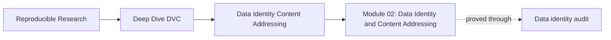
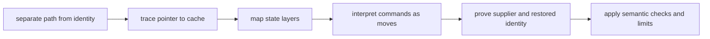
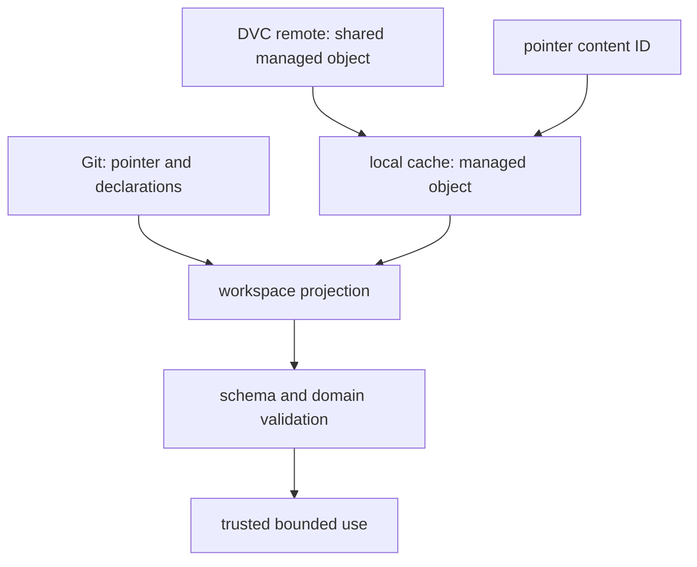
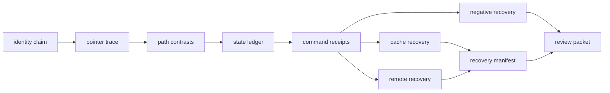

# Module 02: Data Identity and Content Addressing

<!-- page-maps:start -->
## Page Maps




<!-- page-maps:end -->

The path `data/observations.csv` can hold different bytes tomorrow. The same bytes can move
to another path today. Reproducible data work therefore needs an identity stronger than a
filename and a recovery claim stronger than “the pointer still exists.”

This module uses seven executable findings to teach:

- content identity follows bytes rather than location;
- a DVC pointer connects identity to a workspace projection;
- cache and remote are different availability layers;
- commands move state between layers;
- metadata alone cannot recover missing content;
- exact byte recovery is necessary but not sufficient for scientific trust.

## Prerequisites

You should be able to:

- run Make targets from the repository root;
- read small YAML and JSON files;
- use `jq`, `cat`, and `find`;
- distinguish Git commits from generated workspace files;
- explain a bounded evidence claim from Module 01.

No prior knowledge of DVC cache layout is required. The lesson derives the audited object
address from the pointer.

## Learning outcomes

After completing the packet, you should be able to:

- disprove path-based identity with paired contrasts;
- trace a pointer to matching cache bytes;
- distinguish workspace, Git, cache, remote, and published state;
- predict `add`, `push`, `pull`, and `checkout` as state moves;
- isolate local cache and remote as recovery suppliers;
- interpret a failed pointer-only checkout as required negative evidence;
- write a recovery decision with exact identity and limits;
- separate byte identity from schema, provenance, and scientific validity;
- declare original content unrecoverable when no trusted copy survives.

## Generate the audit

```bash
make PROGRAM=reproducible-research/deep-dive-dvc capstone-data-identity-audit
```

Evidence appears under:

```text
artifacts/audit/reproducible-research/deep-dive-dvc/data-identity/
```

Begin:

```bash
audit=artifacts/audit/reproducible-research/deep-dive-dvc/data-identity
column -t -s $'\t' "$audit/summary.tsv"
cat "$audit/route.txt"
```

The audit creates separate no-SCM DVC repositories for every case so recovery cannot
borrow cache or remote state from another experiment.

## Read the seven findings

| Finding | Decision | Claim |
| --- | --- | --- |
| pointer names cached content | accept | metadata leads to matching local bytes |
| same bytes share identity | accept | path change does not require identity change |
| changed bytes change identity | accept | stable path does not preserve identity |
| cache restores workspace | accept | local cache can project missing workspace content |
| remote restores after cache loss | accept | remote can repopulate local layers |
| remote recovery preserves identity | accept | recovered bytes match baseline identity |
| pointer only is not recoverable | reject | metadata without supplier cannot restore |

`PASS / REJECT` means the audit successfully reproduced a recovery claim that must be
rejected.

## The state model



The pointer tells DVC which content should appear where. Cache or remote must supply the
bytes. Semantic checks decide whether exact bytes support the intended research claim.

## Full study route

| Reading | Question answered | Evidence action |
| --- | --- | --- |
| [Paths Are Locators, Not Data Identity](paths-are-locators-not-data-identity.md) | why is a filename too weak? | compare paired identity contrasts |
| [Content Addressing, Cache, and Pointer Files](content-addressing-cache-and-pointer-files.md) | how does the pointer lead to bytes? | derive and verify cache object |
| [Workspace, Git, Cache, Remote, and Published State](workspace-git-cache-remote-and-published-state.md) | which layer owns which claim? | build loss-state ledger |
| [DVC Add, Push, Pull, and Checkout as State Moves](dvc-add-push-pull-and-checkout-as-state-moves.md) | what does each command prove? | read receipts with before/after state |
| [Failure Modes, Recovery, and Trust](failure-modes-recovery-and-trust.md) | when is recovery trustworthy? | isolate supplier and verify semantics |
| [Worked Investigation: Proving Data Recovery Boundaries](worked-investigation-proving-data-recovery-boundaries.md) | how do all findings form one argument? | execute identity and recovery route |
| [Exercises](exercises.md) | can you produce independent proof? | build ten-artifact packet |
| [Exercise Answers](exercise-answers.md) | where does reasoning overclaim? | revise against model evidence |
| [Glossary](glossary.md) | are identity terms precise? | check language during review |

Read in order on a first pass. Use the worked investigation before beginning the cumulative
packet.

## Diagnostic return route

| Symptom | Begin with | Continue with |
| --- | --- | --- |
| same path contains surprising data | locator lesson | changed-content finding |
| pointer exists but file is missing | state layers | recovery failure lesson |
| checkout works but remote durability is uncertain | command moves | remote recovery case |
| pull restores file but trust remains unclear | recovery and trust | semantic checks |
| remote migration is planned | state layers | Module 07 stewardship |
| published bundle survives but pipeline does not | state layers | Module 08 recovery |

## Cumulative learning packet

Exercises create:

```text
artifacts/learning/deep-dive-dvc/data-identity/
├── identity-claim.md
├── pointer-trace.tsv
├── path-contrasts.md
├── state-ledger.tsv
├── command-receipts.md
├── cache-recovery.md
├── remote-recovery.md
├── negative-recovery.md
├── recovery-manifest.json
└── review-packet.md
```



## Evidence reading order

For any recovery claim:

1. record required content identity;
2. preserve workspace/cache/remote before-state;
3. identify the only trustworthy supplier;
4. save raw command receipt;
5. record after-state;
6. compare restored content identity and independent digest;
7. apply schema, provenance, and domain checks;
8. state decision and limits.

Do not run recovery commands before preserving the state needed to prove what was lost.

## Commands to keep close

Generate:

```bash
make PROGRAM=reproducible-research/deep-dive-dvc capstone-data-identity-audit
```

Enforce:

```bash
make PROGRAM=reproducible-research/deep-dive-dvc capstone-data-identity-selftest
```

Inspect the rejected case:

```bash
jq '.findings[] |
  select(.finding == "POINTER_ONLY_IS_NOT_RECOVERABLE")' \
  artifacts/audit/reproducible-research/deep-dive-dvc/data-identity/report.json
```

## Common reasoning errors

| Error | Correction |
| --- | --- |
| same path means same data | compare content identity |
| different path means different data | compare bytes and pointer IDs |
| pointer contains data | pointer contains metadata |
| local cache is a backup | test governed remote recovery |
| checkout proves remote health | checkout can use local cache |
| pull success proves dataset validity | apply semantic contracts after identity |
| one restored object proves remote completeness | bound claim to object and time |
| plausible replacement is recovery | original identity must match |

## Completion proof

```bash
learning=artifacts/learning/deep-dive-dvc/data-identity

test -s "$learning/identity-claim.md"
test -s "$learning/pointer-trace.tsv"
test -s "$learning/path-contrasts.md"
test -s "$learning/state-ledger.tsv"
test -s "$learning/command-receipts.md"
test -s "$learning/cache-recovery.md"
test -s "$learning/remote-recovery.md"
test -s "$learning/negative-recovery.md"
jq empty "$learning/recovery-manifest.json"
test -s "$learning/review-packet.md"
```

Explain:

- Why can two paths share identity?
- Why can one path change identity?
- How does a pointer map to cache content?
- What proves cache supplied one recovery?
- What proves remote supplied another?
- Why does pointer-only failure pass the audit?
- What checks follow byte identity?

## Transition to Module 03

Module 02 makes data identity explicit. Module 03 adds runtime identity: even exact data
bytes can produce different meaning under a changed execution environment.

Carry forward:

> Reproducibility needs both the exact content and the conditions under which that content
> is interpreted.
