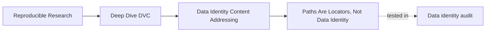
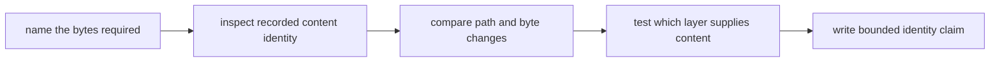
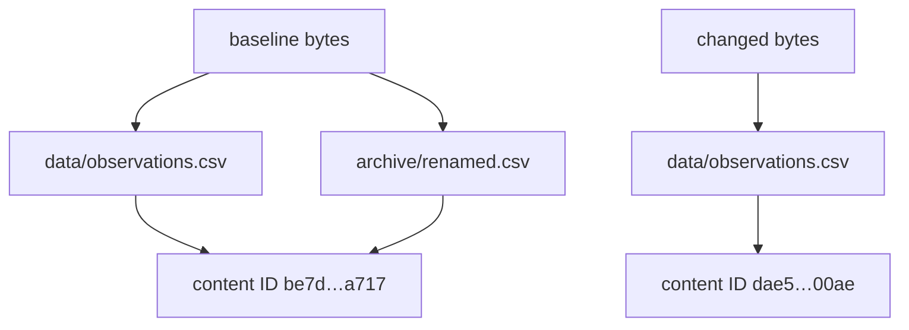

# Paths Are Locators, Not Data Identity

<!-- page-maps:start -->
## Page Maps




<!-- page-maps:end -->

A path answers “where should I look?” It does not answer “which exact bytes should be
there?”

That distinction matters whenever a dataset can be replaced in place, renamed, copied,
mounted elsewhere, or restored after loss. A workflow that identifies data only as
`data/observations.csv` cannot distinguish yesterday's content from today's content at the
same location.

## Separate three questions

| Question | Example answer | Evidence |
| --- | --- | --- |
| Where should content appear? | `data/observations.csv` | workspace path |
| Which content is required? | DVC content ID `be7d…a717` | pointer or lock |
| Where can those bytes be supplied from? | local cache or configured remote | successful identity-checked recovery |

Location, identity, and availability cooperate, but none is a synonym for another.

## Run the paired contrasts

Generate the audit:

```bash
make PROGRAM=reproducible-research/deep-dive-dvc capstone-data-identity-audit
audit=artifacts/audit/reproducible-research/deep-dive-dvc/data-identity
```

Read:

```bash
column -t -s $'\t' "$audit/summary.tsv"
jq '.findings[] |
  select(
    .finding == "SAME_BYTES_SHARE_IDENTITY" or
    .finding == "CHANGED_BYTES_CHANGE_IDENTITY"
  )' "$audit/report.json"
```

The audit performs two controlled changes:

| Case | Path | Bytes | Content identity |
| --- | --- | --- | --- |
| original | `data/observations.csv` | baseline | `be7d…a717` |
| copied | `archive/renamed.csv` | same baseline bytes | `be7d…a717` |
| replaced | `data/observations.csv` | appended row | `dae5…00ae` |



Together, the contrasts defeat path-based identity:

- moving identical bytes does not change their content identity;
- changing bytes at a stable path does change their content identity.

## Inspect the pointer

```bash
cat "$audit/workspace/pointer-cache/data/observations.csv.dvc"
```

The relevant record resembles:

```yaml
outs:
  - md5: be7d1d8e728323219fd8315dcbfea717
    size: 40
    hash: md5
    path: observations.csv
```

Read each field narrowly:

| Field | Meaning |
| --- | --- |
| `path` | workspace projection relative to the pointer |
| `md5` | content identifier used to locate DVC-managed content |
| `size` | recorded byte-size evidence |
| `hash` | identifier algorithm used by this pointer |

The path remains useful. It tells DVC where the workspace projection belongs. It simply
does not identify the bytes alone.

## Follow identity into the cache

The content ID maps to:

```text
.dvc/cache/files/md5/be/7d1d8e728323219fd8315dcbfea717
```

The audit independently hashes workspace and cache bytes with SHA-256:

```bash
jq '.findings[] |
  select(.finding == "POINTER_NAMES_CACHED_CONTENT")' "$audit/report.json"
```

Two algorithms have different evidence roles:

- DVC's recorded MD5 selects its cache object.
- The audit's SHA-256 comparison independently confirms byte equality across layers.

Do not turn this teaching contrast into a universal cryptographic policy. The bounded
claim is that the pointer, cache path, recorded size, and independently compared bytes
agree for this specimen.

## Understand identity without claiming meaning

Content identity answers:

> Are these bytes the bytes named by the recorded state?

It does not answer:

- Is the dataset scientifically valid?
- Does it have the expected schema?
- Was it collected ethically?
- Does it represent the intended population?
- Can every collaborator retrieve it?
- Will it remain available next year?

Two files with equal bytes have equal content identity for this audit. They can still be
mislabelled or unsuitable for the research claim.

## Use identity in review

A weak review statement:

> The dataset is still at the same path.

A stronger statement:

> The pointer at the reviewed revision names content ID `be7d…a717`, and the restored
> workspace bytes independently match the recorded baseline digest. The workspace path is
> a projection location, not the basis of identity.

For a changed dataset:

> The path is unchanged, but the pointer content ID changed from `be7d…a717` to
> `dae5…00ae`; this is a new data identity and dependent results need review.

## Diagnose common path illusions

| Observation | Unsupported conclusion | Better next evidence |
| --- | --- | --- |
| filename unchanged | data unchanged | compare recorded content identity |
| filename changed | data changed | compare bytes or content IDs |
| file exists | correct data available | compare identity and schema |
| pointer exists | bytes recoverable | test cache or remote restoration |
| remote contains same filename | correct object stored | verify content identity |
| copied file opens successfully | exact recovery | compare immutable digest |

## Make datasets addressable by claim

For a result claim, record:

- content identity;
- schema or format contract;
- provenance or collection boundary;
- workspace projection when needed;
- available recovery layers;
- result dependencies;
- retention expectation.

The content ID is one essential coordinate, not the entire dataset contract.

## Review checkpoint

You understand locator versus identity when you can explain:

- why two paths share one identity in the audit;
- why one path receives a new identity after bytes change;
- what the pointer path contributes;
- how the pointer selects a cache object;
- why byte identity does not establish scientific validity;
- why pointer identity does not establish availability.

Carry this question through the module:

> Which exact bytes does the recorded state name, and which independent evidence proves
> that the bytes at this location are those bytes?
