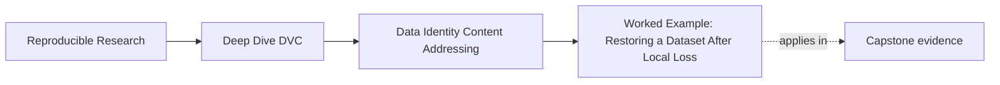

# Worked Example: Restoring a Dataset After Local Loss


<!-- page-maps:start -->
## Page Maps




<!-- page-maps:end -->

This example shows how Module 02 ideas fit together when you stop talking about files
abstractly and start asking what survives real failure.

The story is intentionally simple.

That helps the module show the important boundaries without burying them in platform detail.

## Run the bounded incident

From the repository root:

```bash
make -C programs/reproducible-research/deep-dive-dvc/capstone data-identity-audit
```

Before reading `summary.tsv`, predict the outcomes:

| Case | Workspace deleted? | Cache deleted? | Remote populated? | Expected recovery |
| --- | --- | --- | --- | --- |
| cache recovery | yes | no | no | checkout succeeds |
| remote recovery | yes | yes | yes | pull and checkout succeed |
| pointer only | yes | yes | no | checkout fails |

If your prediction makes cache recovery and pointer-only recovery equivalent, stop and
revisit the distinction between pointer metadata and stored content.

## The situation

Suppose you have a DVC-tracked dataset in the workspace and say:

> the data is `data/raw/service_incidents.csv`, and we should be fine because it is already
> in the repo.

Then the local tracked file and local cache are removed.

Now the comforting sentence disappears, and the real questions begin.

## Step 1: Name the boundary problem correctly

The first correction is conceptual:

- `data/raw/service_incidents.csv` was never the identity by itself
- it was the workspace path pointing at tracked content identity

That sounds like small wording, but it changes how the whole incident is understood.

You are not asking:

> where did the file go?

You are now asking:

> can the repository recover the tracked content that this path used to project?

## Step 2: Check which layers still exist

At this point, you inspect:

- Git-tracked DVC files and `dvc.lock`
- the configured remote
- the recovery route and state summaries

What matters most is that:

- the recorded identity still exists in the repo story
- the remote still has the needed content

The missing workspace file is serious, but it is not the whole story.

## Step 2A: Establish the original identity

Open:

```text
workspace/remote-recovery/data/observations.csv.dvc
report.json
```

Record:

- pointer `md5`
- pointer size
- audit SHA-256

This is the pre-loss identity packet. Without it, a file appearing after recovery proves
only that some bytes exist at the path.

## Step 3: Use the command model honestly

The recovery explanation is:

1. `dvc pull` restores tracked content from remote into local durable storage
2. `dvc checkout` rebuilds the workspace path from that tracked content

That is stronger than saying:

> we downloaded the file again.

The restored file matters because it came back through a recorded identity path, not only
through luck or a teammate copying something over Slack.

## Step 3A: Prove the loss was real

The remote case removes both the workspace projection and `.dvc/cache/` before pulling.
The audit checks the resulting filesystem, not merely the intended deletion commands.

This matters because a surviving local cache would weaken the remote claim. Pull could
appear successful while reusing local content.

Read these receipts in order:

1. `remote-recovery-push.stdout.txt`
2. `remote-recovery-pull.stdout.txt`
3. `remote-recovery-checkout.stdout.txt`

Then inspect the regenerated cache object and workspace file. The receipts explain what
DVC attempted; the files and digests establish the resulting state.

## Step 4: Ask what this proves

After the restore, you can now say:

- the workspace path was reconstructed
- the tracked content identity was durably recoverable
- local loss did not erase the repository's data story

That is a strong and valuable claim.

But Module 02 keeps the scope honest:

- this does not prove the dataset is semantically correct
- this does not replace the downstream publish contract
- this does not mean every internal file in the project is equally recoverable

## Step 4A: Compare the counterexample

Now inspect `pointer-only-checkout.stderr.txt`.

The pointer-only case begins with the same recorded content identity but has no cache and
no remote. Checkout fails. This counterexample strengthens the remote-recovery argument:

- a pointer did not supply the bytes
- a path did not supply the bytes
- the populated remote was the relevant difference

The comparison is causal because the specimen bytes and DVC version are held constant
while the available storage layer changes.

## Step 5: Compare the layers explicitly

This is the moment where the module's state-layer vocabulary becomes useful:

- workspace: restored local file
- Git: recorded pointers and declarations
- cache: local durable copy now available again
- remote: the source of durability after loss
- publish: a narrower downstream trust surface, not the whole recovery story

Once you can say that in plain language, Module 02 is doing real work.

## Build the review packet

Hand another reviewer:

| Surface | Why it is included |
| --- | --- |
| `summary.tsv` | one-line result and decision for each claim |
| remote pointer | original content ID, path, and size |
| push and pull receipts | attempted cache-to-remote and remote-to-local moves |
| restored cache object | local availability after pull |
| restored workspace digest | byte equality after recovery |
| pointer-only stderr | negative control showing metadata alone is insufficient |

The packet is deliberately smaller than the whole generated workspace. Each item closes a
specific inference.

## What you should not say anymore

After this example, weak sentences should sound weak:

- the file is the identity
- Git had the data
- DVC magically rebuilt everything
- publish state is the whole repository story

The module is succeeding when you now notice those shortcuts on your own.

## The review note you would want

> The local workspace file was lost, but the tracked data identity remained recoverable
> because the repository still had recorded DVC state and the remote still held the
> content. `dvc pull` restored the durable local content, and `dvc checkout` rebuilt the
> workspace projection. This proves the recovery path for the tracked dataset is working.
> It does not by itself settle broader questions about data quality or the full published
> release boundary.

That is the level of precision Module 02 is trying to teach.

## Write the acceptance argument

A defensible conclusion is:

> The test removed the tracked workspace projection and local DVC cache after pushing
> content ID `X`. Pull repopulated the cache, checkout materialized the workspace, and the
> recovered SHA-256 matched the immutable source. The pointer-only control failed under
> the same local loss, so pointer metadata was not the recovery source. This proves remote
> recoverability for `X`; it does not prove dataset meaning or publish approval.

Replace `X` with the actual generated pointer ID. If the conclusion cannot name the
tested loss and matching digest, it is still relying on the command narrative.

## Why this is a mastery example

This one story exercises the whole module:

- Core 1: the path stopped being mistaken for identity
- Core 2: content identity and pointer files became the real reference point
- Core 3: the layers were named distinctly
- Core 4: commands were explained as state moves
- Core 5: recovery was described as a bounded proof rather than as magic
