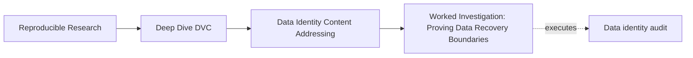
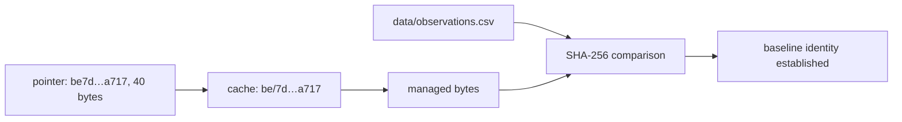
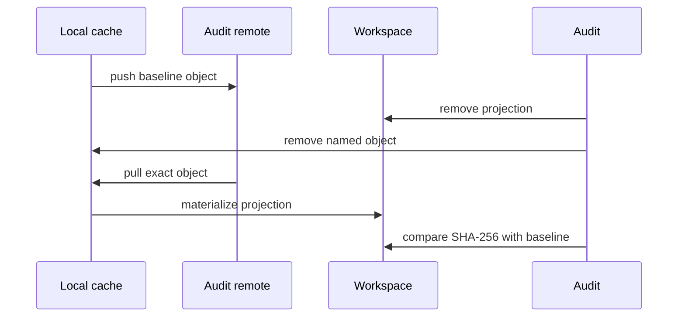

# Worked Investigation: Proving Data Recovery Boundaries

<!-- page-maps:start -->
## Page Maps




<!-- page-maps:end -->

This investigation answers two questions:

1. Which exact bytes does the pointer name?
2. Which storage layer can supply them after loss?

You will establish content identity with paired contrasts, then prove cache and remote
recovery by removing alternative suppliers. Finally, you will use a failed checkout to
show why metadata alone is not recoverability.

## Generate the evidence packet

```bash
make PROGRAM=reproducible-research/deep-dive-dvc capstone-data-identity-audit
audit=artifacts/audit/reproducible-research/deep-dive-dvc/data-identity
```

Read:

```bash
column -t -s $'\t' "$audit/summary.tsv"
cat "$audit/route.txt"
```

Six findings are `PASS / ACCEPT`. Pointer-only recovery is `PASS / REJECT`: the audit
successfully proves a claim the course says to reject.

## Establish the baseline identity

Inspect the immutable source:

```bash
cat programs/reproducible-research/deep-dive-dvc/capstone/repro/data-identity/source/observations.csv
```

Inspect the generated pointer:

```bash
case="$audit/workspace/pointer-cache"
cat "$case/data/observations.csv.dvc"
```

The pointer records:

```text
content ID: be7d1d8e728323219fd8315dcbfea717
size:       40
path:       observations.csv
```

Follow it to:

```text
.dvc/cache/files/md5/be/7d1d8e728323219fd8315dcbfea717
```

Inspect the finding:

```bash
jq '.findings[] |
  select(.finding == "POINTER_NAMES_CACHED_CONTENT")' "$audit/report.json"
```

The checks connect pointer metadata, cache existence, recorded size, and independently
equal workspace/cache bytes.



## Disprove path-based identity

Read both contrast findings:

```bash
jq '.findings[] |
  select(
    .finding == "SAME_BYTES_SHARE_IDENTITY" or
    .finding == "CHANGED_BYTES_CHANGE_IDENTITY"
  )' "$audit/report.json"
```

The same-content case copies baseline bytes:

```text
data/observations.csv -> be7d…a717
archive/renamed.csv   -> be7d…a717
```

The changed-content case appends a row at the original path:

```text
data/observations.csv
before -> be7d…a717
after  -> dae5…00ae
```

One contrast could be misread. Together they prove:

- path change is not sufficient for identity change;
- path stability is not sufficient for identity stability;
- byte content determines the audited content identity.

## Prove local cache recovery

The cache-recovery workspace begins with pointer, workspace file, and cache object. The
audit deletes the workspace projection but preserves the named cache object.

Read the receipt:

```bash
cat "$audit/evidence/cache-recovery-checkout.stdout.txt"
```

Read the checks:

```bash
jq '.findings[] |
  select(.finding == "CACHE_RESTORES_WORKSPACE")' "$audit/report.json"
```

The proof route:

| Before checkout | After checkout |
| --- | --- |
| pointer present | pointer identity unchanged |
| workspace absent | workspace restored |
| cache object present | cache object still present |
| baseline SHA-256 known | restored SHA-256 matches |

Conclusion:

> The local cache can restore the workspace projection for the recorded identity.

Limit:

> This case does not test remote durability because the local supplier survived.

## Prove remote recovery after cache loss

The remote case is stronger because the audit removes local content after publication.

Read receipts:

```bash
cat "$audit/evidence/remote-recovery-push.stdout.txt"
cat "$audit/evidence/remote-recovery-pull.stdout.txt"
```

Read findings:

```bash
jq '.findings[] |
  select(
    .finding == "REMOTE_RESTORES_AFTER_CACHE_LOSS" or
    .finding == "REMOTE_RECOVERY_PRESERVES_IDENTITY"
  )' "$audit/report.json"
```

The causal sequence:



Evidence closes:

- remote had been supplied;
- workspace and local cache were absent before recovery;
- pull repopulated both;
- recovered content ID matches baseline;
- recovered SHA-256 matches baseline.

Conclusion:

> The configured audit remote supplied exact baseline content after local cache loss.

Limit:

> The receipt covers this object, remote, identity, and audit time—not all history or
> future retention.

## Examine the pointer-only counterexample

The pointer-only case preserves the `.dvc` file and deletes workspace/cache without a
remote.

Read the failure:

```bash
cat "$audit/evidence/pointer-only-checkout.stderr.txt"
```

Read the structured finding:

```bash
jq '.findings[] |
  select(.finding == "POINTER_ONLY_IS_NOT_RECOVERABLE")' "$audit/report.json"
```

Expected:

- pointer still names `be7d…a717`;
- checkout returns nonzero;
- workspace remains absent;
- cache object remains absent.

This negative evidence is not a broken audit. It proves the boundary:

> Metadata can identify missing content without containing or recovering it.

## Compare all suppliers

| Case | Pointer | Workspace before | Cache before | Remote | Outcome |
| --- | --- | --- | --- | --- | --- |
| cache recovery | yes | absent | matching object | not needed | checkout restores |
| remote recovery | yes | absent | matching object absent | matching object present | pull restores |
| pointer only | yes | absent | absent | absent | checkout fails |

The pointer participates in all three cases. Supplier availability explains the different
outcomes.

## Write the recovery argument

A complete argument:

```text
Claim:
The remote can restore the audited baseline dataset after workspace and local cache loss.

Required identity:
Pointer content ID be7d…a717; independent baseline SHA-256 9771…2fb4.

Loss:
Workspace projection and named local cache object were absent.

Supplier:
Configured isolated audit remote previously received the object.

Move:
Pull returned success and repopulated cache and workspace.

Verification:
Recovered pointer ID and SHA-256 match baseline.

Decision:
Accept bounded remote recovery for this object.

Limits:
No claim about future retention, other objects, scientific validity, or runtime
interpretation.
```

## Diagnose wrong conclusions

| Wrong conclusion | Missing reasoning |
| --- | --- |
| “The path came back, so recovery succeeded” | compare recorded identity |
| “Checkout succeeded, so remote is healthy” | local cache may be supplier |
| “Pointer survived, so data survived” | pointer contains metadata, not bytes |
| “Pull succeeded, so dataset is valid” | identity recovery precedes semantic checks |
| “One pull proves backup policy” | future retention and broader coverage untested |
| “Same filename means same dataset” | changed-content contrast disproves it |

## Transfer to a real incident

For a missing research dataset:

1. preserve pointer and lock identities;
2. record workspace and cache state before repair;
3. identify configured remotes and access identity;
4. locate the exact object, not merely a matching filename;
5. restore with the narrowest state move;
6. compare independent digest;
7. run schema, provenance, and domain validation;
8. identify stale dependent results;
9. record decision and limits;
10. improve publication or retention controls.

If no trusted matching object survives, declare the original identity unrecoverable.
Recollection creates a new identity and new result history.

## Investigation checklist

- [ ] Required content identity is recorded.
- [ ] Path and identity are not conflated.
- [ ] Before-state names workspace, cache, and remote availability.
- [ ] Alternative suppliers are removed for causal recovery tests.
- [ ] Raw command receipts are preserved.
- [ ] Restored bytes independently match baseline.
- [ ] Pointer-only failure is retained as negative evidence.
- [ ] Semantic validation follows identity verification.
- [ ] Decision is bounded to the tested object and time.
- [ ] Future retention and broader coverage remain explicit limits.

The investigation is complete when another learner can follow the pointer to bytes,
identify the actual recovery supplier, and reproduce both the accepted and rejected
claims without instructor explanation.
