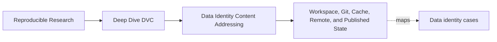
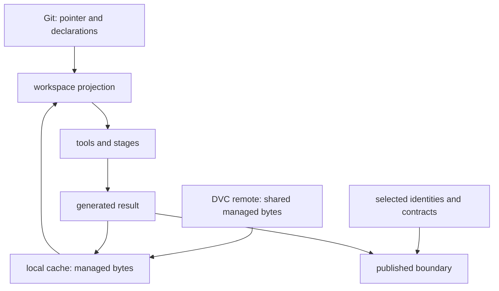

# Workspace, Git, Cache, Remote, and Published State

<!-- page-maps:start -->
## Page Maps




<!-- page-maps:end -->

A DVC project distributes state across layers. Confusion begins when a team treats one
layer as if it contained the whole project.

| Layer | Usually contains | Does not prove |
| --- | --- | --- |
| workspace | materialized files used by tools | recorded identity or durable recovery |
| Git | declarations, pointers, code, small policy | availability of DVC-managed bytes |
| local DVC cache | managed content available on one machine | shared durability |
| DVC remote | shared managed objects | tracked declarations or scientific meaning |
| published state | a selected result boundary for consumers | full development reconstruction |

The useful question is not “which layer is the truth?” It is:

> Which layer has authority for this claim, and which other layers must join it?

## Draw the normal state route



The arrows describe possible managed moves, not automatic guarantees. A remote supplies
the cache only when configured, authorized, and holding the requested object. Published
state contains only what its contract selects.

## Inspect the audit ledger

Run:

```bash
make PROGRAM=reproducible-research/deep-dive-dvc capstone-data-identity-audit
audit=artifacts/audit/reproducible-research/deep-dive-dvc/data-identity
```

Build a state ledger for the recovery cases:

| Case moment | Pointer | Workspace | Cache | Remote | Claim |
| --- | --- | --- | --- | --- | --- |
| after `dvc add` | present | present | present | absent | local identity recorded |
| workspace deleted | present | absent | present | absent | cache recovery possible |
| after checkout | present | restored | present | absent | local projection recovered |
| after push | present | present | present | present | remote contains object |
| workspace and cache deleted | present | absent | absent | present | remote recovery possible |
| after pull | present | restored | repopulated | present | remote recovery proven |
| pointer-only loss | present | absent | absent | absent | identity known, bytes unavailable |

This table makes failure diagnosis mechanical: identify what survives, then ask whether
that layer can supply the claim.

## Workspace is a projection

The workspace gives scripts a stable, human-readable path. It may be:

- present and matching recorded identity;
- present but modified;
- absent while cache remains;
- restored from cache or remote;
- generated from another stage.

Workspace presence alone is weak evidence. Compare it with recorded content identity.

In the cache-recovery case, deleting the workspace does not destroy content because the
cache retains the named object. Checkout re-projects the same bytes.

## Git preserves the map

Git typically holds:

- `.dvc` pointer files;
- `dvc.yaml` and `dvc.lock`;
- scripts, parameters, and policies;
- non-secret remote configuration;
- result and publication contracts.

Git can preserve exactly which DVC object is required. It usually does not hold the large
object itself.

The pointer-only case demonstrates the limit: Git metadata survives, but no content layer
can supply the bytes.

## Local cache provides machine-local materialization

The cache supports:

- efficient reuse;
- workspace checkout;
- avoiding duplicate local managed content;
- staging content for remote publication.

It is vulnerable to:

- machine loss;
- cache cleanup;
- workspace isolation;
- corruption;
- being unavailable to teammates.

A warm cache can make a command succeed even when shared recovery is broken. Test remote
durability after removing or isolating local cache state.

## Remote provides shared object availability

A configured remote can supply exact managed content to another cache. The audit proves
this by:

1. pushing the baseline object;
2. deleting workspace and local cache;
3. pulling from remote;
4. confirming workspace and cache return;
5. comparing restored SHA-256 and pointer ID with baseline.

```bash
jq '.findings[] |
  select(
    .finding == "REMOTE_RESTORES_AFTER_CACHE_LOSS" or
    .finding == "REMOTE_RECOVERY_PRESERVES_IDENTITY"
  )' "$audit/report.json"
```

The remote is authoritative for this bounded availability claim because local suppliers
were removed before pull.

It does not prove future retention, authorization for other identities, or completeness
for other pointers.

## Published state is a consumer contract

Published state may contain:

- result files;
- manifests;
- input and model identities;
- metrics and parameters;
- schema and interpretation;
- verification instructions.

It can support a consumer without exposing every intermediate artifact. That is useful,
but different from full workflow recovery.

Avoid:

> The release exists, so the entire training pipeline is recoverable.

Prefer:

> The published bundle supports the declared consumer claim. Full pipeline reconstruction
> additionally requires Git state, DVC inputs, intermediate dependencies, and runtime
> evidence.

## Name authority by question

| Claim | Primary authority | Required corroboration |
| --- | --- | --- |
| which bytes were recorded | pointer/lock | content digest inspection |
| which path tools use | declaration and workspace | materialization check |
| whether local checkout can recover | cache | checkout receipt and digest |
| whether another machine can recover | remote | cache-cold pull and digest |
| whether submitted result is current | lock/status | input and execution evidence |
| what consumers may rely on | published contract | manifest and integrity checks |
| whether data is scientifically suitable | domain contract | provenance, schema, validation |

There is no single “source of truth” for all rows.

## Preserve negative evidence

A failed checkout in the pointer-only case is valuable:

```bash
cat "$audit/evidence/pointer-only-checkout.stderr.txt"
jq '.findings[] |
  select(.finding == "POINTER_ONLY_IS_NOT_RECOVERABLE")' "$audit/report.json"
```

It establishes:

- identity metadata survived;
- local content did not;
- no remote supplier existed;
- checkout failed;
- workspace remained absent.

Do not repair first and then claim the pointer had been sufficient. Preserve the layer
ledger before intervention.

## Review a loss event by layer

Use:

```text
Claim:
Which recovery or review statement is being tested?

Recorded identity:
Which pointer or lock names the content?

Workspace:
Does the projection exist, and does it match?

Cache:
Does the named object exist locally?

Remote:
Is a route configured, readable, and proven to contain the object?

Published boundary:
Does a selected consumer artifact survive, and what does it cover?

Intervention:
Which command moved content from which layer to which layer?

Verification:
Which identity and semantic checks close the claim?

Limits:
Which layers, identities, or future durability remain untested?
```

## Avoid layer substitutions

| Evidence present | Missing evidence | Wrong conclusion |
| --- | --- | --- |
| pointer | cache and remote | data is backed up |
| workspace | pointer comparison | file is the recorded dataset |
| local cache | remote test | teammates can recover |
| remote object | tracked route | clean clone can discover storage |
| published result | workflow dependencies | project is fully reconstructable |
| successful checkout | remote receipt | remote recovery works |

## Review checkpoint

You understand the state layers when you can:

- identify what survives each audit loss event;
- explain why workspace deletion differs from content loss;
- show how Git preserves identity without bytes;
- prove when cache is the supplier;
- prove when remote is the supplier;
- separate published consumer state from workflow recovery;
- select authority according to the exact claim.

The durable model is:

> Identity, materialization, shared availability, execution, and publication live in
> different layers; trustworthy claims join the required layers without pretending one
> owns them all.
