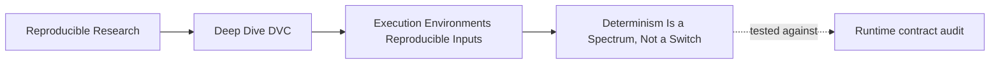
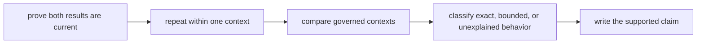
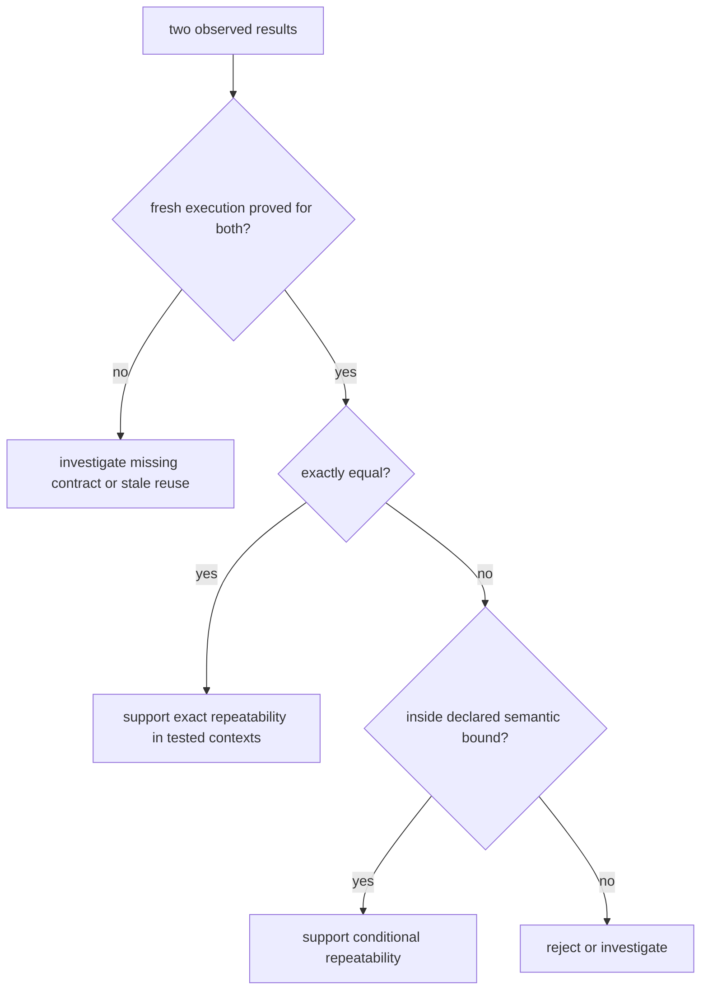
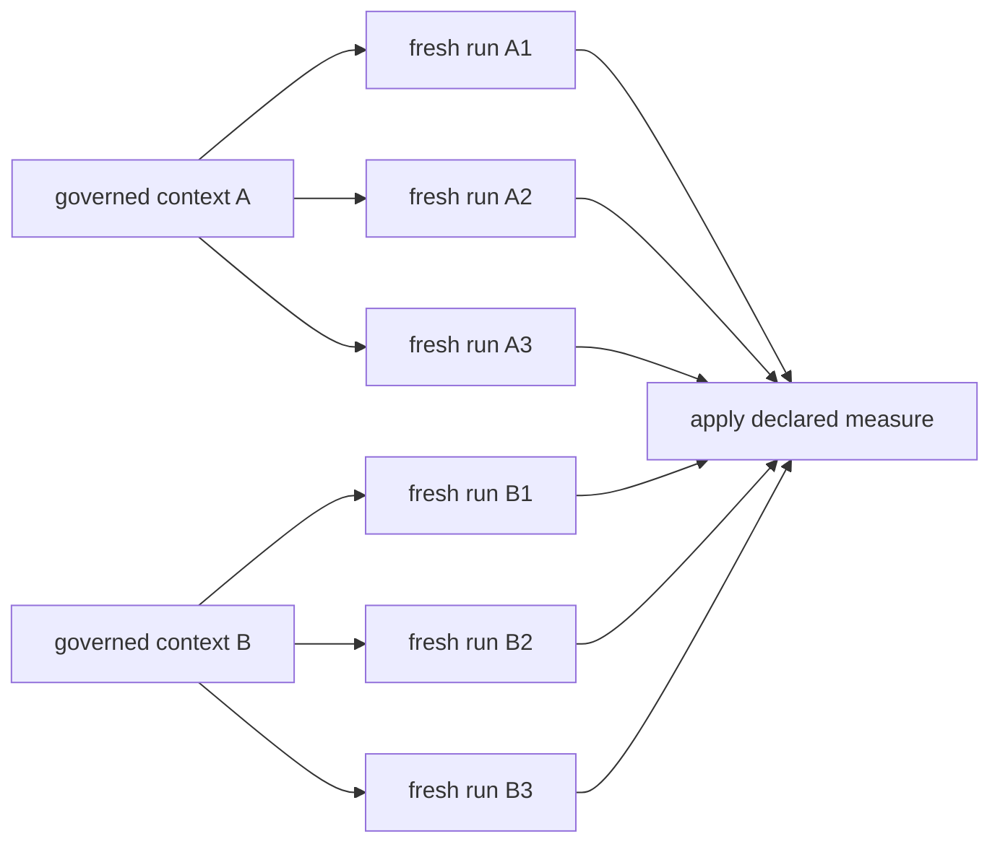

# Determinism Is a Spectrum, Not a Switch

<!-- page-maps:start -->
## Page Maps




<!-- page-maps:end -->

Teams often use *deterministic* as a verdict: the workflow either is deterministic or it
is not. That verdict hides the conditions under which the result was produced.

A more useful question is:

> Under which declared conditions, comparison method, and tolerance does this workflow
> produce a result we are willing to call repeatable?

The answer can require exact bytes, equal semantic values, or a bounded metric difference.
It must always require proof that the compared results were freshly produced under the
contexts being discussed.

## Separate four properties

These properties are related, but they are not synonyms:

| Property | Question | Evidence |
| --- | --- | --- |
| planner convergence | does an unchanged declared graph skip work? | settled repro receipt |
| execution repeatability | do fresh runs in one governed context agree? | repeated clean executions |
| cross-context stability | do fresh runs in two governed contexts agree? | paired fingerprints and results |
| semantic acceptability | are observed differences acceptable for the claim? | comparison policy and measured delta |

A pipeline may converge perfectly while reusing an output created under obsolete hidden
runtime state. It may repeat exactly on one machine yet differ on another. Two results may
differ in bytes while representing the same scientific value. “Deterministic” does not
tell a reviewer which of these claims was tested.

## The first gate is currency

Before comparing values, prove that each result reflects its stated context.

The runtime audit demonstrates why this gate matters:

| Result | Intended style | Stage executed after change? | Value | Current? |
| --- | --- | --- | --- | --- |
| declared case | `comma` | yes | `8,00` | yes |
| hidden case after ordinary repro | `comma` | no | `8.00` | no |
| hidden case after force | `comma` | yes | `8,00` | yes for this run only |

Calling the ordinary hidden result “stable across environments” would be false. The
second environment never produced it.



This ordering prevents a tolerance from laundering stale output.

## Describe determinism as a contract

A useful determinism contract names six things:

| Contract element | Example |
| --- | --- |
| result | validation metric JSON |
| governed context | lockfile hash and container digest |
| controlled runtime values | seed `41`, thread count `1` |
| execution method | clean DVC repro from the declared root |
| comparison method | parse JSON and compare `f1` |
| acceptance rule | absolute delta no greater than `0.002` |

Without the result, the claim is vague. Without context, it is unbounded. Without fresh
execution, it may describe cache reuse. Without a comparison method, “same” is ambiguous.
Without an acceptance rule, a reviewer cannot reproduce the judgment.

## Exact, conditional, and uncontrolled behavior

Use classifications that describe evidence rather than prestige:

### Exact in tested contexts

Fresh executions under the governed contexts produce identical comparison values.

This does not prove identity on every possible executor. State the contexts and the
comparison surface. For some outputs, byte identity is appropriate. For archives,
timestamps or member ordering may make semantic comparison more useful.

### Conditionally repeatable

Fresh executions may differ, but the causes and acceptable boundary are declared.

Examples include:

- a stochastic algorithm with a documented seed policy;
- parallel numerical reduction with an agreed metric tolerance;
- hardware-specific kernels compared by a domain-relevant measure.

Conditional does not mean unexplained. The conditions are the substance of the claim.

### Uncontrolled or unexplained

An influential fact is hidden, the compared results may not be current, or the observed
difference has no approved bound.

This is an investigation state, not an acceptable form of conditional determinism.

## Run the audit as a classification exercise

Generate the evidence:

```bash
make PROGRAM=reproducible-research/deep-dive-dvc capstone-runtime-contract-audit
```

Set a short path:

```bash
audit=artifacts/audit/reproducible-research/deep-dive-dvc/runtime-contracts
```

Read the accepted and rejected decisions:

```bash
column -t -s $'\t' "$audit/summary.tsv"
```

`PASS / ACCEPT` means the observed behavior supports a truthful contract. `PASS / REJECT`
means the audit successfully reproduced behavior that the production contract must reject.
The latter is not a failed test.

The important rejected finding is:

```text
ORDINARY_REPRO_PRESERVES_STALE_RUNTIME_MEANING  PASS  REJECT
```

The tool behaved consistently with its declared graph. The graph was incomplete relative
to the result claim.

## Distinguish stale reuse from tolerance

Suppose a metric is `0.843` locally and `0.844` in CI, and the accepted tolerance is
`0.002`. That numerical comparison is not enough.

First request:

- the runtime identity for each execution;
- proof that both stages ran after their relevant contexts were established;
- the data, parameter, and code identities;
- the exact comparison rule.

Only then calculate:

```text
absolute delta = |0.843 - 0.844| = 0.001
```

If both executions are current and their contexts are governed, the result is inside the
declared bound. If CI silently reused the local result, the same numbers would say nothing
about cross-context behavior.

| Observation | Correct classification | Why |
| --- | --- | --- |
| equal results, both freshly executed | exact agreement in tested contexts | execution evidence supports comparison |
| bounded difference, both freshly executed | conditional repeatability candidate | tolerance can now be applied |
| equal results, one stage skipped after hidden drift | stale reuse candidate | equality came without a current execution |
| unbounded difference after governed runs | rejected comparison | result exceeds contract |

## Use force as a causal probe

The audit forces the hidden stage:

```bash
cat "$audit/evidence/hidden-change-forced-repro.stdout.txt"
jq '.findings[] |
  select(.finding == "FORCED_RUN_CHANGES_OUTPUT_WITH_STABLE_DECLARATION") |
  .evidence' "$audit/report.json"
```

The output changes to `8,00`. This closes an important causal question: the current
process value can change the result.

It does not close the future-planning question:

- `dvc.yaml` is unchanged;
- the process variable still has no graph edge;
- another process-value change can again be invisible.

Force is therefore an experiment, not an operating policy.

## Design an honest repeated-run study

For real variability, use a study structure that can distinguish within-context noise from
between-context drift.



Record:

1. the immutable identity of each context;
2. the declared graph state used for every run;
3. a receipt proving every run executed;
4. the raw results;
5. the comparison calculation;
6. the predeclared acceptance boundary.

Three runs are an example, not a universal sample size. Choose repetition according to the
scientific and operational stakes. The durable principle is that the study design comes
before the surprising result.

## Choose the right equality

Exact file hashes are valuable when any byte change matters. They can be misleading when
formatting or metadata is intentionally variable.

| Output | Plausible comparison | Reason |
| --- | --- | --- |
| trained model used for release | content hash plus behavioral tests | serialization identity and behavior may both matter |
| metric JSON | parsed named metrics | key order and whitespace need not matter |
| rendered report | domain values plus approved presentation rules | presentation may itself carry meaning |
| row-oriented dataset | schema, row count, keys, and value checks | byte order may not define scientific equality |

In the runtime specimen, punctuation is deliberately semantic because the claim says the
result must adopt the current report style. Treating `8.00` and `8,00` as equivalent would
erase the very influence being tested.

## Avoid three weak conclusions

### “The hashes match, so the environments are equivalent”

Matching output hashes establish output identity for those observations. They do not
establish environment identity or prove that both contexts executed.

### “The numbers are close, so the workflow is conditionally deterministic”

Closeness requires a predeclared measure, a boundary, current executions, and governed
contexts.

### “The results differ, so reproducibility failed”

A declared, measured, accepted difference may be exactly what the workflow contract
allows. The failure is unexplained or unsupported divergence, not difference itself.

## Write the review statement

A strong statement has a limited scope:

> Three clean executions under each of container digests A and B used identical data,
> code, parameters, seed, and single-thread policy. Every execution receipt confirms the
> evaluation stage ran. The absolute `f1` delta remained below the predeclared `0.002`
> boundary. These results support conditional repeatability for this metric under the two
> tested contexts; they do not claim byte-identical artifacts elsewhere.

For the hidden runtime audit, the honest statement is different:

> The changed process policy was absent from the graph, status remained empty, and
> ordinary repro reused the old result. A forced run changed the output, proving the
> hidden policy was causal. No cross-context repeatability claim is supported until the
> runtime influence is governed and both results are freshly executed.

## Review checkpoint

You are ready to use the term *conditionally deterministic* when you can answer:

- Which result and semantic comparison does the claim cover?
- Which contexts were governed?
- What proves every compared result was freshly executed?
- What difference was measured?
- Was the acceptance boundary declared before review?
- Which contexts and outputs remain outside the claim?

The goal is not to choose a flattering label. It is to make the evidence boundary clear
enough that another researcher can repeat both the execution and the judgment.
