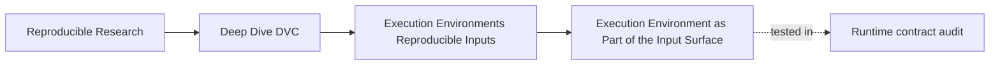
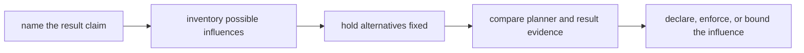
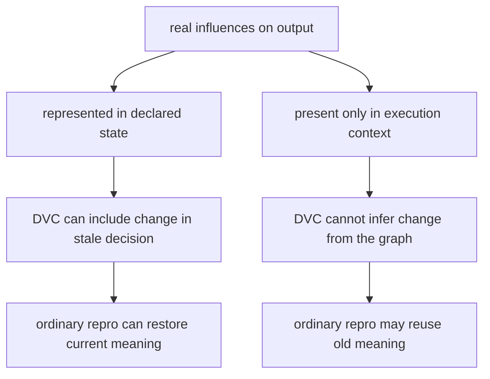

# Execution Environment as Part of the Input Surface

<!-- page-maps:start -->
## Page Maps




<!-- page-maps:end -->

A data pipeline does not run on code, data, and parameters alone. It also runs with an
interpreter, libraries, operating-system behavior, process variables, locale settings,
hardware, and services. Any of those facts can affect the result.

The useful rule is narrower than “record everything about the machine”:

> A runtime fact belongs to the input surface when changing it can change a result or the
> meaning of a result claim.

This module is about finding those facts, proving which ones matter, and giving influential
facts a reviewable route into the workflow contract.

## Begin with the claim, not the machine

An environment inventory can grow without limit. A claim gives the investigation a
boundary.

Suppose the claim is:

> `results/declared.txt` renders the total according to the repository's current report
> style.

The report style matters because `dot` produces `8.00` while `comma` produces `8,00`.
The keyboard layout does not matter to this claim. The operating-system family might
matter to another claim, but the audit holds it fixed.

Ask three questions:

1. What result or interpretation must remain trustworthy?
2. Which runtime facts could plausibly change it?
3. What observation would show that one fact is causal?

This prevents two common failures: ignoring runtime entirely and collecting a huge
machine dump that cannot support a decision.

## Four kinds of workflow influence

The words *input* and *environment* can blur important differences. Classify influences
by how they reach execution:

| Kind | Examples | Typical DVC representation |
| --- | --- | --- |
| content input | source data, model weights, lookup tables | `deps` |
| control input | threshold, seed, report style | `params` or a file in `deps` |
| implementation input | script, executable wrapper | `deps` |
| execution context | Python build, locale, process variables, accelerator | declared artifact or external executor policy |

The same fact can move between categories. A locale inherited silently from the process is
execution context. A locale written to `runtime.env` and listed in `deps` becomes a
declared control input. Its causal role did not change; its visibility did.



## Inspect the paired specimen

Run the module's controlled experiment from the repository root:

```bash
make PROGRAM=reproducible-research/deep-dive-dvc capstone-runtime-contract-audit
```

The command creates an isolated audit under:

```text
artifacts/audit/reproducible-research/deep-dive-dvc/runtime-contracts/
```

Start with:

```bash
cat artifacts/audit/reproducible-research/deep-dive-dvc/runtime-contracts/summary.tsv
cat artifacts/audit/reproducible-research/deep-dive-dvc/runtime-contracts/route.txt
```

The specimen has two stages. Both read the numbers `3` and `5`, run the same Python
renderer, and write a formatted total.

```yaml
stages:
  declared_runtime:
    cmd: >-
      python scripts/render_runtime.py
      --source data/source.txt
      --contract environment/runtime.env
      --output results/declared.txt
    deps:
      - data/source.txt
      - environment/runtime.env
      - scripts/render_runtime.py

  hidden_runtime:
    cmd: >-
      python scripts/render_runtime.py
      --source data/source.txt
      --environment-variable REPORT_STYLE
      --output results/hidden.txt
    deps:
      - data/source.txt
      - scripts/render_runtime.py
```

The two routes differ in one decisive way:

- `declared_runtime` reads report style from a dependency.
- `hidden_runtime` reads report style from process state that is absent from the graph.

At the baseline, both use `dot` and produce `8.00`. The audit then changes the intended
style to `comma`.

## Predict before reading

Write down your predictions for these cells:

| Case after policy changes | Will status name the stage? | Will ordinary repro run it? | Which value should remain? |
| --- | --- | --- | --- |
| declared contract file | ? | ? | ? |
| hidden process variable | ? | ? | ? |

Then inspect the report:

```bash
jq '.findings[] |
  {finding, result, decision, checks}' \
  artifacts/audit/reproducible-research/deep-dive-dvc/runtime-contracts/report.json
```

The declared change appears in `dvc status`; ordinary repro runs the stage and changes
the result to `8,00`.

The hidden change appears in the runtime fingerprint but not in `dvc status`; ordinary
repro skips and preserves `8.00`.

The hidden result is byte-stable and semantically stale. Stability alone is not
reproducibility.

## Read evidence in separate layers

The audit supplies four layers. Each closes a different question.

| Layer | Evidence | Question it can answer |
| --- | --- | --- |
| causal context | baseline and drift fingerprints | which tested runtime fact changed? |
| declaration | paired `dvc.yaml` stages | could DVC observe that fact before execution? |
| planner | status and repro receipts | did DVC decide the stage needed to run? |
| semantics | result files and report values | does output express current runtime meaning? |

Do not let one layer impersonate another:

- A changed fingerprint does not prove that output changed.
- Empty DVC status does not prove that runtime stayed constant.
- A changed result does not identify its cause.
- A changed lockfile after execution does not prove the cause was declared beforehand.

A defensible explanation joins all four.

## Prove causality with a controlled contrast

Local-versus-CI comparisons often change many things at once. Python, platform, package
resolution, credentials, filesystem layout, and data access may all differ. That can
identify a correlation but rarely isolates a cause.

The runtime audit is deliberately smaller:

| Held constant | Deliberately changed |
| --- | --- |
| Python version | `report_style` |
| Python implementation | |
| platform | |
| machine architecture | |
| data | |
| renderer code | |

Verify the isolation:

```bash
jq -s '
  {
    changed: (
      (.[0] | to_entries) as $left
      | (.[1] | to_entries) as $right
      | [
          $left[] as $item
          | select($item.value != ($right[] | select(.key == $item.key).value))
          | $item.key
        ]
    )
  }
' \
  artifacts/audit/reproducible-research/deep-dive-dvc/runtime-contracts/evidence/baseline-fingerprint.json \
  artifacts/audit/reproducible-research/deep-dive-dvc/runtime-contracts/evidence/drift-fingerprint.json
```

The forced hidden-stage run then provides the causal probe: under the changed process
variable, the result changes from `8.00` to `8,00`. The variable can affect the result.

That does not make force a repair. It proves the missing edge matters.

## Choose a governance route

Once an influence is shown to matter, choose how the repository will govern it:

| Route | Use when | Evidence a reviewer needs |
| --- | --- | --- |
| declared dependency | a runtime contract can be materialized as a file | dependency diff, stale receipt, rebuilt result |
| governed parameter | the value is a deliberate experimental control | parameter diff, lock evidence, comparison |
| pinned execution artifact | a packaged runtime defines the accepted stack | immutable identity such as image digest |
| canonical executor | one controlled service has authority to produce accepted evidence | executor identity, enforcement receipt, result |
| declared tolerance | fresh governed runs may differ acceptably | execution proof, comparison method, threshold |

These routes can be combined. A lockfile, container image, and CI policy often protect
different boundaries.

Merely printing a value in logs is not yet governance. A runtime receipt becomes useful
when a rule says which fields matter, an enforcement point checks them, and the result can
be joined to that check.

## Avoid the impossible promise

“Every environment fact must be identical forever” is usually neither practical nor
necessary. The goal is an honest contract:

- influential facts are declared, enforced, or explicitly bounded;
- irrelevant facts are not mistaken for controls;
- evidence can distinguish current execution from stale reuse;
- the claim states the contexts in which it is supported.

For this specimen, the supported claim is intentionally modest:

> When report style is a declared dependency, DVC detects its change and ordinary repro
> rebuilds output with current formatting policy.

The audit does not prove that containers eliminate variation, that every Python workflow
is deterministic, or that a fingerprint automatically governs the environment.

## Review checkpoint

You understand the input-surface idea when you can explain all of these without saying
“DVC tracks the environment”:

- why `REPORT_STYLE` is a real input to the hidden stage;
- why DVC cannot make a stale decision from an undeclared process variable;
- why the fingerprint is evidence of context, not a dependency edge;
- why the forced run proves causality but leaves the contract defective;
- which governance route you would choose for a comparable influence in your own work.

Carry this question into the rest of the module:

> Which real influence reaches the result, and which enforceable route makes it visible
> before the result is trusted?
