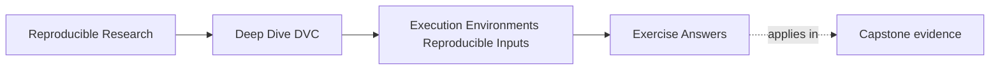
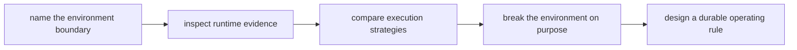

# Exercise Answers

<!-- page-maps:start -->
## Page Maps

<!-- page-maps:end -->

These answers are model explanations, not the only acceptable wording.

## How to use the answer page well

Do not read the model answer first and then shrink the whole module into "containers fix
it" or "environment drift is inevitable."

A better rhythm is:

1. finish the exercise with your own boundary table and environment packet
2. state the result claim and the environment facts that could move it
3. compare your reasoning with the model answer
4. revise anywhere your answer overclaims, blurs DVC's role, or skips the evidence route

What matters is whether the reasoning keeps result claims, runtime evidence, and
governance choices connected.

Strong Module 03 answers usually do five things:

- they treat environment as part of the input surface
- they distinguish acceptable sensitivity from unexplained drift
- they describe DVC's role precisely rather than magically
- they compare lockfiles, containers, and CI by responsibility
- they turn the lesson into a repeatable review or gate

The strongest self-study packets also leave behind six concrete artifacts:

- one environment boundary statement
- one DVC-versus-environment control table
- one environment fingerprint
- one deliberate drift experiment
- one strategy comparison table
- one governed drift gate

If your answers rely only on "same code, same result," the reasoning is still too thin.

## Answer 1: Name the environment as input

Why the claim is too strong:

- code, data, and parameters can remain aligned while runtime facts still influence the
  observed result

Which runtime facts may matter:

- interpreter or compiler versions
- numerical libraries
- operating-system behavior
- thread scheduling or parallel runtime choices
- locale, timezone, or filesystem conventions
- hardware or accelerator differences

Why this does not make the workflow hopeless:

- it means the team needs a clearer environment contract and evidence route, not a
  surrender of reproducibility

A strong next-evidence sentence is:

> Before deciding whether this is acceptable drift or a broken run, I want the two run
> fingerprints side by side: interpreter, dependency identity, platform, and any governed
> runtime flags.

The main lesson is that environment influence is ordinary engineering context, not magic.

## Answer 2: Explain conditional determinism

Why the workflow may still be honest:

- small divergence can come from runtime-sensitive numerical behavior even when the team
  changed nothing deceptively

What conditional determinism means:

- the workflow is reliably identical only under declared runtime conditions, not across
  every possible machine or dependency stack

What evidence to inspect next:

- environment fingerprints for both runs
- dependency identities
- governed tolerance rules for the metric or artifact
- any documentation that declares the canonical execution context

A reviewer-facing explanation might say:

> The result moved slightly across environments. That may still be honest if the workflow
> contract allows bounded runtime-sensitive variation. We need the two environment
> fingerprints and the declared tolerance before deciding whether this is acceptable or a
> reproducibility defect.

## Answer 3: Draw DVC's environment boundary

Strong note:

> DVC helps make data identity, parameters, and declared workflow state explicit. That is
> valuable because it gives us a clean record of which tracked inputs and stage contracts
> were supposed to produce the result. But DVC does not directly pin interpreter
> versions, package resolution, container images, operating-system behavior, or hardware.
> The distinction matters because teams can diagnose environment drift much faster with
> DVC while still needing separate controls to reduce or govern that drift.

Useful table:

| DVC clarifies | Separate environment controls |
| --- | --- |
| tracked data identity | dependency lockfiles |
| declared parameters | container images |
| stage contracts and lock evidence | CI executor policy |
| rerun decisions from declared influence | runtime flag governance |

One example failure:

- evaluation results differ because BLAS or numerical library versions changed; DVC makes
  the unchanged tracked inputs obvious, but it does not prevent the library drift itself

## Answer 4: Choose an environment strategy

Strong comparison:

| Control | What it contributes | What it does not cover well | When it is strongest |
| --- | --- | --- | --- |
| Lockfile | reviewable dependency resolution | host OS, native libs, hardware | local iteration and dependency review |
| Container | broader packaged runtime filesystem | secrets, network behavior, host scheduling | stable automation and shared execution |
| CI as canonical executor | one governed proof context | local developer convenience or all off-platform uses | release evidence and shared authority |

A strong operating model for this team is:

- use lockfiles so dependency changes are reviewable and reproducible locally
- build or pin a container image for the governed automation context
- treat CI as the canonical proof environment for accepted results

That combination is strong because it gives fast local work, explicit dependency history,
and one shared authority for result acceptance.

## Answer 5: Diagnose local-versus-CI drift

Environment evidence to inspect next:

- interpreter and tool versions
- resolved dependency identity
- container image digest if CI uses one
- platform or architecture differences
- governed runtime flags, seeds, locale, and thread settings

How to decide whether the difference is acceptable:

- compare the observed movement against the workflow's declared tolerance and the release
  significance of the metric or artifact

Repairs if the strategy is too weak:

- tighten dependency control with a governed lockfile
- move CI into a pinned image
- record environment fingerprints automatically
- declare CI explicitly as the proof context for accepted outputs

A disciplined PR sentence might say:

> DVC-tracked inputs agree, but local and CI environments still differ; we are comparing
> run fingerprints now to decide whether this is accepted numeric sensitivity or an
> environment-governance defect.

## Answer 6: Capture an environment fingerprint

A useful fingerprint is compact but discriminating. It usually includes:

- exact interpreter or compiler identity
- dependency lock hash or resolved environment export
- operating-system or image identity
- major tool versions
- governed runtime flags and meaningful environment variables

Values most likely to alter meaning include:

- numerical library identity
- package versions
- image digest
- locale, seed, or thread settings when relevant

Values that may be context only:

- hostname
- transient CI job number
- machine nickname

A strong smallest-reviewable fingerprint is:

> interpreter version, dependency identity, image or platform identity, and any governed
> runtime flags that can plausibly move the result.

## Answer 7: Break an environment deliberately

A strong answer preserves all non-environment inputs, records one explicit dependency
change, and compares outputs under the workflow's real acceptance rule.

What matters in the judgment:

- deterministic difference: the changed environment predictably produces a different but
  explainable result
- tolerated difference: the result moves within an agreed contract
- release blocker: the difference is unexplained, semantically important, or outside the
  accepted bound

The main lesson is that environment governance becomes concrete only when teams practice
failure classification instead of assuming every drift is either harmless or catastrophic.

## Answer 8: Compare lockfile and container guarantees

Strong comparison:

| Surface | Lockfile constrains | Container digest constrains |
| --- | --- | --- |
| language packages | yes | indirectly through the image filesystem |
| operating-system libraries | usually no | often yes, within the image |
| hardware | no | no |
| environment variables | no | no, unless separately governed |
| network access | no | no |
| entry commands | no | only if the image and execution policy declare them |

Why containers do not remove the need for dependency contracts:

- a container can package a runtime broadly, but teams still need reviewable dependency
  intent and explicit upgrade history. Otherwise the image becomes a large opaque blob
  with weak explanation of what actually changed.

## Answer 9: Design an environment drift gate

A strong gate does four things:

- checks governed environment identities such as lockfile hash or image digest
- records the resolved runtime as an artifact
- fails with the exact boundary that drifted
- defines an intentional upgrade path with result comparison and review

Example failure wording:

> Environment drift detected: CI resolved dependencies no longer match the approved
> lockfile hash for this result contract. Regenerate the governed environment, compare
> outputs, and submit the upgrade for review.

Reviewer expectation after a failure:

- inspect the changed environment evidence
- inspect the result comparison
- decide whether this is an approved upgrade or a defect

## Answer 10: Reproduce across two contexts

The comparison should include:

- both environment fingerprints
- the exact command and tracked inputs
- the output comparison rule
- the conclusion about whether current governance is adequate

Matching digests are strong evidence when exact identity is expected. For numerically
sensitive work, the honest contract may instead be bounded metric variation plus stable
scientific interpretation.

A strong final conclusion sounds like this:

> Our current strategy is strong enough only if we treat CI as canonical and record the
> runtime fingerprint automatically. Local runs are still useful, but they are not yet a
> fully governed proof environment.

## Self-check

If your answers consistently explain:

- why environment belongs in the input surface
- why conditional determinism is a serious engineering concept
- what DVC clarifies without directly managing
- how environment strategies trade explicitness, stability, and authority
- how a governed gate turns theory into durable team practice

then you are using Module 03 correctly.
