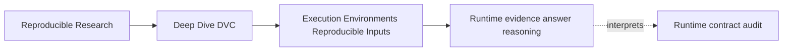
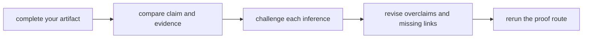
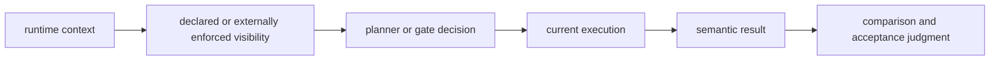
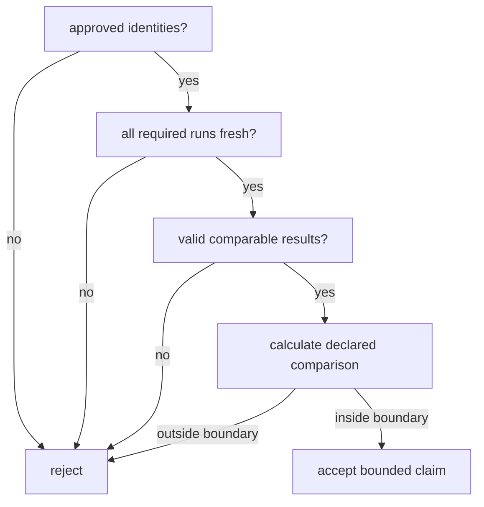

# Exercise Answers

<!-- page-maps:start -->
## Page Maps




<!-- page-maps:end -->

These are model reasoning routes, not text to copy. Compare the structure of your argument,
the evidence you chose, and the limits you stated. A different design can be stronger if
it closes the same questions with equally inspectable evidence.

Use this answer page effectively:

1. Open your artifact beside the corresponding answer.
2. Mark every claim in your work that lacks a receipt, rule, or comparison.
3. Mark every receipt that you asked to prove more than it can.
4. Revise the artifact, then rerun its validation command.

The central discipline across all answers is:



Skipping a link produces a weaker claim.

## Answer: Bound the runtime-sensitive claim

A strong bounded claim is:

> For the paired specimen, a result is semantically current when its `style` and
> `rendered` fields reflect the report-style policy used for that execution. The audit
> tests whether DVC reacts when this policy is declared and when the equivalent influence
> exists only in process state.

A model input-surface table:

| Influence | Source | Can change result? | Representation before execution | Governance status |
| --- | --- | --- | --- | --- |
| source numbers | `data/source.txt` | yes, changes total | file in `deps` | declared |
| renderer code | `scripts/render_runtime.py` | yes, changes calculation or format | file in `deps` | declared |
| declared report style | `environment/runtime.env` | yes, changes style and punctuation | file in `deps` | declared |
| hidden report style | process `REPORT_STYLE` | yes, same formatting effect | absent from graph; fingerprint observes it | defective |
| Python version | interpreter | plausibly, though not in this contrast | fingerprint only | observed, held constant |

The deliberately changed fact is `report_style`. The audit holds Python version,
implementation, platform, machine, data, and renderer code constant.

The comparison checks semantic fields:

```text
dot   -> style=dot, rendered=8.00
comma -> style=comma, rendered=8,00
```

Two necessary limits:

- The audit does not prove every relevant environment fact is captured.
- The audit does not characterize numerical or hardware nondeterminism.

Why this reasoning is stronger than “environment is an input”: it names a result claim,
one causal influence, its representation, and the tested boundary.

## Answer: Predict planner behavior from declarations

A model prediction table:

| Case | Declared route | Expected status | Expected repro | Expected result |
| --- | --- | --- | --- | --- |
| settled baseline | all recorded declarations match | empty | skip | retained dot |
| contract becomes comma | changed file in `deps` | `declared_runtime` stale | execute declared stage | comma |
| process becomes comma | no declared value or artifact | empty | skip hidden stage | retained dot |
| second repro after declared rebuild | changed dependency and output now recorded | empty | skip | retained comma |
| forced hidden execution | force bypasses stale decision | status need not be stale | execute hidden stage | comma |

The crucial reasoning happens before output is inspected:

- DVC can compare the declared contract file.
- DVC cannot compare a process value that has no representation in stage state.
- Force requests execution regardless of ordinary staleness.

An incorrect prediction such as “DVC reads `REPORT_STYLE` because the Python command does”
confuses the executed program with DVC's dependency model. DVC sees command text, but the
value inherited at process launch is not embedded in that text.

A useful correction note is:

> I predicted the hidden stage would become stale because its program consumes the
> variable. The declaration shows that DVC has no value or artifact to compare. Program
> causality does not create planner visibility automatically.

## Answer: Inventory evidence by inferential role

Representative rows:

| Evidence | Primary layer | Question closed | Question not closed |
| --- | --- | --- | --- |
| `summary.tsv` | enforcement | did every audit assertion pass, and which behavior is accepted? | what exact receipt supports each assertion? |
| paired fingerprints | context | which recorded runtime fields differ? | did the stage run or output change? |
| declared status | planner | which declared change makes the stage stale? | did rebuild complete? |
| hidden status | planner | did any declared influence make the stage stale? | did runtime context stay fixed? |
| ordinary repro receipt | execution | did DVC run or skip the hidden stage? | why the hidden influence is absent |
| forced repro receipt | execution | did the diagnostic execution occur? | was future stale detection repaired? |
| result values | semantics | which report style the output expresses | which context caused it without paired evidence |
| declaration hash | declaration | did stage declaration change across force? | whether the process variable affects output |
| lock hashes | execution | did recorded execution/output state change after force? | whether hidden state is visible before execution |
| audit tests | enforcement | which invariants the audit checks | whether those invariants cover a real project's claim |

The `summary.tsv` distinction matters:

- `PASS / ACCEPT`: the audit observed behavior the truthful contract should preserve.
- `PASS / REJECT`: the audit successfully reproduced a defect the truthful contract
  should reject.

Calling both merely “tests passed” loses the educational decision.

## Answer: Reconstruct lock evidence in time order

A model chronology:

### Baseline after dot execution

- Declaration has no edge for hidden `REPORT_STYLE`.
- Lock records the dependencies and output from the dot execution.
- Intended and result styles are both dot.
- The result is current for that baseline context.

### Process policy changes to comma

- Declaration is byte-for-byte unchanged.
- Lock is unchanged because no execution happened.
- Intended style is comma; retained result still says dot.
- The result is not evidence of comma-context execution.

### Ordinary repro skips

- Empty status follows from unchanged declared state.
- Lock remains unchanged.
- The ordinary repro receipt confirms the hidden stage did not execute.
- The dot result is now semantically stale relative to comma intent.

### Forced execution

- Declaration remains unchanged.
- The stage executes under comma process state.
- Result changes to comma.
- Lock changes to record the new execution/output identity.

The useful inference from the changed lock is:

> The forced execution produced new recorded stage state and output identity.

The unsupported inference is:

> DVC can now detect future `REPORT_STYLE` changes.

The stale decision occurs before a future execution. Because the declaration still lacks
the value, the next change can remain invisible.

## Answer: Prove the hidden runtime diagnosis

A model diagnosis:

**Observed symptom**

The current process context requests comma formatting, but ordinary repro retains a result
whose style is dot.

**Competing explanations**

Data, renderer code, Python, platform, report style, or stale reuse could explain the
observation.

**Controlled facts**

The paired specimen keeps source data and renderer code fixed. Fingerprints show Python,
implementation, platform, and machine match.

**Changed fact**

The fingerprint changes only `report_style` from dot to comma.

**Planner and execution evidence**

Hidden status is empty and the ordinary repro receipt says the pipeline is up to date.
The hidden stage does not execute.

**Semantic evidence**

The retained result remains `style=dot` and `rendered=8.00`.

**Causal intervention**

Forced execution under comma changes output to `style=comma` and `rendered=8,00`.

**Contract finding**

`dvc.yaml` remains unchanged and contains no representation of the process value.

**Supported conclusion**

> Report style is causal for this output and undeclared for the hidden stage. Ordinary
> repro therefore preserves stale semantic meaning when only the process value changes.

**Remaining limits**

The audit isolates one deterministic formatting influence. It does not establish how
other environment changes affect other stages.

Why force is evidence rather than repair: it manipulates execution while leaving planner
inputs unchanged.

## Answer: Choose an environment strategy by threat

A model result claim:

> Accepted evaluation reports are produced by CI from reviewed source, DVC data and
> parameters, the approved dependency resolution and image digest, with declared locale
> and thread count.

A model threat table:

| Threat | Control | Enforcement | Receipt |
| --- | --- | --- | --- |
| Python dependency resolution drifts | hashed lockfile | image build and CI verify lock identity | lock hash plus installation/build record |
| native numerical library drifts | immutable image | CI permits approved digest | image digest |
| locale changes report semantics | runtime contract in `deps` | schema validation before DVC repro | contract hash and status/repro evidence |
| thread count changes numerical behavior | selected parameter or contract field | pre-execution gate | governed value in run manifest |
| unapproved executor accepts result | canonical CI policy | protected acceptance workflow | signed or retained run manifest |

Roles:

- The lockfile defines reviewed language resolution.
- The image packages the resolved dependencies and native library.
- CI verifies identities, executes the pipeline, and has acceptance authority.
- DVC connects declared data, parameters, code, and runtime controls to stale decisions and
  result evidence.

Residual limits might include:

- macOS local runs support development but not acceptance;
- the host kernel remains outside the image;
- external data services are outside the claim unless snapshotted;
- reconstruction depends on retaining the image digest and accessible image content.

A sensible rejected control is GPU attestation because GPU execution is explicitly
unsupported. Adding it would create maintenance without protecting the stated claim.

The strategy succeeds when evidence from the lock, image, executor, DVC, and result shares
one run identity.

## Answer: Design a fresh-execution tolerance gate

Correct decisions:

| Case | Delta | Currency gate | Decision |
| --- | --- | --- | --- |
| `0.843` versus `0.844`, complete proof | `0.001` | pass | accept |
| `0.843` versus `0.838`, complete proof | `0.005` | pass | reject outside tolerance |
| equal `0.843`, B skipped after hidden drift | `0.000` | fail | reject before comparison |

Model pseudocode:

```text
require approved_executor_identity(A, B)
require matching_code_data_parameter_identities(A, B)
require valid_result_schema(A, B)
require three_fresh_evaluation_receipts(A)
require three_fresh_evaluation_receipts(B)

delta = absolute_difference(A.f1, B.f1)
accept only if every paired or aggregate comparison follows the declared method
and delta <= 0.002
```

The exact aggregation rule for three runs must be declared. Options include comparing
means, every pair, or distributions; they make different claims. A stronger answer names
one. For example:

> Compare the mean `f1` from three fresh runs per executor; require absolute mean delta no
> greater than `0.002`, and retain every raw result.

The gate order is non-negotiable:



## Answer: Design a joined executor manifest

A compact model:

```json
{
  "schema_version": "runtime-evidence-manifest/v1",
  "run_id": "example-run-identity",
  "source": {
    "git_commit": "example-git-sha",
    "dvc_yaml_sha256": "example-declaration-sha256",
    "dvc_lock_sha256": "example-lock-sha256",
    "data_revision": "example-data-revision",
    "params_sha256": "example-parameter-sha256"
  },
  "runtime": {
    "dependency_lock_sha256": "example-dependency-lock-sha256",
    "container_digest": "sha256:example-image-digest",
    "platform": "linux/amd64",
    "controls": {
      "locale": "C.UTF-8",
      "thread_count": 1
    }
  },
  "execution": {
    "executor": "canonical-ci",
    "started_at": "2030-01-01T12:00:00Z",
    "completed_at": "2030-01-01T12:10:00Z",
    "dvc_receipt_sha256": "example-receipt-sha256"
  },
  "results": [
    {
      "path": "metrics.json",
      "sha256": "example-result-sha256"
    }
  ],
  "decision": {
    "status": "accepted",
    "policy": "evaluation-runtime-policy"
  }
}
```

Observations include platform and timestamps. Enforced controls include approved image
digest, lock identity, locale, and thread count. The run ID binds the evidence packet;
hashes and artifact references let reviewers detect substitution.

Do not put secret values, access tokens, private environment dumps, or credentials in the
manifest. A safe secret version or policy identity may be appropriate if it reveals no
sensitive value.

The manifest is only trustworthy if the canonical executor creates or signs it after
enforcing the controls. A developer-authored JSON file with plausible values is a claim,
not a receipt.

## Answer: Specify and test a contract repair

A direct repaired stage:

```yaml
hidden_runtime:
  cmd: >-
    python scripts/render_runtime.py
    --source data/source.txt
    --contract environment/runtime.env
    --output results/hidden.txt
  deps:
    - data/source.txt
    - environment/runtime.env
    - scripts/render_runtime.py
  outs:
    - results/hidden.txt
```

The contract:

```text
REPORT_STYLE=dot
```

It is safe to record because report style is non-secret policy. A repository owner or
validated configuration generator can establish it.

Acceptance matrix:

| Test case | Expected status | Expected execution | Expected semantic result |
| --- | --- | --- | --- |
| settled baseline | empty | skip | dot |
| contract changes to comma | repaired stage stale | not yet | retained dot until rebuild |
| ordinary repro after change | becomes settled | execute | comma |
| second repro after rebuild | empty | skip | retained comma |
| unrelated process variable changes | empty | skip | retained governed comma |

The negative test removes `environment/runtime.env` from `deps`, settles the stage, changes
the contract, and asserts that the test suite fails because the stage is not reported
stale. The test should fail on the missing edge, not merely on output after force.

An alternative parameter-based repair can be valid. It must still prove that the command
consumes the selected parameter and that changing the parameter makes the stage stale.

## Answer: Assemble an independent runtime review

A strong entry document is short because the evidence is organized, not because reasoning
is omitted.

Model opening:

> This packet tests whether report-style policy participates in DVC stale decisions. The
> declared case changes a dependency, becomes stale, executes, and adopts current meaning.
> The hidden case changes only process state; status remains empty and ordinary repro
> preserves old meaning. A forced execution changes output without changing the
> declaration, proving a causal but undeclared influence.

Model artifact route:

| Artifact | Review purpose |
| --- | --- |
| `claim-boundary.md` | states exactly what is tested |
| `planner-predictions.tsv` | distinguishes declaration-based expectation from observation |
| `evidence-inventory.tsv` | prevents evidence-layer overclaims |
| `lock-chronology.md` | explains pre- and post-execution state |
| `causal-diagnosis.md` | joins contrast, planner, execution, and semantics |
| `environment-strategy.md` | assigns control ownership |
| `tolerance-gate.md` | rejects stale comparison before numeric judgment |
| `executor-manifest.json` | joins runtime and result identities |
| `contract-repair.md` | specifies durable repair and acceptance tests |

Model unresolved risks:

- the specimen tests one formatting influence, not a real numerical stack;
- the proposed CI manifest design is not implemented here;
- image rebuild provenance needs separate evidence;
- external services and secrets remain outside the specimen;
- a real repeated-run study needs a domain-specific comparison design.

Model regeneration commands:

```bash
make PROGRAM=reproducible-research/deep-dive-dvc capstone-runtime-contract-audit
make PROGRAM=reproducible-research/deep-dive-dvc capstone-runtime-contract-selftest
jq empty artifacts/learning/deep-dive-dvc/runtime-evidence/executor-manifest.json
```

The final quality test is handoff:

> Can a reviewer move from the claim to the exact receipt, repeat the inference, locate
> the decision rule, and see the residual limit without asking what you meant?

If not, revise the route rather than adding a broad summary.

## Self-review standard

Your packet should now make these distinctions without prompting:

- influential runtime fact versus exhaustive machine inventory;
- declared dependency versus observed fingerprint;
- planner convergence versus current-context execution;
- lock evidence after execution versus stale visibility before execution;
- causal force probe versus durable repair;
- immutable runtime identity versus proof it was enforced;
- bounded fresh-run variation versus stale semantic reuse;
- passing audit assertion versus acceptable production behavior.

Those distinctions are the practical skill of Module 03.
