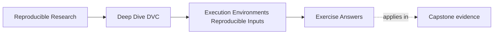
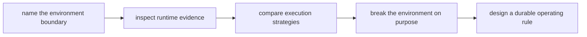

# Exercise Answers

<!-- page-maps:start -->
## Page Maps

<!-- page-maps:end -->

These answers are model explanations, not the only acceptable wording.

## How to use the answer page well

Do not read the model answer first and then shrink the whole module into "containers fix
it" or "environment drift is inevitable."

A better rhythm is:

1. finish the exercise with your own boundary table and environment packet
2. state the result claim and the environment facts that could move it
3. compare your reasoning with the model answer
4. revise anywhere your answer overclaims, blurs DVC's role, or skips the evidence route

What matters is whether the reasoning keeps result claims, runtime evidence, and
governance choices connected.

Strong Module 03 answers usually do five things:

- they treat environment as part of the input surface
- they distinguish acceptable sensitivity from unexplained drift
- they describe DVC's role precisely rather than magically
- they compare lockfiles, containers, and CI by responsibility
- they turn the lesson into a repeatable review or gate

The strongest self-study packets also leave behind six concrete artifacts:

- one environment boundary statement
- one DVC-versus-environment control table
- one environment fingerprint
- one deliberate drift experiment
- one strategy comparison table
- one governed drift gate

If your answers rely only on "same code, same result," the reasoning is still too thin.

## Answer 1: Name the environment as input

Why the claim is too strong:

- code, data, and parameters can remain aligned while runtime facts still influence the
  observed result

Which runtime facts may matter:

- interpreter or compiler versions
- numerical libraries
- operating-system behavior
- thread scheduling or parallel runtime choices
- locale, timezone, or filesystem conventions
- hardware or accelerator differences

Why this does not make the workflow hopeless:

- it means the team needs a clearer environment contract and evidence route, not a
  surrender of reproducibility

A strong next-evidence sentence is:

> Before deciding whether this is acceptable drift or a broken run, I want the two run
> fingerprints side by side: interpreter, dependency identity, platform, and any governed
> runtime flags.

The main lesson is that environment influence is ordinary engineering context, not magic.

## Answer 2: Explain conditional determinism

Why the workflow may still be honest:

- small divergence can come from runtime-sensitive numerical behavior even when the team
  changed nothing deceptively

What conditional determinism means:

- the workflow is reliably identical only under declared runtime conditions, not across
  every possible machine or dependency stack

What evidence to inspect next:

- environment fingerprints for both runs
- dependency identities
- governed tolerance rules for the metric or artifact
- any documentation that declares the canonical execution context

A reviewer-facing explanation might say:

> The result moved slightly across environments. That may still be honest if the workflow
> contract allows bounded runtime-sensitive variation. We need the two environment
> fingerprints and the declared tolerance before deciding whether this is acceptable or a
> reproducibility defect.

## Answer 3: Draw DVC's environment boundary

Strong note:

> DVC helps make data identity, parameters, and declared workflow state explicit. That is
> valuable because it gives us a clean record of which tracked inputs and stage contracts
> were supposed to produce the result. But DVC does not directly pin interpreter
> versions, package resolution, container images, operating-system behavior, or hardware.
> The distinction matters because teams can diagnose environment drift much faster with
> DVC while still needing separate controls to reduce or govern that drift.

Useful table:

| DVC clarifies | Separate environment controls |
| --- | --- |
| tracked data identity | dependency lockfiles |
| declared parameters | container images |
| stage contracts and lock evidence | CI executor policy |
| rerun decisions from declared influence | runtime flag governance |

One example failure:

- evaluation results differ because BLAS or numerical library versions changed; DVC makes
  the unchanged tracked inputs obvious, but it does not prevent the library drift itself

## Answer 4: Choose an environment strategy

Strong comparison:

| Control | What it contributes | What it does not cover well | When it is strongest |
| --- | --- | --- | --- |
| Lockfile | reviewable dependency resolution | host OS, native libs, hardware | local iteration and dependency review |
| Container | broader packaged runtime filesystem | secrets, network behavior, host scheduling | stable automation and shared execution |
| CI as canonical executor | one governed proof context | local developer convenience or all off-platform uses | release evidence and shared authority |

A strong operating model for this team is:

- use lockfiles so dependency changes are reviewable and reproducible locally
- build or pin a container image for the governed automation context
- treat CI as the canonical proof environment for accepted results

That combination is strong because it gives fast local work, explicit dependency history,
and one shared authority for result acceptance.

## Answer 5: Diagnose local-versus-CI drift

Environment evidence to inspect next:

- interpreter and tool versions
- resolved dependency identity
- container image digest if CI uses one
- platform or architecture differences
- governed runtime flags, seeds, locale, and thread settings

How to decide whether the difference is acceptable:

- compare the observed movement against the workflow's declared tolerance and the release
  significance of the metric or artifact

Repairs if the strategy is too weak:

- tighten dependency control with a governed lockfile
- move CI into a pinned image
- record environment fingerprints automatically
- declare CI explicitly as the proof context for accepted outputs

A disciplined PR sentence might say:

> DVC-tracked inputs agree, but local and CI environments still differ; we are comparing
> run fingerprints now to decide whether this is accepted numeric sensitivity or an
> environment-governance defect.

## Answer 6: Predict the runtime audit

Expected results:

| Finding | Decision | Reason |
| --- | --- | --- |
| `BASELINE_CONVERGES` | `ACCEPT` | both stages settle under dot context |
| `DECLARED_RUNTIME_CHANGE_IS_STALE` | `ACCEPT` | contract file is a dependency |
| `DECLARED_RUNTIME_REBUILD_ADOPTS_POLICY` | `ACCEPT` | rebuild produces comma meaning |
| `HIDDEN_RUNTIME_CHANGE_IS_INVISIBLE` | `REJECT` | process variable has no graph edge |
| `ORDINARY_REPRO_PRESERVES_STALE_RUNTIME_MEANING` | `REJECT` | skipped stage retains dot output |
| `FORCED_RUN_CHANGES_OUTPUT_WITH_STABLE_DECLARATION` | `REJECT` | force proves cause but not governance |
| `FINGERPRINT_EXPOSES_RUNTIME_MISMATCH` | `ACCEPT` | changed field is isolated |

The three rejected rows are successful negative tests. Accepting them in a production
contract would allow semantically stale output or recurring forced execution.

## Answer 7: Join fingerprints to planner evidence

Python, implementation, platform, and machine remain fixed. `report_style` changes from
`dot` to `comma`.

The declared status names `declared_runtime`; the hidden status is empty. After ordinary
repro, declared output is `8,00`, while hidden output remains `8.00`.

The fingerprint proves context differs. It does not make DVC stale because DVC compares
declared graph state, not arbitrary audit JSON. To influence planning, the governed fact
must enter a dependency, parameter, or enforced external contract.

## Answer 8: Distinguish stale reuse from tolerance

| Observation | Classification |
| --- | --- |
| hidden output remains `8.00` after skip | under-rebuild |
| force changes hidden output to `8,00` | deterministic runtime influence |
| declared rebuild produces `8,00` | truthful rebuild |
| fresh governed runs differ within a bound | conditional determinism candidate |

Tolerance cannot approve the first row because no current-context result exists to
compare. A stable old value is not evidence of low variation.

Conditional determinism requires fresh executions, governed context evidence, a comparison
measure, and a predeclared acceptance boundary.

## Answer 9: Audit force as a diagnostic

The expected four-surface comparison is:

| Surface | Before force | After force |
| --- | --- | --- |
| hidden result | dot / `8.00` | comma / `8,00` |
| runtime fingerprint | dot baseline | comma drift |
| `dvc.yaml` hash | unchanged | unchanged |
| `dvc.lock` hash | old output | new output |

The process variable caused the semantic change. The lock recorded the new output after
execution, while the declaration still omitted the cause.

A durable repair is to materialize the runtime policy in a declared file or enforce an
approved environment identity before execution. “Always use force” is not policy because
it neither detects which context changed nor repairs future stale decisions.

## Answer 10: Design the runtime review contract

A complete packet joins:

1. paired stage declarations
2. baseline and drift fingerprints
3. declared and hidden status receipts
4. ordinary repro receipt
5. pre-force and post-force semantic outputs
6. declaration and lock hashes

For a locale-like runtime fact, a declared contract file is appropriate when repository
execution should react directly. A canonical executor gate is appropriate when image or
platform identity is governed outside DVC. The choice must identify who enforces the
fact and which receipt joins it to the result.

Example failure:

> Runtime contract mismatch: `REPORT_STYLE=comma` differs from the declared dot context,
> but the stage has no declared or externally approved runtime edge. Reject result reuse;
> repair the contract and rebuild before comparison.

A bounded conclusion is:

> The isolated runtime field changed while code, data, Python, and platform stayed fixed.
> Declared runtime state triggered rebuild and current output; hidden state produced empty
> status and stale reuse until force. Force changed lock evidence without changing the
> declaration. The runtime influence is causal and must be governed before tolerance or
> release review.

Only after fresh governed execution should reviewers ask whether a real numerical delta
fits the workflow's declared tolerance.

## Self-check

If your answers consistently explain:

- why environment belongs in the input surface
- why conditional determinism is a serious engineering concept
- what DVC clarifies without directly managing
- how environment strategies trade explicitness, stability, and authority
- how a governed gate turns theory into durable team practice

then you are using Module 03 correctly.
