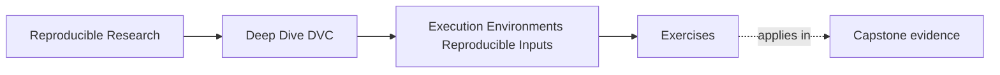

# Exercises

<!-- page-maps:start -->
## Page Maps

<!-- page-maps:end -->

Use these exercises to practice environment judgment, not only runtime vocabulary.

The strongest answers will make the environment boundary, DVC boundary, and evidence route
explicit.

## Exercise 1: Name the environment as input

A teammate says:

> the code, data, and parameters are unchanged, so the environment cannot be the reason the result moved.

Write a short response that explains:

- why this claim is too strong
- which kinds of runtime facts may still matter
- why that does not make the workflow hopeless

## Exercise 2: Explain conditional determinism

You see a tiny metric difference between two honest runs on different machines.

Explain:

- why the workflow may still be behaving honestly
- what it means to call the workflow conditionally deterministic
- what kind of follow-up evidence you would want next

## Exercise 3: Draw DVC's environment boundary

A teammate says:

> once we use DVC, environment drift stops being our problem.

Write a short note that explains:

- what DVC really helps with in this situation
- what it still does not manage directly
- why the distinction matters

## Exercise 4: Choose an environment strategy

A small team wants:

- reviewable dependency changes
- more stable CI behavior
- faster local iteration

Explain how you would think about:

- lockfiles
- containers
- CI as a canonical executor

You do not need to choose only one, but you should explain what each contributes.

## Exercise 5: Diagnose local-versus-CI drift

A workflow differs slightly between local and CI runs.

You already confirmed:

- the DVC-tracked data matches
- `params.yaml` matches
- the declared workflow matches

Describe:

- what environment evidence you would inspect next
- how you would decide whether the difference is acceptable or needs escalation
- what kind of repair might follow if the current environment strategy is too weak

## Exercise 6: Capture an environment fingerprint

Run one pipeline stage and record the interpreter, operating system, dependency lock
digest, relevant tool versions, and container image digest if used. Identify which values
can change result meaning.

## Exercise 7: Break an environment deliberately

Change one dependency version while keeping code, data, and parameters fixed. Compare the
output and logs, then decide whether the difference is deterministic, tolerated, or a
release blocker.

## Exercise 8: Compare lockfile and container guarantees

Write a table showing what a language lockfile and a container digest each constrain.
Include operating-system libraries, hardware, environment variables, network access, and
entry commands.

## Exercise 9: Design an environment drift gate

Specify a CI check that detects accidental environment drift before accepting a result.
Name its inputs, evidence artifact, failure message, and the exception process for an
intentional upgrade.

## Exercise 10: Reproduce across two contexts

Run a small stage locally and in a second context such as CI, a container, or another
machine. Compare content digests and runtime evidence, and explain any difference without
assuming byte identity is always required.

## Mastery check

You have a strong grasp of this module if your answers consistently keep four ideas
visible:

- environment is part of the input surface
- determinism is often conditional rather than absolute
- DVC helps make drift diagnosable without owning all of environment management
- lockfiles, containers, and CI solve different parts of the runtime problem
