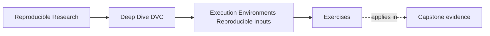
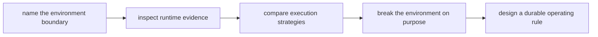
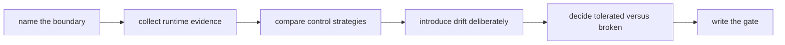

# Exercises


<!-- page-maps:start -->
## Page Maps




<!-- page-maps:end -->

Use these exercises to practice environment judgment, not only runtime vocabulary.

The goal of the day is to stop saying "the code and data were the same" as if that
settles the result. In real reproducible work, the environment is part of the input
surface. The hard part is not memorizing that slogan. The hard part is learning how to
name the boundary, collect the right evidence, and decide which differences matter.

## How to work through this set

Treat the ten exercises as one full lab day on environment authority.

Before each answer:

1. name the result claim under review
2. name the environment facts that could change that claim
3. say what evidence would separate acceptable drift from a real reproducibility failure

Do the exercises in order. The day is one progression:

- Exercises 1-3 define the boundary and separate DVC's job from environment management
- Exercises 4-5 compare lockfiles, containers, and CI as control strategies
- Exercises 6-8 collect evidence and break the environment on purpose
- Exercises 9-10 turn the lesson into a reviewable gate and a cross-context proof

Keep one environment packet as you go. By the end of the day it should contain:

- one plain-language statement of why environment is part of the input surface
- one boundary table separating DVC-managed state from environment-managed state
- one environment fingerprint from a real run
- one deliberate drift experiment with a written judgment
- one strategy comparison table for lockfiles, containers, and CI
- one environment drift gate design with failure wording and exception process

If those six artifacts are missing, you are probably still reading about environment drift
instead of learning how to govern it.

## Recommended working layout

If you want one lab tree that can support the whole day, use something like:

```text
module03-lab/
├── artifacts/
├── containers/
├── notes/
├── params.yaml
├── requirements.lock
└── src/
```

Keep one boundary table while you work:

| Surface | Example evidence | What it can prove | What it cannot prove by itself |
| --- | --- | --- | --- |
| DVC-tracked inputs | `dvc.lock`, hashes, `params.yaml` | declared data and parameter identity | runtime library or platform state |
| Dependency contract | lockfile, package manifest | resolved dependency intent | host image, kernel, or hardware |
| Execution image | container digest, image recipe | packaged runtime filesystem | external services or runtime flags |
| Run authority | CI logs, artifacts, provenance bundle | what the governed executor actually used | whether local machines matched it |

Also keep one environment fingerprint table:

| Run context | Interpreter | Dependency identity | Platform | Special flags | Result note |
| --- | --- | --- | --- | --- | --- |



Use that route on purpose. It keeps the day focused on evidence and judgment instead of
falling into vague talk about "machine differences."

## Exercise 1: Name the environment as input

A teammate says:

> The code, data, and parameters are unchanged, so the environment cannot be the reason
> the result moved.

Write a short response that explains:

- why this claim is too strong
- which runtime facts may still matter
- why that does not make the workflow hopeless
- one sentence stating what evidence you would ask for next

Study note:
The point is not to make environment sound mysterious. The point is to make the input
surface complete enough to review honestly.

## Exercise 2: Explain conditional determinism

You see a tiny metric difference between two honest runs on different machines.

Explain:

- why the workflow may still be behaving honestly
- what it means to call the workflow conditionally deterministic
- what kind of follow-up evidence you would want next
- how you would describe the difference to a reviewer without either hiding it or
  exaggerating it

Study note:
Many students think the only honest choices are "identical" or "broken." Real practice is
more demanding than that.

## Exercise 3: Draw DVC's environment boundary

A teammate says:

> Once we use DVC, environment drift stops being our problem.

Write a short note that explains:

- what DVC really helps with in this situation
- what it still does not manage directly
- why the distinction matters
- one example of a failure that DVC makes diagnosable without directly preventing it

What to hand in:

- one paragraph in plain language
- one two-column table with `DVC clarifies` and `separate environment controls`

Study note:
Module 03 gets much easier once DVC stops being treated as a magical reproducibility box.

## Exercise 4: Choose an environment strategy

A small team wants:

- reviewable dependency changes
- more stable CI behavior
- faster local iteration

Explain how you would think about:

- lockfiles
- containers
- CI as a canonical executor

You do not need to choose only one, but you should explain what each contributes, what
each fails to cover, and how you would combine them for a serious project.

What to hand in:

- one comparison table
- one recommended operating model for this team

Study note:
The strongest answer does not pick a winner too early. It explains which problem each
control solves.

## Exercise 5: Diagnose local-versus-CI drift

A workflow differs slightly between local and CI runs.

You already confirmed:

- the DVC-tracked data matches
- `params.yaml` matches
- the declared workflow matches

Describe:

- what environment evidence you would inspect next
- how you would decide whether the difference is acceptable or needs escalation
- what repair might follow if the current environment strategy is too weak
- what single sentence you would put in a PR review while the investigation is open

Study note:
This exercise is about disciplined triage. Good teams do not jump from "it moved" to "the
whole pipeline is untrustworthy."

## Midday self-check

Before you move into fingerprinting, deliberate drift, and gate design, make sure your
packet can already answer these questions clearly:

- why environment belongs in the input surface
- what DVC does and does not govern
- what kind of evidence separates acceptable numeric sensitivity from a broken run
- why lockfiles, containers, and CI are not interchangeable

If you cannot answer those four questions in plain language, return to Exercises 1-5 and
make the packet more explicit before continuing.

## Exercise 6: Predict the runtime audit

Inspect `capstone/repro/runtime-contracts/dvc.yaml` without running the audit. Predict:

- which stage becomes stale when `runtime.env` changes
- what status reports when only `REPORT_STYLE` changes
- which result ordinary repro leaves behind
- what force changes
- which durable declaration remains unrepaired

Then run:

```bash
make -C programs/reproducible-research/deep-dive-dvc/capstone runtime-contract-audit
```

What to hand in:

- prediction table
- generated `summary.tsv`
- corrections with evidence paths
- explanation of all three `PASS / REJECT` findings

## Exercise 7: Join fingerprints to planner evidence

Compare the two fingerprint JSON files, then join each runtime change to its status receipt
and semantic result.

What to hand in:

- fields held constant
- field deliberately changed
- declared and hidden status results
- result before and after ordinary repro
- explanation of why fingerprint mismatch alone cannot make DVC stale

## Exercise 8: Distinguish stale reuse from tolerance

Classify each observation:

1. hidden output remains `8.00` after ordinary repro under comma context
2. forced hidden output becomes `8,00`
3. declared output rebuilds to `8,00`
4. two freshly executed numerical results differ within a declared bound

Choose from under-rebuild, deterministic runtime influence, truthful rebuild, or
conditional determinism.

What to hand in:

- classification table
- evidence needed for each classification
- explanation of why tolerance cannot approve observation 1

## Exercise 9: Audit force as a diagnostic

Use `report.json` to compare:

- hidden result before force
- hidden result after force
- `dvc.yaml` hash before and after
- `dvc.lock` hash before and after

What to hand in:

- four-surface comparison
- causal conclusion
- explanation of what the lock recorded
- one durable repair
- one sentence rejecting force as recurring policy

## Exercise 10: Design the runtime review contract

Prepare a reviewer packet containing:

- paired stage declarations
- baseline and drift fingerprints
- status and ordinary repro receipts
- semantic outputs
- force evidence
- declaration and lock hashes

Then choose one governance route for a real runtime fact: declared file, governed
parameter, or external executor gate.

What to hand in:

- packet inventory
- chosen governance route and rationale
- failure message for undeclared drift
- bounded review conclusion
- one separate tolerance question that should be asked only after fresh execution

Study note:
The final product is an enforceable evidence contract, not a list of environment facts.

## Mastery check

You have a strong grasp of this module if your answers consistently keep five ideas
visible:

- environment is part of the input surface
- determinism is often conditional rather than absolute
- DVC helps make drift diagnosable without owning all environment management
- lockfiles, containers, and CI solve different parts of the runtime problem
- result trust improves when environment evidence is explicit and reviewable
