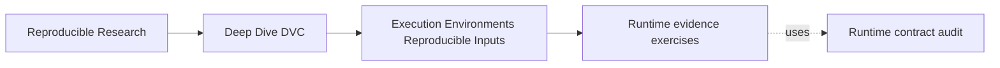
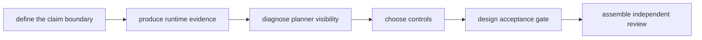
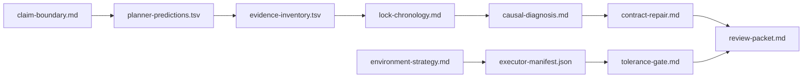

# Exercises

<!-- page-maps:start -->
## Page Maps




<!-- page-maps:end -->

These exercises form one cumulative investigation. You will not receive credit from
yourself for phrases such as “pin the environment” or “use Docker.” Every conclusion must
name the evidence, the inference it supports, and the boundary it does not cross.

The capstone audit is intentionally deterministic and isolated. Use its receipts to learn
the method before transferring the method to a noisier workflow.

## Working directory and source evidence

Run from the repository root:

```bash
make PROGRAM=reproducible-research/deep-dive-dvc capstone-runtime-contract-audit
```

The source packet is:

```text
artifacts/audit/reproducible-research/deep-dive-dvc/runtime-contracts/
```

Create your durable learning packet under the repository artifact boundary:

```bash
learning=artifacts/learning/deep-dive-dvc/runtime-evidence
mkdir -p "$learning"
```

Use this structure:

```text
runtime-evidence/
├── claim-boundary.md
├── planner-predictions.tsv
├── evidence-inventory.tsv
├── lock-chronology.md
├── causal-diagnosis.md
├── environment-strategy.md
├── tolerance-gate.md
├── executor-manifest.json
├── contract-repair.md
└── review-packet.md
```

These names describe lasting purpose. Do not create numbered answer files.

## How to check your own work

For every artifact, ask:

1. Can another learner identify the exact claim?
2. Does every conclusion cite a receipt or declared policy?
3. Are observation, enforcement, execution, and semantic result kept separate?
4. Does the artifact say what remains unknown?
5. Could the review be repeated without an instructor?

Use the answer page only after producing your own files.

## Exercise: Bound the runtime-sensitive claim

Write `claim-boundary.md` for the runtime specimen.

Include:

- the exact result claim involving current report style;
- the output field whose meaning changes;
- four facts the audit holds constant;
- the one fact deliberately changed;
- the comparison method;
- two claims the audit does not support.

Add an input-surface table with these rows:

| Influence | Source | Can change result? | Representation before execution | Governance status |
| --- | --- | --- | --- | --- |
| source numbers | | | | |
| renderer code | | | | |
| declared report style | | | | |
| hidden report style | | | | |
| Python version | | | | |

**Evidence to inspect**

```bash
sed -n '1,220p' \
  programs/reproducible-research/deep-dive-dvc/capstone/repro/runtime-contracts/dvc.yaml
sed -n '1,220p' \
  programs/reproducible-research/deep-dive-dvc/capstone/repro/runtime-contracts/scripts/render_runtime.py
```

**Success condition**

A reviewer can tell why `REPORT_STYLE` belongs to the input surface without concluding
that every machine fact must become a DVC dependency.

**If you are stuck**

Begin with the semantic promise made about `rendered=`, not with a list of environment
variables.

## Exercise: Predict planner behavior from declarations

Before reading the generated status receipts, inspect the specimen `dvc.yaml`. Write
`planner-predictions.tsv` with columns:

```text
case	changed_fact	declared_route	expected_status	expected_repro	expected_result	reason
```

Add rows for:

- the settled baseline;
- declared contract changing from dot to comma;
- hidden process value changing from dot to comma;
- a second ordinary repro after the declared rebuild;
- a forced hidden-stage execution.

Then reveal the receipts:

```bash
audit=artifacts/audit/reproducible-research/deep-dive-dvc/runtime-contracts
cat "$audit/evidence/declared-change-status.stdout.txt"
cat "$audit/evidence/hidden-change-status.stdout.txt"
cat "$audit/evidence/declared-change-repro.stdout.txt"
cat "$audit/evidence/hidden-change-ordinary-repro.stdout.txt"
```

Append `observed_status`, `observed_repro`, and `prediction_match` columns. Do not erase an
incorrect prediction; explain why it was wrong.

**Success condition**

Every planner prediction follows from a named declaration edge or its absence. No reason
uses the observed result as if DVC could see it in advance.

**If you are stuck**

Ask what file, parameter, or command text DVC can compare before execution.

## Exercise: Inventory evidence by inferential role

Write `evidence-inventory.tsv` with columns:

```text
evidence	layer	question_closed	question_not_closed
```

Include at least these evidence surfaces:

- `summary.tsv`;
- baseline and drift fingerprints;
- baseline status receipt;
- declared-change status receipt;
- hidden-change status receipt;
- hidden ordinary repro receipt;
- hidden forced repro receipt;
- result values before and after force;
- `dvc.yaml` hash;
- `dvc.lock` hashes;
- audit tests.

Use one of these layer values:

```text
context
declaration
planner
execution
semantics
enforcement
```

Some items can support more than one layer, but choose the primary role and explain any
secondary role in the question columns.

**Evidence to inspect**

```bash
cat "$audit/route.txt"
jq '.findings[] | {finding, checks, evidence}' "$audit/report.json"
```

**Success condition**

No row says merely “proves reproducibility.” Each row states a narrower inference and a
plausible overclaim it cannot support.

**If you are stuck**

Contrast “runtime changed,” “DVC saw a declared change,” “the stage ran,” and “output has
current meaning.” Those require different evidence.

## Exercise: Reconstruct lock evidence in time order

Write `lock-chronology.md`. Explain the hidden case at four moments:

1. after the baseline dot execution;
2. after process policy changes to comma;
3. after ordinary repro skips;
4. after forced execution.

For each moment, record:

- declaration identity;
- lock identity when available;
- intended runtime style;
- result style;
- whether the result was freshly executed in that context;
- what DVC can use in the next stale decision.

Include the report evidence:

```bash
jq '.findings[] |
  select(.finding == "FORCED_RUN_CHANGES_OUTPUT_WITH_STABLE_DECLARATION") |
  .evidence' "$audit/report.json"
```

End with two sentences:

- why the changed lock after force is useful evidence;
- why it does not repair the missing runtime edge.

**Success condition**

Your chronology never describes `dvc.lock` as a pre-execution environment detector.

**If you are stuck**

Write a vertical timeline. Mark when DVC makes the stale decision and when lock content can
change.

## Exercise: Prove the hidden runtime diagnosis

Write `causal-diagnosis.md` using this argument structure:

```text
Observed symptom:
Competing explanations:
Controlled facts:
Changed fact:
Planner evidence:
Execution evidence:
Semantic evidence:
Causal intervention:
Contract finding:
Supported conclusion:
Remaining limits:
```

Your competing explanations must include:

- source data change;
- renderer code change;
- Python or platform change;
- report-style change;
- stale reuse.

Use the fingerprints to rule in or rule out recorded differences:

```bash
jq -n \
  --slurpfile before "$audit/evidence/baseline-fingerprint.json" \
  --slurpfile after "$audit/evidence/drift-fingerprint.json" \
  '{before: $before[0], after: $after[0]}'
```

Use the forced run as an intervention, not as the final repair.

**Success condition**

Your conclusion names `REPORT_STYLE` as causal and undeclared, explains why ordinary repro
preserved stale meaning, and does not generalize beyond this specimen.

**If you are stuck**

For every sentence containing “therefore,” point to the two receipts that make the
inference possible.

## Exercise: Choose an environment strategy by threat

Write `environment-strategy.md` for this hypothetical workflow:

> A small research team develops locally on Linux and macOS. Accepted evaluation reports
> are produced in CI. Python packages and one native numerical library can affect results.
> A report locale and thread count are controlled values. GPU execution is not supported.

Your document must include:

- a result claim;
- a threat-to-control table;
- roles for a dependency lockfile, container image, CI, and DVC;
- the immutable identities to retain;
- an enforcement point for each governed fact;
- evidence joining runtime identity to result identity;
- three residual limits;
- a recovery route.

At least one proposed control must be rejected as unnecessary or mismatched, with a reason.

**Success condition**

The strategy does not say “use all the tools.” Each tool owns a named boundary, and the
evidence route shows they participated in the same run.

**If you are stuck**

Map each threat first. Select a control only after you can state what failure it prevents
or exposes.

## Exercise: Design a fresh-execution tolerance gate

Write `tolerance-gate.md` for a metric that may differ slightly across two approved
executors.

Use this policy:

```text
metric: f1
comparison: absolute delta
maximum delta: 0.002
required runs: three fresh executions per executor
```

Your gate must reject before comparing metrics when:

- an executor identity is unapproved;
- data, code, or parameter identities differ;
- any evaluation stage lacks fresh-execution proof;
- result schema is invalid.

Then show decisions for:

| Case | Executor A | Executor B | Execution proof | Expected decision |
| --- | --- | --- | --- | --- |
| bounded current results | `0.843` | `0.844` | complete | |
| large current difference | `0.843` | `0.838` | complete | |
| equal but stale result | `0.843` | `0.843` | B skipped after hidden drift | |

Add pseudocode or a decision diagram. Do not implement a production gate.

**Success condition**

The equal-but-stale case is rejected before numeric tolerance is applied.

**If you are stuck**

Currency is a prerequisite for comparison. Put that condition above the delta calculation.

## Exercise: Design a joined executor manifest

Create `executor-manifest.json` as a schema example for an accepted CI run. Use obvious
placeholder identities rather than invented real hashes.

Include fields for:

- manifest schema version;
- run identifier;
- Git commit;
- DVC declaration and lock identities;
- data revision identity;
- selected parameter identity;
- dependency lock identity;
- container digest;
- relevant platform identity;
- governed runtime controls;
- start and completion timestamps;
- DVC execution receipt identity;
- result identities;
- acceptance decision.

Write a short companion section in `environment-strategy.md` explaining:

- which fields are observations;
- which are enforced controls;
- how the run identifier prevents evidence from different executions being mixed;
- which sensitive values must not appear;
- who verifies the manifest.

Validate JSON syntax:

```bash
jq empty "$learning/executor-manifest.json"
```

**Success condition**

The manifest can join one runtime identity to one workflow execution and its results
without containing secrets.

**If you are stuck**

Imagine a reviewer has the result file and the manifest but no CI web interface. What must
the manifest identify for the claim to remain reviewable?

## Exercise: Specify and test a contract repair

Write `contract-repair.md` for replacing the hidden process-variable route with a truthful
contract. Do not edit the capstone specimen; its intentional defect is used by the
self-test.

Include:

- the proposed `dvc.yaml` stage;
- the runtime contract file format;
- who generates or approves the contract;
- why the chosen representation is safe to record;
- an acceptance test matrix.

Your matrix must cover:

| Test case | Expected status | Expected execution | Expected semantic result |
| --- | --- | --- | --- |
| settled baseline | | | |
| contract changes dot to comma | | | |
| ordinary repro after change | | | |
| second repro after rebuild | | | |
| unrelated process variable changes | | | |

Add a negative test that would fail if a developer removed the runtime dependency.

**Success condition**

The proposed test proves stale detection, execution, semantic currency, and convergence.
It does not pass merely because force produces the expected output.

**If you are stuck**

Translate each link of the declared audit route into an assertion.

## Exercise: Assemble an independent runtime review

Write `review-packet.md` as the entry point to your cumulative work.

It must contain:

- the bounded claim;
- a short table linking all nine other artifacts to their review purpose;
- the declared-versus-hidden findings;
- the causal conclusion;
- the proposed contract repair;
- the environment strategy for accepted results;
- the fresh-execution tolerance rule;
- an explicit list of unresolved risks;
- exact commands for regenerating source evidence and validating your packet.

Include this proof route:



Run:

```bash
test -s "$learning/claim-boundary.md"
test -s "$learning/planner-predictions.tsv"
test -s "$learning/evidence-inventory.tsv"
test -s "$learning/lock-chronology.md"
test -s "$learning/causal-diagnosis.md"
test -s "$learning/environment-strategy.md"
test -s "$learning/tolerance-gate.md"
jq empty "$learning/executor-manifest.json"
test -s "$learning/contract-repair.md"
test -s "$learning/review-packet.md"
```

**Success condition**

A learner who missed the class can regenerate the audit, follow your evidence links, test
the reasoning, and identify exactly where your claim stops.

**If you are stuck**

Do not summarize every page in the module. Give the reviewer the shortest route from claim
to evidence, decision, and residual risk.

## Completion standard

The exercise set is complete when your packet demonstrates all of these:

- runtime is treated as a claim-specific input surface;
- planner visibility is predicted from declarations;
- status, execution, result, and fingerprint evidence are not conflated;
- lock evidence is read in time order;
- hidden runtime drift is established by a controlled intervention;
- controls are chosen by boundary rather than fashion;
- tolerance is applied only to current governed executions;
- external runtime evidence is joined to DVC result evidence;
- the proposed repair has an executable acceptance design;
- the review route works without instructor interpretation.
